<a id="top"></a>

# Bölüm 13: HTTP Boundary, DTO, Validasyon ve Hata Sözleşmeleri

<!-- nav:top:start -->
[← Bölüm 12](java-chapter-12.md#top) · [İçindekiler](README.md#top)
<!-- nav:top:end -->

Artık elimizde kullanım senaryolarını *(user stories)* koordine eden bir servis tasarımı, olaylarla haberleşen gözlemciler *(Observers)* ve verileri kalıcı olarak saklayan bir katman *(repository)* var. Eksik olan tek şey dış dünya. Şu ana kadar sistemi yalnızca main metodunun olduğu sınıf ve birim testler üzerinden çalıştırdık. Pek tabii ki gerçek hayat senaryolarında sistemin dış dünya tarafından da erişilebilir olması gerekir.

İşte bu bölümde `sales` modülüne bir HTTP katmanı ekleyeceğiz. Ancak Payara ve JAX-RS'e geçmeden önce bilinçli olarak JDK ile birlikte gelen basit HTTP sunucusunu *(`com.sun.net.httpserver`)* kullanacağız. Daha önceki bölümlerde **Dependency Injection Container**'ın, **Java Persistence API**'nın neyi otomatikleştirdiğini görmek için ne yaptıysak burada da aynı strateji ile devam edeceğiz. Bir JAX-RS runtime'ının bizim yerimize yaptığı işleri bir kez elle yazacağız ve aşağıdaki soruların cevabını bulacağız.

- HTTP katmanı domain nesnelerini bilmeli midir? Kullanım senaryolarına *(User Stories)* nasıl erişmelidir?
- Girdi doğrulama *(Validation)* nerede yapılmalıdır? Sınırda mı, domain'de mi, yoksa her ikisinde birden mi?
- Bir domain exception'ı hangi HTTP durum koduna karşılık gelir? Bu kararı nasıl vermeliyiz?
- Bir API servisinden dönecek hatalar istemciye nasıl anlatmalıdır? *(RFC 9457 - Problem Details mevzusu)*

## REST Paketinin Oluşturulması

Kod tarafına geçmeden önceb `rest` paketini oluşturarak işe başlayalım. Bu amaçla `com.lectures.business.design.sales.rest` isimli paketi `sales` modülünde oluşturacağız. Bunun için `Week 13 / sales` modülündeki **Source Packages** kısmında sağ tıklayıp `New -> Java Package` ile ilerleyebiliriz. Modüldeki diğer paketlerde olduğu gibi bu paketin de sorumluluğunu ve dependency kurallarını `package-info.java` dosyasında aşağıdaki gibi belirtebiliriz.

> HTTP katmanı için yeni bir Maven modülü açmıyoruz. "Bir modül bir katman değildir" felsefesini benimsedik. Yani katmanlar paketler aracılığıyla temsil edilecek ve bağımlılık yönleri paketler arasında belirlenecek. rest de api, application, domain ve persistence gibi sales modülünün içinde bir paket olacak.

```java
/**
 * The HTTP edge of the sales module.
 *
 * <p>
 * Sees {@code api} and {@code shared.kernel} only - never domain, application
 * or persistence (ADR-0009). The only package allowed to use Jackson, Bean
 * Validation and the JDK HTTP server; nobody depends on it.
 */
package com.lectures.business.design.sales.rest;
```

Kısaca JSON dönüşümleri için Jackson, girdi doğrulama için Jakarta Bean Validation spesifikasyonunu ele alan Hibernate Validator'un kullanılacağı belirtiliyor. HTTP sunucusu olarak da **JDK** ile birlikte gelen `jdk.httpserver` kullanılacak. Şimdi `week13-http-boundary` modülümüzün ana `pom.xml` dosyasına gerekli sürümleri ve dependency bileşenlerini aşağıdaki gibi ekleyelim. *(pom içerisindeki properties kısmının tamamı şu anda aşağıdaki gibi olmalı)*

```xml
<properties>
    <archunit.version>1.5.1</archunit.version>
    <jar.plugin.version>3.4.2</jar.plugin.version>
    <flyway.version>10.20.1</flyway.version>
    <h2.version>2.4.240</h2.version>
    <postgresql.version>42.7.4</postgresql.version>
    <testcontainers.version>2.0.5</testcontainers.version>
    <slf4j.version>2.0.16</slf4j.version>
    <jackson.version>2.21.5</jackson.version>
    <hibernate-validator.version>9.1.3.Final</hibernate-validator.version>
</properties>
```

Dependency bildirimleri ise şöyle;

```xml
<dependency>
    <groupId>com.fasterxml.jackson.core</groupId>
    <artifactId>jackson-databind</artifactId>
    <version>${jackson.version}</version>
</dependency>
<dependency>
    <groupId>com.fasterxml.jackson.datatype</groupId>
    <artifactId>jackson-datatype-jsr310</artifactId>
    <version>${jackson.version}</version>
</dependency>
<dependency>
    <groupId>org.hibernate.validator</groupId>
    <artifactId>hibernate-validator</artifactId>
    <version>${hibernate-validator.version}</version>
</dependency>
```

İşimiz henüz bitmedi... `sales` modülünün `pom.xml` dosyasında da aşağıdaki gibi benzer bağımlılıkları ekleyelim. Bu bağımlılıklar derleme *(compile)* kapsamında ele alınmalılar zira Bölüm 12'deki test bağımlılıklarından farklı olarak bu kütüphaneleri doğrudan `rest` paketinin asıl *(main)* kodu kullanacak.

```xml
<dependency>
    <groupId>com.fasterxml.jackson.core</groupId>
    <artifactId>jackson-databind</artifactId>
</dependency>
<dependency>
    <groupId>com.fasterxml.jackson.datatype</groupId>
    <artifactId>jackson-datatype-jsr310</artifactId>
</dependency>
<dependency>
    <groupId>org.hibernate.validator</groupId>
    <artifactId>hibernate-validator</artifactId>
</dependency>
```

## API Sözleşmesinin Tanımlanması

Şimdi `api` paketine aşağıdaki içeriğe sahip yeni bir sözleşme *(interface)* ekleyeceğiz.

```java
package com.lectures.business.design.sales.api;

public interface OrderingFacade {

    OrderSummary placeOrder(PlaceOrderCommand command);

    OrderSummary confirm(int orderId);

    OrderSummary ship(int orderId);

    OrderSummary cancel(int orderId);

    OrderSummary getOrder(int orderId);
}
```

Bu arayüz içerisinde sipariş işlemleri ile ilgili bazı temel operasyonlar tanımlı. `OrderingFacade` arayüzü, HTTP katmanının **application** paketini ve **domain** nesnelerini bilmeden sipariş işlemlerini gerçekleştirebilmesini sağlayacak. Bu sayede application katmanı ile HTTP katmanı arasında bir soyutlama sağlamış olacağız. *(Bunun ne gibi bir avantaj/avantajlar sağladığını tartışalım)* Sıradaki hamlemiz bu sözleşemyi **OrderService** sınıfına uygulamak. Tabii unutmamamız gereken bir şeyde buradaki metotların ilgili arayüzden implemente edildiğini `@Override` anotasyonu ile açıkça belirtmek.


**OrderingFacade** arayüzünü uygulayan bir sınıf kullanmak, **HTTP** katmanının **application** servislerine doğrudan bağımlı olmasını engeller. Bu sayede application servisleri değiştiğinde HTTP katmanında minimum değişiklik yapmamız yeterli olur. Ayrıca test yazarken de HTTP katmanını izole edebilir ve sadece facade üzerinden testler gerçekleştirebiliriz.

Henüz yazmadığımız `rest` paketinin bağımlılık kuralı da oldukça nettir. Sadece `api` ve `shared-kernel` paketlerini görebilir. Ayrıca hiçbir paket `rest` paketine bağımlı olamaz. HTTP katmanı bağımlılık grafiğinin en dış halkasında yer alır. Kimse onu tanımaz ve o da sadece sözleşmeyi tanır. Hatta bu durumu `ADR-003` dökümanındanki bağımlılık matrisine eklemeliyiz *(Belgeyi kontrol edin)* Bu arada şunu da belirtmemiz gerekiyor. ADR belgeleri genellikle kabul edildikten sonra değiştirilmezler. Yeni karar yeni bir ADR olur ve eskisine atıf yapar. Bu nedenle `ADR-003` e şimdilik bir not düştük.

> Hexagonal mimari terminolojisiyle ifade edersek `OrderingFacade` arayüzü bir **giriş portu** *(driving port)*, `rest` paketi ise bir **giriş adaptörü** *(driving adapter)* olarak düşünülebilir. Daha önceden ele aldığımız `CustomerNotifier` ise bir çıkış portuydu. Yarın aynı kullanım senaryolarını bir RabbitMQ tüketicisi *(consumer)* üzerinden de sunmak istersek, yazacağımız `messaging` paketi de aynı façade bileşenini kullanabilir.

## Request DTO ve Bean Validation

Sözleşmedeki **placeOrder** metodu parametre olarak **PlaceOrderCommand** tipinden bir nesne almakta. Bir HTTP isteğinin gövdesini *(body)* doğrudan bu record tipine okumak mümkün. Lakin bu iki tipin kullanım amaçlarının farklı olduğunu göz önünde bulundurmalıyız. **PlaceOrderCommand** modülün dış sözleşmesidir ve hangi protokolle gelirse gelsin aynı kalır. HTTP isteğinin gövdesi ise HTTP standartlarına özgüdür. Alan adları *(field names)*, isteğe bağlı alanlar *(optional fields)*, varsayılan değerler ve doğrulama mesajları bu katmana aittir. Bu nedenle `rest` paketine ayrı bir record ekleyerek devam edelim.

```java
package com.lectures.business.design.sales.rest;

import com.lectures.business.design.sales.api.OrderLineRequest;
import com.lectures.business.design.sales.api.PlaceOrderCommand;
import jakarta.validation.Valid;
import jakarta.validation.constraints.*;
import java.math.BigDecimal;
import java.util.List;

public record PlaceOrderRequest(
        @NotBlank
        String customerId,
        @NotEmpty
        @Size(max = 50)
        List<@NotNull @Valid Line> lines) {

    public record Line(
            @Positive
            int productId,
            @NotNull
            @Positive
            @Digits(integer = 8, fraction = 2)
            BigDecimal unitPrice,
            @Positive
            int quantity,
            // The default DecimalMin/Max messages need Expression Language, hence our own wording
            @DecimalMin(value = "0", message = "must be between 0 and 1")
            @DecimalMax(value = "1", message = "must be between 0 and 1")
            @Digits(integer = 1, fraction = 2)
            BigDecimal discount) {

    }

    PlaceOrderCommand toCommand() {
        return new PlaceOrderCommand(customerId, lines.stream()
                .map(line -> new OrderLineRequest(line.productId(), line.unitPrice(), line.quantity(),
                        line.discount() == null ? BigDecimal.ZERO : line.discount()))
                .toList());
    }
}
```

Kodda gördüğünüz anotasyonlar, **Jakarta Bean Validation 3.1** spesifikasyonuna ait. Doğrulamayı yapan yer ise Hibernate Validator. Normalde **Payara** gibi uygulama sunucuları bu enstrümanları zaten içerir. Record bileşenlerine *(component)* doğrudan annotation ekleyebildiğimize ve `List<@Valid Line>` ifadesiyle liste elemanlarının da tek tek doğrulanmasını sağlayabildiğimize dikkat edelim *(type-use annotation)*. **discount** alanı isteğe bağlı. Gönderilmezse **toCommand** metodu onu sıfır olarak kabul ediyor. Bu tür varsayılan değer kararları da HTTP sözleşmesine ait.

### Doğrulamaların Yeri *(Boundary mi Domain mi?)*

Şu soruyu düşünelim; **quantity** değerinin pozitif olması gerektiği kural olarak zaten **OrderLine** record türünde var. Aynı kuralı `@Positive` anotasyonu ile neden tekrardan yazalım? Zira aynı kuralı iki farklı yerde yazmak, ileride ikisinin birden farklılaşması riskini doğurup, bakım maliyetini artırabilir. Burada doğrulamanın amacını düşünmemiz gerekiyor. İki durumu aşağıdaki tablo ile değerlendirelim.

| | **Sınırda doğrulama *(Bean Validation)*** | **Domain Tarafında doğrulama *(invariant)*** |
| --- | --- | --- |
| **Soru** | Gelen Request doğru biçimde mi? | Bu durum business kuralı açısından geçerli mi? |
| **Ne zaman çalışır?** | Sadece bu kapıdan *(HTTP)* gelen isteklerde | Nesne her oluşturulduğunda veya değiştirildiğinde *(Yani nerede gelirse gelsin)* |
| **Hata davranışı** | Tüm hataları toplar ve birlikte raporlar | İlk hatada exception fırlatır |
| **Hedef kitle** | API istemcisi *(okunabilir alan adları, mesajlar)* | Geliştirici ve sistemin bütünü |
| **Atlanabilir mi?** | Evet *(başka bir kapıdan gelen çağrı bu doğrulamadan geçmez)* | Hayır |

Burada iş kuralının ana geçerlilik kaynağı her zaman domain tarafıdır *(Source of truth konusunu araştıralım)* Boundary tarafındaki kurallar ise domain'e ulaşmadan önce istemciye daha iyi bir geri bildirim vermek için kullanılır. Bu yüzden sınırda sadece **biçimsel** kurallara yer verdik. Bir başka deyişler alan var mı, boş mu, pozitif mi, kaç basamaklı vb Bu arada kullandığımız kobay Northwind veritabanına özgü olarak Customer kimliğiinin beş harften oluşması gibi bir durum söz konusuydu. Bu kuralı sınırda tekrar etmedik. Halen **CustomerId** record'unda duruyor ve ihlal edildiğinde bir **IllegalArgumentException** fırlatıyor. Bu exception nesnesi de bir HTTP 400 yanıtına dönüştürülecek, bunu birazdan göreceğiz.

### Expression Language Hakkında

Anotasyonlar tek başına hiçbir şey yapmaz esasında. Onları okuyup kuralları işletecek bir doğrulayıcıya *(Validator)* ihtiyaç vardır *(Bir nevi çalışma zamanı olarak düşünebiliriz)*. **Payara** gibi bir uygulama sunucusunda bu doğrulayıcı hazır olarak gelir ve `JAX-RS`, `@Valid` ile işaretlenmiş parametreleri bizim yerimize doğrular. İşin detaylarını kavramak adına bunu şimdilik elle yapacağız. `rest` paketine aşağıda kodları görünen **RequestValidator** sınıfını ekleyerek devam edelim.

```java
package com.lectures.business.design.sales.rest;

import jakarta.validation.ConstraintViolation;
import jakarta.validation.ConstraintViolationException;
import jakarta.validation.Validation;
import jakarta.validation.Validator;
import java.util.Objects;
import java.util.Set;
import org.hibernate.validator.messageinterpolation.ParameterMessageInterpolator;

public final class RequestValidator {

    private final Validator validator;

    public RequestValidator(Validator validator) {
        this.validator = Objects.requireNonNull(validator, "validator must not be null");
    }

    public static RequestValidator withoutExpressionLanguage() {
        Validator validator = Validation.byDefaultProvider()
                .configure()
                .messageInterpolator(new ParameterMessageInterpolator())
                .buildValidatorFactory()
                .getValidator();
        return new RequestValidator(validator);
    }

    <T> T validate(T request) {
        if (request == null) {
            throw new IllegalArgumentException("request body must not be empty");
        }
        Set<ConstraintViolation<T>> violations = validator.validate(request);
        if (!violations.isEmpty()) {
            throw new ConstraintViolationException(violations);
        }
        return request;
    }
}
```

**validate** metodu, doğrulama ihlali *(constraint violation)* bulduğunda ilk hatada durmaz. Tüm ihlalleri toplar ve tek bir **ConstraintViolationException** nesnesi ile fırlatır. Böylece istemci taraf, hatalı alanların hepsini tek bir yanıtta öğrenebilir. Tabii istek gövdesi *(request body)* komple **null** olarak da gönderilebilir. Bunu da burada yakalayıp **IllegalArgumentException** fırlatıyoruz.

Kodda validator nesnesinin üretimi için bir fabrika metodu kullanıldığı dikkatinizi çekmiştir, **buildDefaultValidatorFactory** Hibernate Validator hata mesajlarını oluştururken varsayılan olarak **Jakarta Expression Language** *(EL)* kullanır. Payara gibi uygulama sunucularında bu implementasyonlar hazır olarak gelir fakat bizim yalın Java uygulamamızda buna benzer bir EL implementasyonu yok. Bunun bir takım sonuçları olabilir. Örneğin EL gerektiren hata mesajları doğru şekilde işlenemez ve doğrulama sırasında beklenmedik hatalar alınabilir. Bu nedenle **withoutExpressionLanguage** metodunda EL kullanmayan bir mesaj interpolator ile validator oluşturuyoruz *(Bunu bir araştıralım)*

## Hata Türleri: DomainException.Kind

Şimdi zor sorulardan birine geldik. **OrderService** servisindeki **ship** metodu bir **InvalidStateTransitionException** fırlattığında HTTP katmanı hangi durum kodunu döndürmeli? İlk akla gelen yöntem aşağıdaki gibi bir eşleme yazmak olabilir.

```java
if (failure instanceof OrderNotFoundException) return 404;
if (failure instanceof CustomerNotFoundException) return 404;
if (failure instanceof InvalidStateTransitionException) return 409;
...
```

Lakim bu yöntemin iki sorunu var. Birincisi `rest` paketinin `domain` paketini kullanmasını gerektiriyor ve az önce `ADR-0003` matrisine eklediğimiz kuralı çiğniyor. İkinci olarak her yeni **exception** için bu listeye bir satır eklemek gerekecek ve unutulan her satır için de istemciye bir HTTP 500 hatası dönecek. Alternatif olarak domain exception'larına bir **httpStatus** gibi bir metod ekleyebilirdik ama bu durumda domain tarafı bir protokolü tanımaya başlardı. Aynı exception bir mesaj kuyruğu tüketicisinde *(RabbitMQ Consumer gibi)* fırlatıldığında **409** değerinin hiçbir anlamı olmaz. Dolayısıyla her **domain exception**'ının iş açısından ne tür bir ret nedeni olduğunu söylemesini sağlayacağız. `shared-kernel` modülündeki **DomainException** sınıfını aşağıdaki gibi değiştirelim.

```java
package com.lectures.business.design.shared.kernel;

import java.util.Locale;
import java.util.Objects;

public abstract class DomainException extends RuntimeException {

    public enum Kind {
        NOT_FOUND,
        CONFLICT,
        RULE_VIOLATION
    }

    private final Kind kind;

    protected DomainException(String message, Kind kind) {
        super(message);
        this.kind = Objects.requireNonNull(kind, "kind must not be null");
    }

    public Kind kind() {
        return kind;
    }

    public String code() {
        String name = getClass().getSimpleName().replaceFirst("Exception$", "");
        return name.replaceAll("([a-z])([A-Z])", "$1-$2").toLowerCase(Locale.ROOT);
    }
}
```

İki yeni kavramımız var.

- **Kind enum yapısı:** Ret türünü ifade eden bir enum. *"Aradığın şey yok"*, *"istediğin şey şu anki durumda yapılamaz"* ve *"istediğin şey kurallara aykırı"* gibi ifadeler bir network protokol kavramı değil tamamen iş *(business)* kavramlarıdır. Uygulamanın sahadaki gerçek kullanıcısı olan bir depo görevlisi de aynı cümleleri kurar. HTTP katmanı bu üç türü 404, 409 ve 422 olarak, bir mesaj tüketicisi ise *"tekrar deneme/retry"*, *"daha sonra tekrar dene/retry later"* ve *"dead letter kuyruğuna gönder"* olarak yorumlayabilir.
- **code metodu:** Makine tarafından okunabilir kararlı bir hata kodu döndürür. Varsayılan olarak sınıf adından türetildiğine dikkat edelim. **OrderNotFoundException** sınıfı `order-not-found` koduna dönüşür. İstemciler hata mesajını ayrıştırmak yerine bu koda bakarak karar verebilirler.

**DomainException** sınıfının yapıcısı artık iki parametre aldığı için `sales` modülündeki beş exception sınıfı derlenmeyecektir. Her birinin constructor'ındaki `super(...)` çağrısına ilgili türü ekleyerek gerekli düzenlemeleri yapmalıyız. Sınıfların geri kalanında bir değişiklik yok. **Kind** enum'ı üst sınıfın içinde tanımlı olduğu için alt sınıflarda ayrıca import etmemize de gerek yok.

```java
// OrderNotFoundException
super("no order with id " + orderId, Kind.NOT_FOUND);

// CustomerNotFoundException
super("no customer with id " + customerId, Kind.NOT_FOUND);

// InvalidStateTransitionException
super("order " + orderId + " cannot move from " + from + " to " + to, Kind.CONFLICT);

// OrderNotModifiableException
super("cannot " + attemptedAction + " on order " + orderId + " in status " + status, Kind.CONFLICT);

// IncompleteOrderException
super("order " + orderId + " cannot be confirmed: " + missingPart + " missing", Kind.RULE_VIOLATION);
```

Kısaca buradaki eşleşmeleri aşağıdaki tablo ile özetleyelim.

| **Exception** | **Kind** | **code** |
| --- | --- | --- |
| `OrderNotFoundException` | `NOT_FOUND` | `order-not-found` |
| `CustomerNotFoundException` | `NOT_FOUND` | `customer-not-found` |
| `InvalidStateTransitionException` | `CONFLICT` | `invalid-state-transition` |
| `OrderNotModifiableException` | `CONFLICT` | `order-not-modifiable` |
| `IncompleteOrderException` | `RULE_VIOLATION` | `incomplete-order` |

Hata kodları artık istemcilerin bağlı olduğu bir sözleşme halini aldı. Dolayısıyla bir geliştirici exception sınıflarından herhangi birisini yeniden adlandırırsa kod sessizce değişir. Bunu fark edebilmek adına `sales` modülündeki **domain** paketine aşağıdaki testi ekleyelim.

```java
package com.lectures.business.design.sales.domain;

import com.lectures.business.design.shared.kernel.DomainException;
import com.lectures.business.design.shared.kernel.DomainException.Kind;
import org.junit.jupiter.api.DisplayName;
import org.junit.jupiter.api.Test;
import static org.assertj.core.api.Assertions.assertThat;

class DomainExceptionKindTest {

    @Test
    @DisplayName("every refusal declares its kind and a stable code")
    void kindsAndCodes() {
        OrderId id = OrderId.of(10248);
        assertKind(new OrderNotFoundException(id), Kind.NOT_FOUND, "order-not-found");
        assertKind(new CustomerNotFoundException(CustomerId.of("ALFKI")), Kind.NOT_FOUND, "customer-not-found");
        assertKind(new InvalidStateTransitionException(id, OrderStatus.DRAFT, OrderStatus.SHIPPED),
                Kind.CONFLICT, "invalid-state-transition");
        assertKind(new OrderNotModifiableException(id, OrderStatus.SHIPPED, "add a line"),
                Kind.CONFLICT, "order-not-modifiable");
        assertKind(new IncompleteOrderException(id, IncompleteOrderException.MissingPart.LINES),
                Kind.RULE_VIOLATION, "incomplete-order");
    }

    private static void assertKind(DomainException exception, Kind kind, String code) {
        assertThat(exception.kind()).as(exception.getClass().getSimpleName()).isEqualTo(kind);
        assertThat(exception.code()).isEqualTo(code);
    }
}
```

## RFC 9457: Problem Details

Bir API servisi hatalarını istemciye nasıl anlatmalı? Bu çok doğal olarak zamanın endüstriyel standartlarında ele alınmış bir mevzu. Her ekibin kendi biçimini kullandığı bir senaryoda istemciler her API için ayrı bir hata ayrıştırıcısı *(parser)* yazmak zorunda kalır. **[RFC 9457 - Problem Details for HTTP APIs](https://www.rfc-editor.org/info/rfc9457/)** *(2023 yılında RFC 7807'nin yerini almıştır ama araştıralım)* bu soruna standart bir cevap verir. Hata gövdesi `application/problem+json` medya tipiyle döner ve aşağıdaki alanları içerir.

| **Alan *(Field)*** | **Anlamı** |
| --- | --- |
| `type` | Hata türünü tanımlayan bir URI. Kararlı olmalı ve ideal olarak bir dokümantasyon sayfasını göstermeli. |
| `title` | Hata türünün insan tarafından okunabilir kısa özeti. Aynı **type** için her zaman aynıdır. |
| `status` | HTTP durum kodu *(gövdede de tekrarlanır)* |
| `detail` | Bu hata örneğine özgü açıklama |
| `instance` | Hatanın oluştuğu kaynağın URI bilgisi |

RFC, bu alanlara ek olarak **genişletme üyeleri** *(extension members)* tanımlamaya da izin verir. Biz iki genişletme ekleyeceğiz. Makine tarafından okunabilir **code** alanı ve doğrulama hataları için **errors** listesi. **rest** paketine aşağıdaki record'u ekleyerek devam edelim.

```java
package com.lectures.business.design.sales.rest;

import com.fasterxml.jackson.annotation.JsonInclude;
import java.util.List;

@JsonInclude(JsonInclude.Include.NON_EMPTY)
public record ProblemDetail(
        String type,
        String title,
        int status,
        String detail,
        String instance,
        String code,
        List<FieldError> errors) {

    public static final String MEDIA_TYPE = "application/problem+json";
    static final String TYPE_BASE = "https://northwind.example/problems/";

    public record FieldError(String field, String message) {

    }

    static ProblemDetail of(int status, String slug, String title, String detail, String instance) {
        return new ProblemDetail(TYPE_BASE + slug, title, status, detail, instance, slug, List.of());
    }

    ProblemDetail withErrors(List<FieldError> fieldErrors) {
        return new ProblemDetail(type, title, status, detail, instance, code, List.copyOf(fieldErrors));
    }
}
```

`@JsonInclude(JsonInclude.Include.NON_EMPTY)` annotation'ı sayesinde boş olan alanlar *(örneğin doğrulama hatası olmayan bir yanıttaki `errors` listesi)* JSON çıktısına hiç yazılmaz.

HTTP katmanına özgü bir hata türümüz daha var. İstemci var olan bir adrese yanlış HTTP metoduyla *(örneğin POST yerine GET)* gelirse **405 Method Not Allowed** dönmemiz gerekiyor. Bu bir iş kuralı ihlali olmadığı için **DomainException** sınıfından türemiyor ve sadece `rest` paketi içinde kullanılıyor.

```java
package com.lectures.business.design.sales.rest;

final class MethodNotAllowed extends RuntimeException {

    MethodNotAllowed(String actual, String allowed) {
        super(actual + " is not allowed here; use " + allowed);
    }
}
```

### Tek Bir Yerden Hata Eşleştirme

Tüm hataları problem gövdesine çeviren tek bir sınıfa ihtiyacımız var görünüyor. **sealed** arayüzler için kullanılan pattern matching switch ifadesi burada da işimize yarayacak. `rest` paketine aşağıdaki sınıfı ekleyerek devam edelim.

```java
package com.lectures.business.design.sales.rest;

import com.fasterxml.jackson.core.JacksonException;
import com.lectures.business.design.shared.kernel.DomainException;
import jakarta.validation.ConstraintViolation;
import jakarta.validation.ConstraintViolationException;
import java.util.Comparator;
import java.util.List;

final class ProblemMapper {

    private static final System.Logger LOG = System.getLogger(ProblemMapper.class.getName());

    ProblemDetail toProblem(Throwable failure, String instance) {
        return switch (failure) {
            case ConstraintViolationException invalid ->
                validation(invalid, instance);
            case MethodNotAllowed wrongVerb ->
                ProblemDetail.of(405, "method-not-allowed",
                "Method not allowed", wrongVerb.getMessage(), instance);
            case JacksonException malformed ->
                ProblemDetail.of(400, "malformed-request",
                "Malformed request body", "the body is not valid JSON for this resource", instance);
            case DomainException refused ->
                domain(refused, instance);
            case IllegalArgumentException invalid ->
                ProblemDetail.of(400, "invalid-argument",
                "Invalid argument", invalid.getMessage(), instance);
            default ->
                unexpected(failure, instance);
        };
    }

    private static ProblemDetail validation(ConstraintViolationException invalid, String instance) {
        List<ProblemDetail.FieldError> errors = invalid.getConstraintViolations().stream()
                .sorted(Comparator.comparing((ConstraintViolation<?> v) -> v.getPropertyPath().toString()))
                .map(v -> new ProblemDetail.FieldError(v.getPropertyPath().toString(), v.getMessage()))
                .toList();
        return ProblemDetail.of(400, "validation-failed", "Request validation failed",
                errors.size() + " field(s) are invalid", instance).withErrors(errors);
    }

    private static ProblemDetail domain(DomainException refused, String instance) {
        return switch (refused.kind()) {
            case NOT_FOUND ->
                problem(404, "Resource not found", refused, instance);
            case CONFLICT ->
                problem(409, "Conflict with the current state", refused, instance);
            case RULE_VIOLATION ->
                problem(422, "Business rule violated", refused, instance);
        };
    }

    private static ProblemDetail problem(int status, String title, DomainException refused, String instance) {
        return ProblemDetail.of(status, refused.code(), title, refused.getMessage(), instance);
    }

    private static ProblemDetail unexpected(Throwable failure, String instance) {
        LOG.log(System.Logger.Level.ERROR, "unhandled failure on " + instance, failure);
        return ProblemDetail.of(500, "internal-error", "Internal server error",
                "an unexpected error occurred", instance);
    }
}
```

Bu sınıfta dikkat edilmesi gereken birkaç nokta var.

- Pattern matching `switch` dalları yukarıdan aşağıya doğru değerlendirilir. Bir üst tipi alt tipinden önce yazarsak derleyici *"this case label is dominated by a preceding case label"* hatası verir. `DomainException` ile `IllegalArgumentException` arasında bir kalıtım ilişkisi olmadığı için ikisinin sırası değişse de sorun olmaz *(Deneyip görelim)*
- **domain** metodundaki `switch` ifadesinde `default` dalı yok. **Kind** bir enum olduğu ve tüm değerleri ele alındığı için derleyici buna izin verir. Eğer **Kind** enum'ına yeni bir değer eklersek bu metot derlenmeyecektir. Bu bir avantaj zira yeni türü eşleştirmeyi unutmamız mümkün olmayacak.
- Domain exception'ları somut sınıflarına göre değil türlerine göre eşleniyor.`rest` paketi **OrderNotFoundException** diye bir sınıfın varlığından haberdar değil. Yeni bir domain exception eklendiğinde bu sınıfta hiçbir değişiklik yapmamız gerekmiyor.
- Beklenmeyen hatalar da olabilir ancak olsa dahi hiçbir ayrıntı sızmayacaktır. **RepositoryException** sınıfında `password authentication failed for user "johndoe"` mesajini taşıyan bir `SQLException` nesnesi kullanılabilir. Bu mesajı istemciye göstermek bir güvenlik açığıdır *(OWASP: Improper Error Handling)*. Ayrıntılar sadece sunucu logunda yazılı kalır. Bunun için JDK ile gelen **System.Logger** arayüzünü kullanıyoruz. Ek bir bağımlılık gerektirmiyor ve ADR-0005'teki **no_standard_streams** kuralına da takılmıyor.
- **RepositoryException** bir **DomainException** değildir. Veritabanı hatası bir iş kuralı ihlali olmadığı için **default** dalına düşer ve 500 olarak döndürülür.
- **IllegalArgumentException** , HTTP 400 olarak döner. Hatırlarsak **CustomerId** record'u beş harften oluşmayan bir kimlik geldiğinde bu exception'ı fırlatıyordu. Sınırda tekrar etmediğimiz bu kural da istemciye anlamlı bir 400 yanıtı olarak ulaşır.

HTTP üzerinden tetiklemesi zor olan iki durumu birim test ile doğrulayalım. `sales` modülünün test kodlarında `com.lectures.business.design.sales.rest` paketini oluşturup aşağıdaki test sınıfını ekleyelim.

```java
package com.lectures.business.design.sales.rest;

import com.lectures.business.design.sales.domain.IncompleteOrderException;
import com.lectures.business.design.sales.domain.OrderId;
import com.lectures.business.design.sales.persistence.RepositoryException;
import java.sql.SQLException;
import org.junit.jupiter.api.DisplayName;
import org.junit.jupiter.api.Test;
import static org.assertj.core.api.Assertions.assertThat;

class ProblemMapperTest {

    private final ProblemMapper mapper = new ProblemMapper();

    @Test
    @DisplayName("RULE_VIOLATION becomes 422 Unprocessable Content")
    void ruleViolationIs422() {
        ProblemDetail problem = mapper.toProblem(new IncompleteOrderException(
                OrderId.of(10248), IncompleteOrderException.MissingPart.SHIPPING_ADDRESS), "/orders/10248/confirm");

        assertThat(problem.status()).isEqualTo(422);
        assertThat(problem.code()).isEqualTo("incomplete-order");
        assertThat(problem.detail()).contains("SHIPPING_ADDRESS");
    }

    @Test
    @DisplayName("an infrastructure failure is a 500 that leaks nothing")
    void unexpectedFailuresAreOpaque() {
        RepositoryException failure = new RepositoryException("could not save order 10248",
                new SQLException("password authentication failed for user \"johndoe\""));

        ProblemDetail problem = mapper.toProblem(failure, "/orders");

        assertThat(problem.status()).isEqualTo(500);
        assertThat(problem.detail()).isEqualTo("an unexpected error occurred");
        assertThat(problem.toString()).doesNotContain("johndoe", "10248");
    }
}
```

> Testi çalıştırdığımızda konsolda password authentication failed içeren bir stack trace görebiliriz. Bu, ProblemMapper’ın beklenmeyen hatayı logladığını gösterir. Yani test başarılıdır.

Burada bir kafa karışıklığı olabilir. Test sınıfımız `rest` paketinde olmasına rağmen `domain` ve `persistence` paketlerindeki sınıfları kullanmakta. Aslında bu bir kural ihlali değil. Mimari testler `ImportOption.DoNotIncludeTests` seçeneği ile sadece asıl kodu analiz eder. Test kodları ise sistemin tamamını değerlendirme adına her pakete erişebilir.

## JSON Dönüşümleri

HTTP isteğinin gövdesini Java nesnelerine, Java nesnelerini de JSON'a çevirmek için Jackson kütüphanesini kullanacağız. Jackson yapılandırmasını tek bir sınıfta toplayabiliriz. Bunun için yine `rest` paketine aşağıdaki JsonCodec sınıfını ekleyelim.

```java
package com.lectures.business.design.sales.rest;

import com.fasterxml.jackson.core.JsonGenerator;
import com.fasterxml.jackson.core.JsonProcessingException;
import com.fasterxml.jackson.databind.DeserializationFeature;
import com.fasterxml.jackson.databind.ObjectMapper;
import com.fasterxml.jackson.databind.SerializationFeature;
import com.fasterxml.jackson.datatype.jsr310.JavaTimeModule;
import java.io.IOException;
import java.io.InputStream;
import java.io.UncheckedIOException;

final class JsonCodec {

    private final ObjectMapper mapper = new ObjectMapper()
            .registerModule(new JavaTimeModule())
            .disable(SerializationFeature.WRITE_DATES_AS_TIMESTAMPS)
            .enable(JsonGenerator.Feature.WRITE_BIGDECIMAL_AS_PLAIN)
            .enable(DeserializationFeature.FAIL_ON_UNKNOWN_PROPERTIES);

    <T> T read(InputStream body, Class<T> type) throws IOException {
        return mapper.readValue(body, type);
    }

    byte[] write(Object value) {
        try {
            return mapper.writeValueAsBytes(value);
        } catch (JsonProcessingException e) {
            throw new UncheckedIOException(e);
        }
    }
}
```

Bu sınıftaki bazı önemli kavramlara bakalım.

- **JavaTimeModule:** Jackson varsayılan olarak **LocalDate** tipini tanımaz. Bu modül **java.time** tipleri için destek ekler.
- **WRITE_DATES_AS_TIMESTAMPS kapalı:** Tarihler `[1996,7,4]` şeklinde bir dizi yerine `"1996-07-04"` şeklinde `ISO-8601` formatında yazılır.
- **WRITE_BIGDECIMAL_AS_PLAIN açık:** `140.00` gibi bir tutar `1.4E+2` şeklinde bilimsel gösterimle yazılmaz.
- **FAIL_ON_UNKNOWN_PROPERTIES açık:** İstemci **customerId** yerine yanlışlıkla **customerID** gönderirse alan sessizce yok sayılıp **null** şeklinde okunmuyor. Bunun yerine istek reddediliyor. *(Bu yaklaşımın güvenlik açısından neden önemli olduğunu araştıralım)*

**OrderSummary** ve **PlaceOrderRequest** birer record olduğu için Jackson'ın onları okuyup yazabilmesi için ek bir anotasyon kullanımına gerek yok. Jackson record'ları **canonical constructor** üzerinden destekliyor.

## Kaynak: OrderResource

Artık istekleri karşılayacak sınıfı yazabiliriz. `JAX-RS`'te `@Path`, `@POST`, `@GET` gibi anotasyonlarla yapılan yönlendirme *(routing)* işini burada düzenli ifadelerle *(regex)* ele alacağız. `rest` paketine aşağıda kodları görünen **OrderResource** sınıfı ekleyerek devam edelim.

```java
package com.lectures.business.design.sales.rest;

import com.lectures.business.design.sales.api.OrderSummary;
import com.lectures.business.design.sales.api.OrderingFacade;
import com.sun.net.httpserver.HttpExchange;
import com.sun.net.httpserver.HttpHandler;
import java.io.IOException;
import java.util.Objects;
import java.util.function.IntFunction;
import java.util.regex.Matcher;
import java.util.regex.Pattern;

final class OrderResource implements HttpHandler {

    private static final Pattern COLLECTION = Pattern.compile("^/orders/?$");
    private static final Pattern ITEM = Pattern.compile("^/orders/(\\d+)$");
    private static final Pattern ACTION = Pattern.compile("^/orders/(\\d+)/(confirm|ship|cancel)$");

    private final OrderingFacade orders;
    private final RequestValidator validator;
    private final JsonCodec json;
    private final ProblemMapper problems;

    OrderResource(OrderingFacade orders, RequestValidator validator, JsonCodec json, ProblemMapper problems) {
        this.orders = Objects.requireNonNull(orders, "orders must not be null");
        this.validator = Objects.requireNonNull(validator, "validator must not be null");
        this.json = Objects.requireNonNull(json, "json must not be null");
        this.problems = Objects.requireNonNull(problems, "problems must not be null");
    }

    @Override
    public void handle(HttpExchange exchange) throws IOException {
        String path = exchange.getRequestURI().getPath();
        try (exchange) {
            try {
                route(exchange, exchange.getRequestMethod(), path);
            } catch (Exception failure) {
                // The JAX-RS ExceptionMapper's job, done by hand
                send(exchange, problems.toProblem(failure, path));
            }
        }
    }

    private void route(HttpExchange exchange, String method, String path) throws IOException {
        Matcher m;
        if (COLLECTION.matcher(path).matches()) {
            requireMethod(exchange, method, "POST");
            PlaceOrderRequest request = validator.validate(
                    json.read(exchange.getRequestBody(), PlaceOrderRequest.class));
            OrderSummary placed = orders.placeOrder(request.toCommand());
            exchange.getResponseHeaders().add("Location", "/orders/" + placed.orderId());
            send(exchange, 201, placed);
        } else if ((m = ITEM.matcher(path)).matches()) {
            requireMethod(exchange, method, "GET");
            send(exchange, 200, orders.getOrder(Integer.parseInt(m.group(1))));
        } else if ((m = ACTION.matcher(path)).matches()) {
            requireMethod(exchange, method, "POST");
            send(exchange, 200, action(m.group(2)).apply(Integer.parseInt(m.group(1))));
        } else {
            send(exchange, ProblemDetail.of(404, "no-such-route", "Resource not found",
                    "no resource at " + path, path));
        }
    }

    private IntFunction<OrderSummary> action(String name) {
        return switch (name) {
            case "confirm" ->
                orders::confirm;
            case "ship" ->
                orders::ship;
            case "cancel" ->
                orders::cancel;
            default ->
                throw new IllegalStateException("route pattern and actions disagree: " + name);
        };
    }

    private static void requireMethod(HttpExchange exchange, String actual, String allowed) {
        if (!allowed.equals(actual)) {
            exchange.getResponseHeaders().set("Allow", allowed);
            throw new MethodNotAllowed(actual, allowed);
        }
    }

    private void send(HttpExchange exchange, int status, Object body) throws IOException {
        write(exchange, status, "application/json", json.write(body));
    }

    private void send(HttpExchange exchange, ProblemDetail problem) throws IOException {
        write(exchange, problem.status(), ProblemDetail.MEDIA_TYPE, json.write(problem));
    }

    private static void write(HttpExchange exchange, int status, String contentType, byte[] body)
            throws IOException {
        exchange.getResponseHeaders().set("Content-Type", contentType);
        exchange.sendResponseHeaders(status, body.length);
        exchange.getResponseBody().write(body);
    }
}
```

Bu sınıfın hiçbir iş kararı vermediğine dikkat edelim. Yaptığı tek şey HTTP isteklerini façade çağrılarına, façade cevaplarını da HTTP yanıtlarına çevirmekten ibaret. Bazı noktaların üzerinden geçelim.

- **Yönlendirme *(Routing)*:** Üç regex ifadesi, üç tür adresi temsil ediyor. Koleksiyon *(`/orders`)*, tek bir sipariş *(`/orders/10248`)* ve bir sipariş üzerindeki eylem *(`/orders/10248/ship`)*. Hiçbirine uymayan adresler 404 problemi olarak dönüyor.
- **201 Created ve Location Header:** Yeni bir sipariş oluşturulduğunda yeni kaynağın adresini **Location** başlığında döndürüyoruz. Bu, HTTP semantiğine uygun bir REST API'nin temel beklentilerinden birisidir.
- **Tek bir catch bloğu kullanıyoruz:** handle metodundaki **catch** bloğu, `JAX-RS`'teki **ExceptionMapper** bileşeninin işini manuel olarak yapıyor. Hangi hata oluşursa oluşsun yanıt **ProblemMapper** üzerinden üretiliyor.
- **try (exchange):** **HttpExchange** bir **AutoCloseable** olduğu için `try-with-resources` ile birlikte kullanabiliriz. Response stream'e yazıldıktan sonra istek ve yanıt akışları kapatılır.
- **Allow başlığı:** Yanlış metotla gelen isteklerde hangi metodun geçerli olduğunu `Allow` başlığı ile bildiriyoruz. RFC 9110, 405 yanıtlarında bu başlığı zorunlu tutar ama kontrol edelim.

> **confirm**, **ship** ve **cancel** işlemleri için `PATCH /orders/{id}` adresine `{"status": "SHIPPED"}` gibi bir gövde göndermek de mümkündü. Ancak bu tasarım istemciyi state machine'i bilmeye zorlar ve iş jargonunu kaybetmesine neden olur. State geçişlerini ayrı eylem kaynakları *(`/ship`, `/cancel`)* olarak sunmak, domain'deki niyet bildiren metotların *(setter yerine `confirm`, `ship`)* HTTP'deki karşılığıdır.

## HTTP Sunucusu

Son olarak **JDK** ile gelen HTTP sunucusunu başlatan sınıfı yazalım. Composition root'un `rest` paketinden kullanacağı iki sınıf bu sınıf ve **RequestValidator** olacak. **JsonCodec**, **ProblemMapper**, **OrderResource** ve **MethodNotAllowed** sınıflarının **package-private** olduklarına da dikkat edelim. Paketin dışından görünmüyorlar.

```java
package com.lectures.business.design.sales.rest;

import com.lectures.business.design.sales.api.OrderingFacade;
import com.sun.net.httpserver.HttpServer;
import java.io.IOException;
import java.io.UncheckedIOException;
import java.net.InetSocketAddress;
import java.util.Objects;
import java.util.concurrent.ExecutorService;
import java.util.concurrent.Executors;

public final class SalesHttpServer implements AutoCloseable {

    private final HttpServer server;
    private final ExecutorService executor;

    private SalesHttpServer(HttpServer server, ExecutorService executor) {
        this.server = server;
        this.executor = executor;
    }

    public static SalesHttpServer start(int port, OrderingFacade orders, RequestValidator validator) {
        Objects.requireNonNull(orders, "orders must not be null");
        Objects.requireNonNull(validator, "validator must not be null");
        try {
            HttpServer server = HttpServer.create(new InetSocketAddress("localhost", port), 0);
            ExecutorService executor = Executors.newVirtualThreadPerTaskExecutor();
            server.setExecutor(executor);
            server.createContext("/orders", new OrderResource(orders, validator, new JsonCodec(), new ProblemMapper()));
            server.start();
            return new SalesHttpServer(server, executor);
        } catch (IOException e) {
            throw new UncheckedIOException("could not start the HTTP server on port " + port, e);
        }
    }

    public int port() {
        return server.getAddress().getPort();
    }

    @Override
    public void close() {
        server.stop(0);
        executor.close();
    }
}
```

Neler olduğuna bir bakalım.

- **Port olarak `0`:** İşletim sistemi boş bir port atar. Testler paralel çalıştırıldığında port çakışması yaşanmaz. Atanan portu **port** metodu ile öğrenebiliriz.
- **localhost adresi:** Sunucu sadece yerel makineden gelen istekleri kabul ediyor. Örnek bir uygulama için güvenli bir yaklaşımdır.
- **Virtual thread'ler:** Her istek için bir **virtual thread** kullanıyoruz. Repository nesneleri JDBC ile bloklayan *(blocking)* çağrılar yapıyor. Platform thread'leri ile her bekleyen istek bir işletim sistemi thread'ini meşgul edebilir. Virtual thread'ler ise bloklandığında üzerinde çalıştıkları taşıyıcı thread'i *(carrier thread)* serbest bırakırlar.
- **AutoCloseable:** Sunucu `try-with-resources` ile kullanılabiliyor. Bu yaklaşım özellikle testlerde işimize yarayacak.

## Composition Root ve İkinci Giriş Noktası

HTTP katmanı servisi sadece **OrderingFacade** arayüzü üzerinden görebilir. İkisini birden tanıyan tek yer composition root, yani **SalesModule**. `app` modülündeki **SalesModule** sınıfına **startHttpApi** isimli metodu ekleyelim ve gerekli import'ları ekleyelim *(RequestValidator ve SalesHttpServer)*.

```java
public SalesHttpServer startHttpApi(int port) {
    return SalesHttpServer.start(port, orderService, RequestValidator.withoutExpressionLanguage());
}
```

**orderService** alanının tipi **OrderService** ancak dikkat edileceği üzere `SalesHttpServer.start` metodu bir **OrderingFacade** referansı bekliyor. **OrderService** bu arayüzü uyguladığı için ek bir dönüşüme gerek kalmadan kullanabiliyoruz.

`app` modülüne ikinci bir giriş noktası *(entry point)* olarak da **SalesApi** sınıfını ekleyelim. Şu ana kadar ara ara kullandığımız **BusinessDesign** sınıfı örnek senaryoları çalıştırıp sonlanıyordu. Bu sınıf ise HTTP sunucusunu başlatıp istekleri beklemeye devam edecek.

```java
package com.lectures.business.design.app;

import com.lectures.business.design.sales.domain.Customer;
import com.lectures.business.design.sales.domain.CustomerId;
import com.lectures.business.design.sales.rest.SalesHttpServer;
import com.lectures.business.design.shared.kernel.Address;
import java.time.Clock;
import java.util.concurrent.CountDownLatch;
import javax.sql.DataSource;

public final class SalesApi {

    private SalesApi() {
    }

    public static void main(String[] args) throws InterruptedException {
        int port = Integer.parseInt(System.getenv().getOrDefault("SALES_HTTP_PORT", "8080"));

        DataSource dataSource = Database.migrated(Database.fromEnvironment(System.getenv()));
        SalesModule module = SalesModule.jdbc(dataSource, Clock.systemUTC(), new ConsoleCustomerNotifier());
        module.customers().save(new Customer(CustomerId.of("VINET"), "Vins et alcools Chevalier",
                new Address("59 rue de l'Abbaye", "Reims", "51100", "France")));
        module.customers().save(new Customer(CustomerId.of("TOMSP"), "Toms Spezialitaten",
                new Address("Luisenstr. 48", "Munster", "44087", "Germany")));

        SalesHttpServer server = module.startHttpApi(port);
        Runtime.getRuntime().addShutdownHook(new Thread(server::close));
        System.out.println("Sales API listening on http://localhost:" + server.port() + "/orders (Ctrl+C to stop)");

        new CountDownLatch(1).await();
    }
}

```

Önceki bölümde yazdığımız **Database** sınıfı sayesinde `SALES_DB_URL` ortam değişkeni tanımlıysa PostgreSQL, değilse bellekte çalışan H2 kullanılacak. Uygulama her açılışta iki örnek müşteriyi kaydetmekte. **JdbcCustomerRepository** `update-then-insert` yaklaşımını kullandığı için PostgreSQL ile ikinci çalıştırmada da hata almamamlıyız. **CountDownLatch** ise ana thread'in sonsuza kadar beklemesini sağlıyor ve böylece uygulamayı **Ctrl+C** ile durdurduğumuzda **addShutdownHook** ile kaydettiğimiz thread sunucuyu düzgün bir şekilde kapatıyor.

## Uçtan Uca Deneme

Uygulamayı başlatmak için NetBeans'te `app` modülündeki `SalesApi` sınıfına sağ tıklayıp **Run File** demek yeterli. Komut satırından çalıştırmak istersek önce modülleri kurup ardından `exec:java` talimatını kullanabiliriz. Aşağıdaki bunu nasıl yapacağımızı gösteren komutlar yer alıyor.

```powershell
cd src\week13-http-boundary
mvn -q install -DskipTests
cd app
mvn -q "-Dexec.mainClass=com.lectures.business.design.app.SalesApi" exec:java
```

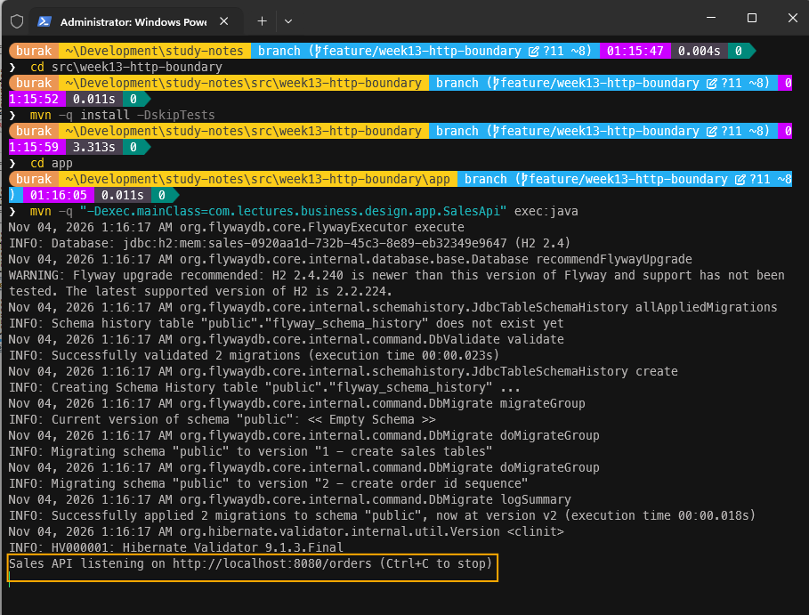

Artık birkaç HTTP isteğini deneyebiliriz. Terminalden veya PowerShell'den `curl` komutlarını kullanabiliriz ya da Insomnia veya Postman gibi araçları tercih edebiliriz.

İlk olarak geçerli bir sipariş oluşturalım.

```text
curl -i -X POST localhost:8080/orders -H "Content-Type: application/json" \
       -d '{"customerId":"VINET","lines":[{"productId":11,"unitPrice":14.00,"quantity":10}]}'
```

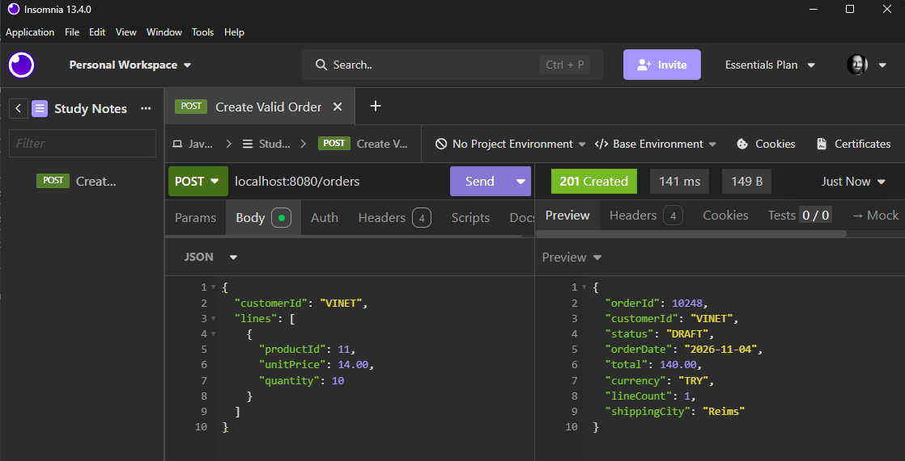

**orderDate** değeri uygulamayı çalıştırdığımız güne göre değişecektir. **SalesApi** sınıfında sabit bir saat yerine `Clock.systemUTC()` kullandık.

Şimdi de beş farklı hata içeren bir istek gönderelim.

```text
curl -i -X POST localhost:8080/orders -H "Content-Type: application/json" \
       -d '{"customerId":" ","lines":[{"productId":0,"unitPrice":14.001,"quantity":0,"discount":1.5}]}'
```

İstemci beş hatanın hepsini tek bir yanıtta öğreniyor. Bu kez biçim olarak doğru ama domain kuralına aykırı bir müşteri kimliği gönderelim.

```text
curl -i -X POST localhost:8080/orders -H "Content-Type: application/json" \
       -d '{"customerId":"VIN3T","lines":[{"productId":11,"unitPrice":14.00,"quantity":1}]}'
```

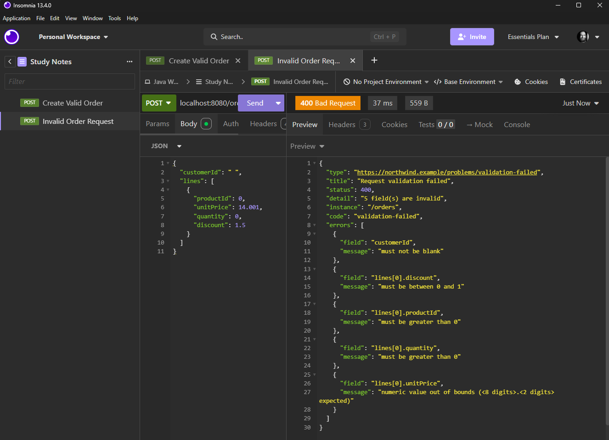

Sınırda tekrar etmediğimiz kural domain tarafındaki **CustomerId** record'undan geliyor. Şimdi de taslak durumdaki bir siparişi onaylamadan kargolamayı deneyelim.

```text
curl -i -X POST localhost:8080/orders/10248/ship
```

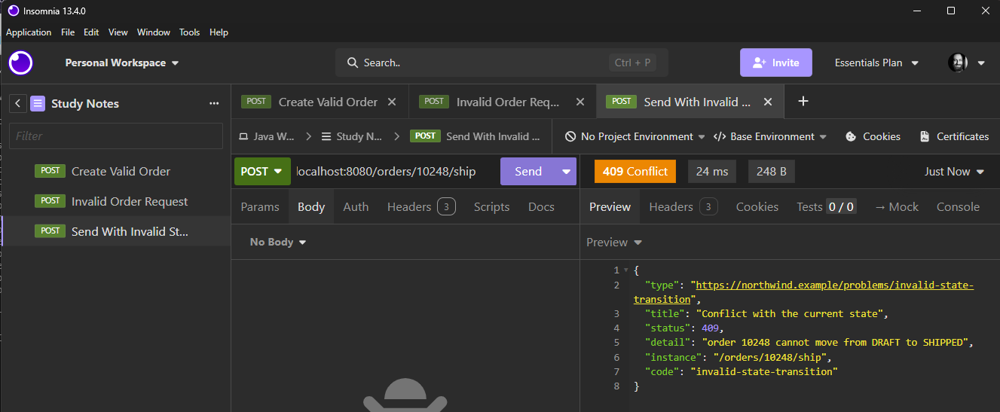

Bu yanıtın içinde HTTP katmanının bilmediği bir şey var ki o da `invalid-state-transition` kodu. Bu bilgi domain'deki exception sınıfının adından geliyor ama `rest` paketi o sınıfı hiç tanımıyor.

Son olarak olmayan bir siparişi isteyelim ve var olan bir eyleme yanlış HTTP metoduyla gelelim *(Örneğin POST gönderilmesi gereken yerde GET ile)*

```text
curl -i localhost:8080/orders/99999
```

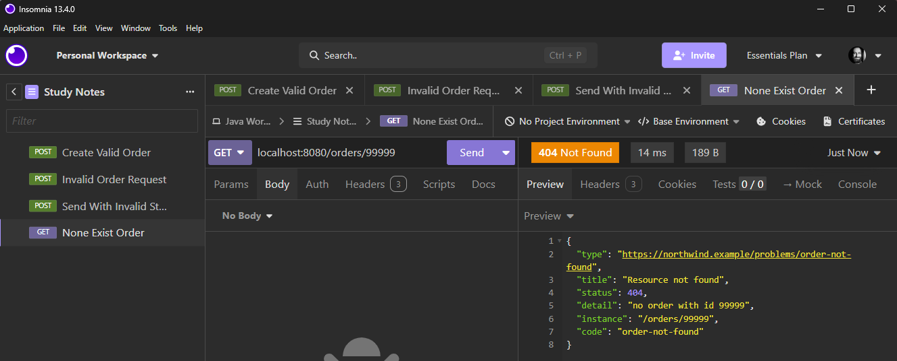

```text
curl -i localhost:8080/orders/10248/ship
```

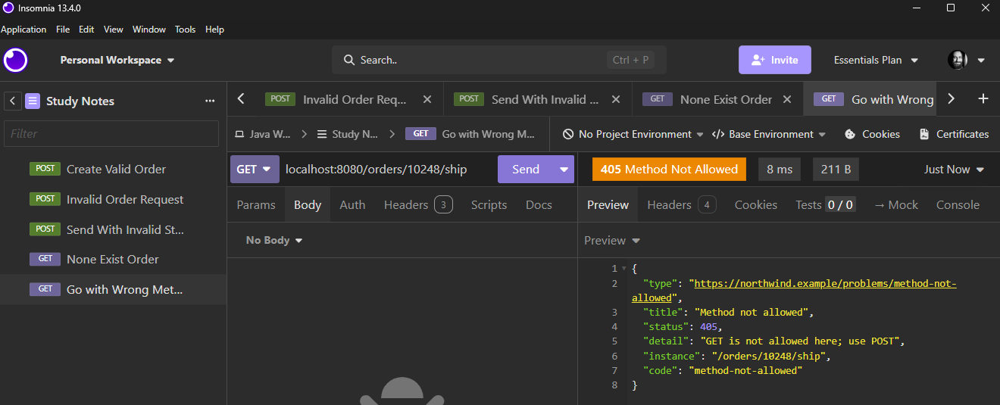

Siparişi sırasıyla onaylamak ve kargolamak için `POST /orders/10248/confirm` ve `POST /orders/10248/ship` isteklerini göndermemiz yeterli.

Confirm sonrası,

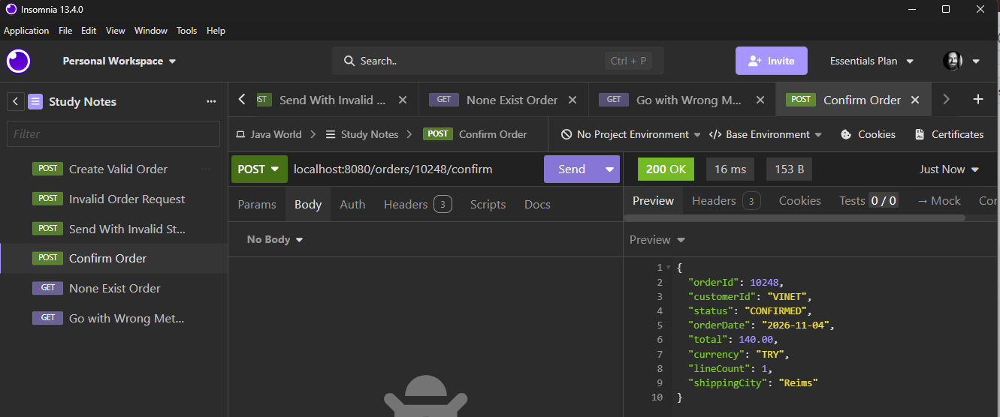

Shipping sonrası,

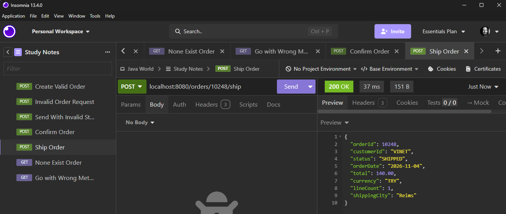

Kargolama sonrasında **ShipmentNotificationHandler** gözlemcisinin yazdığı bildirimi de sunucunun konsolunda görebiliriz.

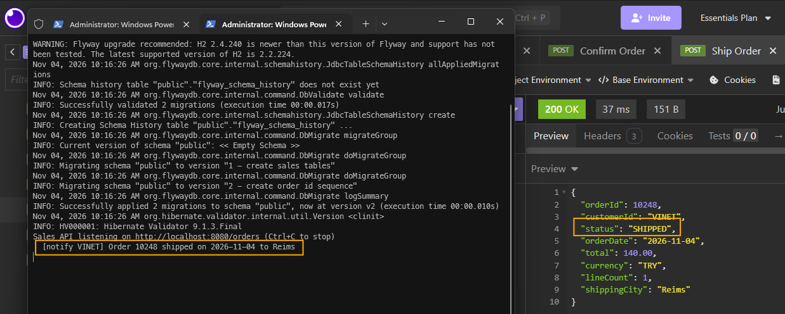

> Testler için kullanılan Insomnia v5 uyumlu dosyaya [buradan](./tools/insomnia-ordering-tests.yaml) erişebilirsiniz.

## Testler

Elle yaptığımız denemeleri otomatik testlere dönüştürmekte yarar var. **SalesHttpServerTest** sınıfı sunucuyu gerçek bir soket üzerinde başlatıp JDK'nın **HttpClient** sınıfı ile istek göndermek üzere kullanılacak. Sunucuya veritabanı yerine in-memory repository'ler ile kurulmuş bir **OrderService** vereceğiz. Bu testin amacı HTTP katmanını doğrulamak. Veritabanı katmanını önceki bölümde yazdığımız sözleşme testleri zaten doğruluyor. `sales` modülünün test kodlarındaki `rest` paketine aşağıdaki sınıfı ekleyerek devam edebiliriz.

```java
package com.lectures.business.design.sales.rest;

import com.lectures.business.design.sales.application.OrderMapper;
import com.lectures.business.design.sales.application.OrderService;
import com.lectures.business.design.sales.application.SteppingClock;
import com.lectures.business.design.sales.domain.Customer;
import com.lectures.business.design.sales.domain.CustomerId;
import com.lectures.business.design.sales.domain.OrderFactory;
import com.lectures.business.design.sales.domain.SequentialOrderIdGenerator;
import com.lectures.business.design.sales.persistence.CustomerRepository;
import com.lectures.business.design.sales.persistence.InMemoryCustomerRepository;
import com.lectures.business.design.sales.persistence.InMemoryOrderRepository;
import com.lectures.business.design.shared.kernel.Address;
import java.io.IOException;
import java.net.URI;
import java.net.http.HttpClient;
import java.net.http.HttpRequest;
import java.net.http.HttpResponse;
import org.junit.jupiter.api.AfterEach;
import org.junit.jupiter.api.BeforeEach;
import org.junit.jupiter.api.DisplayName;
import org.junit.jupiter.api.Test;
import static org.assertj.core.api.Assertions.assertThat;

class SalesHttpServerTest {

    private static final String VALID_ORDER = """
            {"customerId": "VINET",
             "lines": [{"productId": 11, "unitPrice": 14.00, "quantity": 10},
                       {"productId": 42, "unitPrice": 9.80, "quantity": 5, "discount": 0.10}]}
            """;

    private final HttpClient client = HttpClient.newHttpClient();
    private SalesHttpServer server;

    @BeforeEach
    void startServer() {
        SteppingClock clock = new SteppingClock("1996-07-04T09:00:00Z");
        CustomerRepository customers = new InMemoryCustomerRepository();
        customers.save(new Customer(CustomerId.of("VINET"), "Vins et alcools Chevalier",
                new Address("59 rue de l'Abbaye", "Reims", "51100", "France")));
        OrderService service = new OrderService(new InMemoryOrderRepository(), customers,
                new OrderFactory(new SequentialOrderIdGenerator(10248), clock),
                new OrderMapper(), clock, event -> {
                });

        server = SalesHttpServer.start(0, service, RequestValidator.withoutExpressionLanguage());
    }

    @AfterEach
    void stopServer() {
        server.close();
    }

    private HttpResponse<String> post(String path, String body) throws IOException, InterruptedException {
        return client.send(HttpRequest.newBuilder(uri(path))
                .header("Content-Type", "application/json")
                .POST(HttpRequest.BodyPublishers.ofString(body))
                .build(), HttpResponse.BodyHandlers.ofString());
    }

    private HttpResponse<String> get(String path) throws IOException, InterruptedException {
        return client.send(HttpRequest.newBuilder(uri(path)).GET().build(), HttpResponse.BodyHandlers.ofString());
    }

    private URI uri(String path) {
        return URI.create("http://localhost:" + server.port() + path);
    }

    @Test
    @DisplayName("POST /orders answers 201, a Location header and the summary")
    void placeOrderReturnsCreated() throws Exception {
        HttpResponse<String> response = post("/orders", VALID_ORDER);

        assertThat(response.statusCode()).isEqualTo(201);
        assertThat(response.headers().firstValue("Location")).contains("/orders/10248");
        assertThat(response.headers().firstValue("Content-Type")).contains("application/json");
        assertThat(response.body())
                .contains("\"orderId\":10248", "\"status\":\"DRAFT\"",
                        "\"orderDate\":\"1996-07-04\"", "\"total\":184.10");
    }

    @Test
    @DisplayName("the whole lifecycle over HTTP: place, confirm, ship, read")
    void lifecycleOverHttp() throws Exception {
        post("/orders", VALID_ORDER);

        assertThat(post("/orders/10248/confirm", "").body()).contains("\"status\":\"CONFIRMED\"");
        assertThat(post("/orders/10248/ship", "").body()).contains("\"status\":\"SHIPPED\"");
        assertThat(get("/orders/10248").body()).contains("\"status\":\"SHIPPED\"");
    }

    @Test
    @DisplayName("every invalid field is reported at once, as a 400 problem")
    void validationFailuresAreCollected() throws Exception {
        HttpResponse<String> response = post("/orders", """
                {"customerId": " ",
                 "lines": [{"productId": 0, "unitPrice": 14.001, "quantity": 0, "discount": 1.5}]}
                """);

        assertThat(response.statusCode()).isEqualTo(400);
        assertThat(response.headers().firstValue("Content-Type")).contains(ProblemDetail.MEDIA_TYPE);
        assertThat(response.body())
                .contains("\"code\":\"validation-failed\"", "\"detail\":\"5 field(s) are invalid\"")
                .contains("\"field\":\"customerId\"", "\"field\":\"lines[0].productId\"",
                        "\"field\":\"lines[0].quantity\"", "\"field\":\"lines[0].unitPrice\"",
                        "\"field\":\"lines[0].discount\"", "must be between 0 and 1")
                .doesNotContain("${");
    }

    @Test
    @DisplayName("shape is checked at the edge, invariants in the domain: a bad id format is still a 400")
    void domainValueObjectRejectionIsA400() throws Exception {
        HttpResponse<String> response = post("/orders", """
                {"customerId": "VIN3T", "lines": [{"productId": 11, "unitPrice": 14.00, "quantity": 1}]}
                """);

        assertThat(response.statusCode()).isEqualTo(400);
        assertThat(response.body()).contains("\"code\":\"invalid-argument\"", "five letters");
    }

    @Test
    @DisplayName("broken JSON and unknown fields are a 400, not a 500")
    void malformedBodies() throws Exception {
        assertThat(post("/orders", "{\"customerId\": ").statusCode()).isEqualTo(400);

        HttpResponse<String> typo = post("/orders", """
                {"customerID": "VINET", "lines": []}
                """);
        assertThat(typo.statusCode()).isEqualTo(400);
        assertThat(typo.body()).contains("\"code\":\"malformed-request\"");
    }

    @Test
    @DisplayName("domain refusals map by kind: NOT_FOUND is 404, CONFLICT is 409")
    void domainRefusalsMapByKind() throws Exception {
        HttpResponse<String> unknownCustomer = post("/orders", """
                {"customerId": "ALFKI", "lines": [{"productId": 11, "unitPrice": 14.00, "quantity": 1}]}
                """);
        assertThat(unknownCustomer.statusCode()).isEqualTo(404);
        assertThat(unknownCustomer.body()).contains("\"code\":\"customer-not-found\"",
                "\"type\":\"https://northwind.example/problems/customer-not-found\"");

        assertThat(get("/orders/99999").statusCode()).isEqualTo(404);

        post("/orders", VALID_ORDER);
        HttpResponse<String> shipDraft = post("/orders/10248/ship", "");
        assertThat(shipDraft.statusCode()).isEqualTo(409);
        assertThat(shipDraft.body()).contains("\"code\":\"invalid-state-transition\"",
                "\"instance\":\"/orders/10248/ship\"");
    }

    @Test
    @DisplayName("a known route with the wrong verb is a 405 with an Allow header")
    void wrongVerb() throws Exception {
        HttpResponse<String> response = get("/orders/10248/ship");

        assertThat(response.statusCode()).isEqualTo(405);
        assertThat(response.headers().firstValue("Allow")).contains("POST");
    }

    @Test
    @DisplayName("an unknown route is a 404 problem, too")
    void unknownRoute() throws Exception {
        HttpResponse<String> response = get("/orders/10248/refund");

        assertThat(response.statusCode()).isEqualTo(404);
        assertThat(response.body()).contains("\"code\":\"no-such-route\"");
    }
}
```

Her test kendi sunucusunu `@BeforeEach` anotasyonu ile **0** numaralı port üzerinden başlatmakta ve `@AfterEach` ile kapatmakta. Birim testler, elle başlattığımız denemelere ilaveten bozuk **JSON** gövdelerini ve tanımsız adresleri de kapsıyor.

`app` modülündeki **HttpSmokeTest** sınıfıysa her şeyi bir arada çalıştırıyor. HTTP isteği, Bean Validation, façade, servis, JDBC repository, H2, Flyway ve bildirim gözlemcisi. Onu da aşağıdaki gibi ekleyebiliriz.

```java
package com.lectures.business.design.app;

import com.lectures.business.design.sales.application.SteppingClock;
import com.lectures.business.design.sales.domain.Customer;
import com.lectures.business.design.sales.domain.CustomerId;
import com.lectures.business.design.sales.rest.SalesHttpServer;
import com.lectures.business.design.shared.kernel.Address;
import java.net.URI;
import java.net.http.HttpClient;
import java.net.http.HttpRequest;
import java.net.http.HttpResponse;
import java.util.ArrayList;
import java.util.List;
import org.junit.jupiter.api.DisplayName;
import org.junit.jupiter.api.Test;
import static org.assertj.core.api.Assertions.assertThat;

class HttpSmokeTest {

    @Test
    @DisplayName("HTTP to database and back: the edge, the use case, JDBC and an observer, wired once")
    void fullStack() throws Exception {
        List<String> sent = new ArrayList<>();
        SalesModule module = SalesModule.jdbc(Database.migrated(Database.h2InMemory()),
                new SteppingClock("1996-07-04T09:00:00Z"), (customerId, message) -> sent.add(customerId));
        module.customers().save(new Customer(CustomerId.of("VINET"), "Vins et alcools Chevalier",
                new Address("59 rue de l'Abbaye", "Reims", "51100", "France")));

        HttpClient client = HttpClient.newHttpClient();
        try (SalesHttpServer server = module.startHttpApi(0)) {
            String base = "http://localhost:" + server.port();
            HttpResponse<String> placed = client.send(HttpRequest.newBuilder(URI.create(base + "/orders"))
                    .POST(HttpRequest.BodyPublishers.ofString("""
                            {"customerId": "VINET", "lines": [{"productId": 11, "unitPrice": 14.00, "quantity": 10}]}
                            """)).build(), HttpResponse.BodyHandlers.ofString());
            String location = placed.headers().firstValue("Location").orElseThrow();

            for (String action : List.of("/confirm", "/ship")) {
                client.send(HttpRequest.newBuilder(URI.create(base + location + action))
                        .POST(HttpRequest.BodyPublishers.noBody()).build(), HttpResponse.BodyHandlers.ofString());
            }

            assertThat(placed.statusCode()).isEqualTo(201);
            assertThat(module.salesReport().countByStatus()).containsEntry("SHIPPED", 1L);
            assertThat(sent).containsExactly("VINET");
        }
    }
}
```

Eğer buraya kadarki kısımları eksiksik tamamladıysak testlerin başarılı bir şekilde geçmesi gerekir.

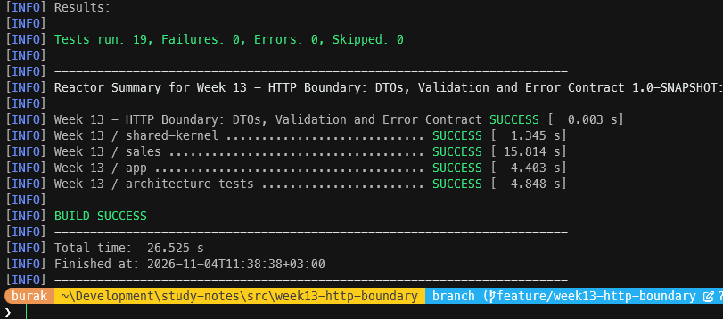)

## Aynı Yapı JAX-RS ile Nasıl Görünürdü?

Normal şartlarda Payara Micro bir uygulama sunucusu kullandığımızda **Jakarta REST *(JAX-RS)*** çatısını kullanırız. Bu bölümde elle yazdığımız her şeyin orada bir karşılığı var. Aşağıdaki kod parçasını bu gözle değerlendirebiliriz. Sadece karşılaştırma amacıyla ekledik.

```java
@Path("/orders")
@ApplicationScoped
public class OrderResource {

    @Inject
    OrderingFacade orders;

    @POST
    @Consumes(MediaType.APPLICATION_JSON)
    @Produces(MediaType.APPLICATION_JSON)
    public Response place(@Valid PlaceOrderRequest request, @Context UriInfo uri) {
        OrderSummary placed = orders.placeOrder(request.toCommand());
        return Response.created(uri.getAbsolutePathBuilder().path(String.valueOf(placed.orderId())).build())
                .entity(placed).build();
    }

    @POST
    @Path("{id}/ship")
    public OrderSummary ship(@PathParam("id") int id) {
        return orders.ship(id);
    }
}

@Provider
public class DomainExceptionMapper implements ExceptionMapper<DomainException> {

    @Override
    public Response toResponse(DomainException refused) {
        ...
        return Response.status(status).type("application/problem+json").entity(problem).build();
    }
}
```

Nelerin eşleştiğine aşağıdaki tabloyla bakalım *(Kolaylık olması açısından C# geliştiricileri için de bir sütun ekledik)*

| **Bu bölümde elle yaptığımız işlemler** | **JAX-RS karşılığı** | **.NET karşılığı** |
| --- | --- | --- |
| Regex ile yönlendirme | `@Path`, `@GET`, `@POST`, `@PathParam` | `[Route]`, `[HttpPost]` veya Minimal API `MapPost` gibi |
| **JsonCodec** | JSON-B *(Payara tarafında Yasson)* ve `@Consumes` / `@Produces` | `System.Text.Json` |
| `RequestValidator.validate(...)` | Parametre üzerindeki `@Valid` | `[ApiController]` ile otomatik model doğrulama |
| **ProblemMapper** | `ExceptionMapper<T>` ve `@Provider` | `IExceptionHandler`, `AddProblemDetails()` |
| **ProblemDetail** record | *(Standart bir tip yok, kendimiz yazıyoruz)* | `Microsoft.AspNetCore.Mvc.ProblemDetails` |
| **MethodNotAllowed** ve HTTP 405 | Runtime otomatik olarak 405 döner | Runtime otomatik olarak 405 döner |
| **startHttpApi** ile sunucuyu başlatmak | `@ApplicationPath` ve uygulama sunucusu | `app.Run()` |

> İlginç bir not da düşelim; **Payara** JSON için **Jackson** değil, **Jakarta JSON Binding *(JSON-B)*** spesifikasyonunun implementasyonu olan **Yasson** kütüphanesini kullanır. Bu yüzden `@JsonInclude` yerine `@JsonbNillable` gibi farklı anotasyonlarla karşılaşabiliriz. Jackson'ı yalnızca `rest` paketinde tutmamızın ve bunu birazdan yazacağımız `web_libraries_stay_in_rest` kuralıyla korumamızın bir faydası da bu. JSON kütüphanesini değiştirmek tek bir paketi etkileyecek.

## Mimari Kurallara Üç İlave Daha

Bu bölümde aldığımız kararları [ADR-0009-HTTP Sınırı ve Hata Sözleşmesi](docs/adr/ADR-0009.md) isimli bir ADR içerisinde toplamakta yarar var. ADR-0003'teki matrise düştüğümüz not da bu yeni belgeye atıfta bulunuyor. Kararları koruyan yeni kuralları **ArchitectureTest** sınıfının sonuna da aşağıdaki gibi ekleyebiliriz.

```java
// ADR-0009 HTTP boundary
@ArchTest
static final ArchRule rest_sees_only_the_contract = noClasses()
        .that().resideInAPackage("..sales.rest..")
        .should().dependOnClassesThat()
        .resideInAnyPackage("..sales.domain..", "..sales.application..", "..sales.persistence..");

@ArchTest
static final ArchRule nothing_depends_on_rest = noClasses()
        .that().resideOutsideOfPackage("..sales.rest..")
        .should().dependOnClassesThat().resideInAPackage("..sales.rest..");

@ArchTest
static final ArchRule web_libraries_stay_in_rest = noClasses()
        .that().resideOutsideOfPackage("..sales.rest..")
        .should().dependOnClassesThat()
        .resideInAnyPackage("com.fasterxml.jackson..", "com.sun.net.httpserver..", "jakarta.validation..");
```

Peki buradaki test metotları ile neleri doğruluyoruz?

| **Kural *(ArchRule alanı)*** | **ADR** | **Neyi Doğrular?** |
| --- | :---: | --- |
| **rest_sees_only_the_contract** | 0009 | `sales.rest` paketinin domain, application ve persistence paketlerine bağımlı olmadığını doğrular. |
| **nothing_depends_on_rest** | 0009 | Analiz kapsamındaki hiçbir paketin `sales.rest` paketine bağımlı olmadığını doğrular. `app` modülü kapsam dışında olduğu için composition root'un `SalesHttpServer` sınıfını kullanması bu kurala takılmamamlıdır *(Zaten istediğimiz de bu)* |
| **web_libraries_stay_in_rest** | 0009 | Jackson, JDK HTTP sunucusu ve Bean Validation tiplerinin yalnızca `sales.rest` paketinde kullanıldığını doğrular. ADR-0004'teki `domain_is_framework_free` kuralı `jakarta..` paketlerini domain için zaten yasaklıyordu. Bu kural **application** ve **persistence** paketlerini de kapsıyor. |

### ArchUnit'in Görmediği Bir Bağımlılık

Kuralların gerçekten çalıştığını görmek için onları bilerek kırmayı denememiz lazım. **ProblemMapper** sınıfının **toProblem** metodundaki **switch** ifadesine, **DomainException** dalından hemen önce domain'e bağımlı yeni bir dal ekleyelim. Aşağıda görüldüğü gibi.

```java
case com.lectures.business.design.sales.domain.OrderNotFoundException gone ->
        ProblemDetail.of(404, "x", "x", "x", instance);
```

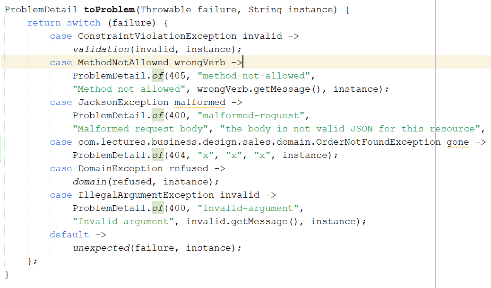

Mimari testleri çalıştırdığımızda testlerin **geçtiğini** görürüz.

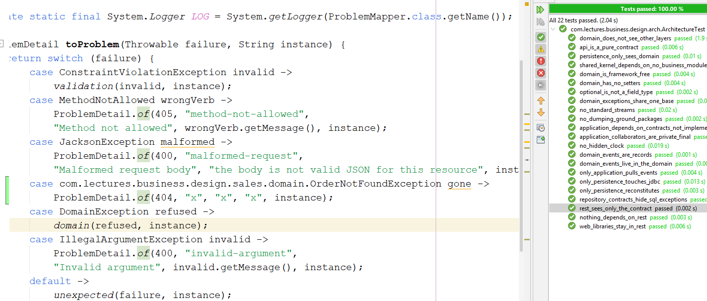

Oysa `rest_sees_only_the_contract` kuralının bu satırı yakalaması gerekiyordu. Şimdi aynı satırda ikinci `"x"` yerine `gone.getMessage()` yazalım ve testleri tekrar çalıştıralım. Bu kez kural beklendiği gibi kırılır.

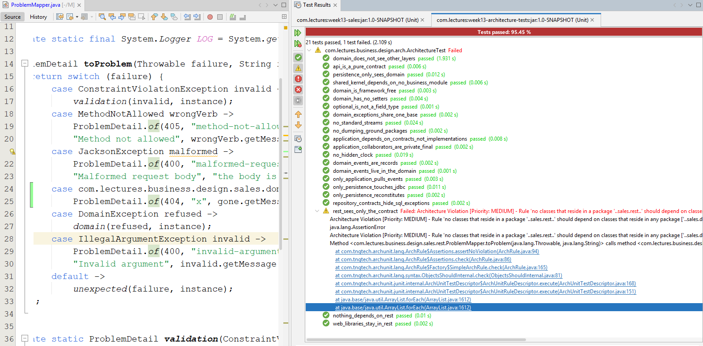

Sebebi anlayabilmek için **bytecode** tarafına bakmakta yarar var. Bunun için derlenmiş sınıfı `javap -c -p` ile incelemek ve **pattern matching switch** ifadesinin nasıl derlendiğine bakmak gerekebilir. Bunun nasıl olduğunu araştıralım. Her halükarda iki önemli noktayı vurgulamakta yarar var.

- Hiçbir statik analiz aracı her şeyi göremez. Bir kuralı yazdıktan sonra onu farklı yollarla kırmayı denemek, aslında kuralın gerçekte neyi koruduğunu anlamanın en iyi yoludur.
- Mimari kurallar tek savunma hattı değildir. `rest` paketi `Kind` ve `code` sayesinde domain tiplerini tanımadan çalışacak şekilde tasarlandığı için bu tür bir ihlale zaten ihtiyaç duyulmuyor. İyi bir tasarım yaparsak, koyduğumuz kuralların delime isteğini de azaltmış oluruz.

---

## Bölüm Soruları

1. **PlaceOrderRequest** yerine HTTP isteğini doğrudan **PlaceOrderCommand** record'una alsaydık ve Bean Validation annotation'larını oraya ekleseydik ne kaybederdik? `api` paketinin `jakarta.validation` bağımlılığı kazanması bu modülü kullanacak bir mesaj kuyruğu tüketicisini nasıl etkilerdi?
2. **409 Conflict** ile **422 Unprocessable Content** arasındaki farkı RFC 9110 üzerinden araştıralım. **IncompleteOrderException** için 422 yerine 409 kullanmak düşünülebilir mi? 
3. Bir siparişin adresi olmadan onaylanamaması bir durum çatışması mı, yoksa bir kural ihlali midir?
4. **code** değeri exception sınıfının adından türetiliyor. Bir geliştirici **InvalidStateTransitionException** sınıfını **IllegalOrderTransitionException** olarak yeniden adlandırırsa istemciler ne yaşar? **DomainExceptionKindTest** bu durumu yakalar mı? **code** değerini sınıf adından bağımsız hale getirmek için ne yapabiliriz?
5. Aynı siparişi iki kez oluşturmamak için istemci tarafı header'da **Idempotency-Key** değeri gönderebilir. Bu header'ı desteklemek için hangi paketlerde değişiklik yapmamız gerekir? Anahtarları nerede ve ne kadar süre saklamalıyız?
6. Bir istemci siparişi kargolarken başka bir istemcinin aynı siparişi iptal ettiğini düşünelim. HTTP'nin **ETag** ve **If-Match** başlıkları bu yarış durumunu *(lost update)* nasıl önler?
7. **type** alanı için `https://northwind.example/problems/...` şeklinde bir URI kullandık. RFC 9457 bu URI'ın çözümlenebilir *(dereferenceable)* olmasını zorunlu tutuyor mu? **about:blank** değeri hangi durumda kullanılır?
8. **ProblemMapper** beklenmeyen hataları **System.Logger** ile logluyor. Üretim ortamında bir 500 hatası alan kullanıcı destek ekibini aradığında, destek ekibi hangi log kaydına bakacağını nasıl bilecek? Problem gövdesine bir **correlation id** eklemek bu sorunu nasıl çözer? Bu id'yi kim üretmelidir?
9. Virtual thread'lerin **JDBC** ile birlikte kullanımında öne çıkan **pinning** sorunu nedir? **synchronized** bloklar içeren eski bir JDBC sürücüsü kullanıldığında ne olur?
10. Bu bölümde yazdığımız **OrderResource**, **JsonCodec**, **RequestValidator** ve **ProblemMapper** sınıfları Payara gibi bir uygulama sunucusunda ele alındıklarında hangileri JAX-RS bileşeni olarak yaşamaya devam eder, hangileri ortadan kalkar?

## Bu bölümün kodu

- [week13-http-boundary](src/week13-http-boundary)

```powershell
cd src\week13-http-boundary

# Bölüm 13'teki tüm modüllerin testleri (Docker yoksa PostgreSQL testleri atlanır)
mvn test

# Yalnızca HTTP katmanı testleri
mvn -pl sales -am test "-Dtest=SalesHttpServerTest,ProblemMapperTest" "-Dsurefire.failIfNoSpecifiedTests=false"

# Yalnızca mimari testler ve ihtiyaç duyduğu modüller
mvn -pl quality/architecture-tests -am test
```

API'yi denemek için NetBeans'te `app` modülündeki **SalesApi** sınıfını çalıştırmak *(Run File)* yeterli. Varsayılan port 8080. `SALES_HTTP_PORT` ortam değişkeni ile değiştirilebilir. `SALES_DB_URL` tanımlıysa PostgreSQL kullanılır.

<!-- nav:bottom:start -->
---

| ← Önceki Bölüm | İçindekiler | Sonraki Bölüm → |
| :--- | :---: | ---: |
| [Bölüm 12: Persistence Boundary, JDBC ve Flayway](java-chapter-12.md#top) | [Ders Notları](README.md#top) | |
<!-- nav:bottom:end -->
