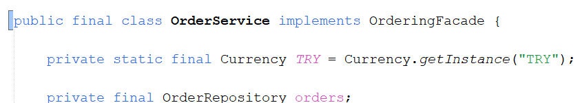

<a id="top"></a>

# Bölüm 13: HTTP Boundary, DTO, Validasyon ve Hata Sözleşmeleri

<!-- nav:top:start -->
[← Bölüm 12](java-chapter-12.md#top) · [İçindekiler](README.md#top)
<!-- nav:top:end -->

Artık elimizde kullanım senaryolarını *(user stories)* koordine eden bir servis tasarımı, olaylarla haberleşen gözlemciler *(Observers)* ve verileri kalıcı olarak saklayan bir katman *(repository)* var. Eksik olan tek şey dış dünya. Şu ana kadar sistemi yalnızca main metodunun olduğu sınıf ve birim testler üzerinden çalıştırdık. Pek tabii ki gerçek hayat senaryolarında sistemin dış dünya tarafından da erişilebilir olması gerekir.

İşte bu bölümde `sales` modülüne bir HTTP katmanı ekleyeceğiz. Ancak Payara ve JAX-RS'e geçmeden önce bilinçli olarak JDK ile birlikte gelen basit HTTP sunucusunu *(`com.sun.net.httpserver`)* kullanacağız. Daha önceki bölümlerde **Dependency Injection Container**'ın, **Java Persistence API**'nın neyi otomatikleştirdiğini görmek için ne yaptıysak burada da aynı strateji ile devam edeceğiz. Bir JAX-RS runtime'ının bizim yerimize yaptığı işleri bir kez elle yazacağız ve aşağıdaki soruların cevabını bulacağız.

- HTTP katmanı domain nesnelerini bilmeli midir? Kullanım senaryolarına *(User Stories)* nasıl erişmelidir?
- Girdi doğrulama *(Validation)* nerede yapılmalıdır? Sınırda mı, domain'de mi, yoksa her ikisinde birden mi?
- Bir domain exception'ı hangi HTTP durum koduna karşılık gelir? Bu kararı nasıl vermeliyiz?
- Bir API servisinden dönecek hatalar istemciye nasıl anlatmalıdır? *(RFC 9457 - Problem Details mevzusu)*

## REST Paketinin Oluşturulması

Kod tarafına geçmeden önceb `rest` paketini oluşturarak işe başlayalım. Bu amaçla `com.lectures.business.design.sales.rest` isimli paketi `sales` modülünde oluşturacağız. Bunun için `Week 13 / sales` modülündeki **Source Packages** kısmında sağ tıklayıp `New -> Java Package` ile ilerleyebiliriz. Modüldeki diğer paketlerde olduğu gibi bu paketin de sorumluluğunu ve dependency kurallarını `package-info.java` dosyasında aşağıdaki gibi belirtebiliriz.

> HTTP katmanı için yeni bir Maven modülü açmıyoruz. "Bir modül bir katman değildir" felsefesini benimsedik. Yani katmanlar paketler aracılığıyla temsil edilecek ve bağımlılık yönleri paketler arasında belirlenecek. rest de api, application, domain ve persistence gibi sales modülünün içinde bir paket olacak.

```java
/**
 * The HTTP edge of the sales module.
 *
 * <p>
 * Sees {@code api} and {@code shared.kernel} only - never domain, application
 * or persistence (ADR-0009). The only package allowed to use Jackson, Bean
 * Validation and the JDK HTTP server; nobody depends on it.
 */
package com.lectures.business.design.sales.rest;
```

Kısaca JSON dönüşümleri için Jackson, girdi doğrulama için Jakarta Bean Validation spesifikasyonunu ele alan Hibernate Validator'un kullanılacağı belirtiliyor. HTTP sunucusu olarak da **JDK** ile birlikte gelen `jdk.httpserver` kullanılacak. Şimdi `week13-http-boundary` modülümüzün ana `pom.xml` dosyasına gerekli sürümleri ve dependency bileşenlerini aşağıdaki gibi ekleyelim. *(pom içerisindeki properties kısmının tamamı şu anda aşağıdaki gibi olmalı)*

```xml
<properties>
    <archunit.version>1.5.1</archunit.version>
    <jar.plugin.version>3.4.2</jar.plugin.version>
    <flyway.version>10.20.1</flyway.version>
    <h2.version>2.4.240</h2.version>
    <postgresql.version>42.7.4</postgresql.version>
    <testcontainers.version>2.0.5</testcontainers.version>
    <slf4j.version>2.0.16</slf4j.version>
    <jackson.version>2.21.5</jackson.version>
    <hibernate-validator.version>9.1.3.Final</hibernate-validator.version>
</properties>
```

Dependency bildirimleri ise şöyle;

```xml
<dependency>
    <groupId>com.fasterxml.jackson.core</groupId>
    <artifactId>jackson-databind</artifactId>
    <version>${jackson.version}</version>
</dependency>
<dependency>
    <groupId>com.fasterxml.jackson.datatype</groupId>
    <artifactId>jackson-datatype-jsr310</artifactId>
    <version>${jackson.version}</version>
</dependency>
<dependency>
    <groupId>org.hibernate.validator</groupId>
    <artifactId>hibernate-validator</artifactId>
    <version>${hibernate-validator.version}</version>
</dependency>
```

İşimiz henüz bitmedi... `sales` modülünün `pom.xml` dosyasında da aşağıdaki gibi benzer bağımlılıkları ekleyelim. Bu bağımlılıklar derleme *(compile)* kapsamında ele alınmalılar zira Bölüm 12'deki test bağımlılıklarından farklı olarak bu kütüphaneleri doğrudan `rest` paketinin asıl *(main)* kodu kullanacak.

```xml
<dependency>
    <groupId>com.fasterxml.jackson.core</groupId>
    <artifactId>jackson-databind</artifactId>
</dependency>
<dependency>
    <groupId>com.fasterxml.jackson.datatype</groupId>
    <artifactId>jackson-datatype-jsr310</artifactId>
</dependency>
<dependency>
    <groupId>org.hibernate.validator</groupId>
    <artifactId>hibernate-validator</artifactId>
</dependency>
```

## API Sözleşmesinin Tanımlanması

Şimdi `api` paketine aşağıdaki içeriğe sahip yeni bir sözleşme *(interface)* ekleyeceğiz.

```java
package com.lectures.business.design.sales.api;

public interface OrderingFacade {

    OrderSummary placeOrder(PlaceOrderCommand command);

    OrderSummary confirm(int orderId);

    OrderSummary ship(int orderId);

    OrderSummary cancel(int orderId);

    OrderSummary getOrder(int orderId);
}
```

Bu arayüz içerisinde sipariş işlemleri ile ilgili bazı temel operasyonlar tanımlı. `OrderingFacade` arayüzü, HTTP katmanının **application** paketini ve **domain** nesnelerini bilmeden sipariş işlemlerini gerçekleştirebilmesini sağlayacak. Bu sayede application katmanı ile HTTP katmanı arasında bir soyutlama sağlamış olacağız. *(Bunun ne gibi bir avantaj/avantajlar sağladığını tartışalım)* Sıradaki hamlemiz bu sözleşemyi **OrderService** sınıfına uygulamak. Tabii unutmamamız gereken bir şeyde buradaki metotların ilgili arayüzden implemente edildiğini `@Override` anotasyonu ile açıkça belirtmek.



**OrderingFacade** arayüzünü uygulayan bir sınıf kullanmak, **HTTP** katmanının **application** servislerine doğrudan bağımlı olmasını engeller. Bu sayede application servisleri değiştiğinde HTTP katmanında minimum değişiklik yapmamız yeterli olur. Ayrıca test yazarken de HTTP katmanını izole edebilir ve sadece facade üzerinden testler gerçekleştirebiliriz.

Henüz yazmadığımız `rest` paketinin bağımlılık kuralı da oldukça nettir. Sadece `api` ve `shared-kernel` paketlerini görebilir. Ayrıca hiçbir paket `rest` paketine bağımlı olamaz. HTTP katmanı bağımlılık grafiğinin en dış halkasında yer alır. Kimse onu tanımaz ve o da sadece sözleşmeyi tanır. Hatta bu durumu `ADR-003` dökümanındanki bağımlılık matrisine eklemeliyiz *(Belgeyi kontrol edin)* Bu arada şunu da belirtmemiz gerekiyor. ADR belgeleri genellikle kabul edildikten sonra değiştirilmezler. Yeni karar yeni bir ADR olur ve eskisine atıf yapar. Bu nedenle `ADR-003` e şimdilik bir not düştük.

> Hexagonal mimari terminolojisiyle ifade edersek `OrderingFacade` arayüzü bir **giriş portu** *(driving port)*, `rest` paketi ise bir **giriş adaptörü** *(driving adapter)* olarak düşünülebilir. Daha önceden ele aldığımız `CustomerNotifier` ise bir çıkış portuydu. Yarın aynı kullanım senaryolarını bir RabbitMQ tüketicisi *(consumer)* üzerinden de sunmak istersek, yazacağımız `messaging` paketi de aynı façade bileşenini kullanabilir.

## Request DTO ve Bean Validation

Sözleşmedeki **placeOrder** metodu parametre olarak **PlaceOrderCommand** tipinden bir nesne almakta. Bir HTTP isteğinin gövdesini *(body)* doğrudan bu record tipine okumak mümkün. Lakin bu iki tipin kullanım amaçlarının farklı olduğunu göz önünde bulundurmalıyız. **PlaceOrderCommand** modülün dış sözleşmesidir ve hangi protokolle gelirse gelsin aynı kalır. HTTP isteğinin gövdesi ise HTTP standartlarına özgüdür. Alan adları *(field names)*, isteğe bağlı alanlar *(optional fields)*, varsayılan değerler ve doğrulama mesajları bu katmana aittir. Bu nedenle `rest` paketine ayrı bir record ekleyerek devam edelim.

```java
package com.lectures.business.design.sales.rest;

import com.lectures.business.design.sales.api.OrderLineRequest;
import com.lectures.business.design.sales.api.PlaceOrderCommand;
import jakarta.validation.Valid;
import jakarta.validation.constraints.*;
import java.math.BigDecimal;
import java.util.List;

public record PlaceOrderRequest(
        @NotBlank
        String customerId,
        @NotEmpty
        @Size(max = 50)
        List<@NotNull @Valid Line> lines) {

    public record Line(
            @Positive
            int productId,
            @NotNull
            @Positive
            @Digits(integer = 8, fraction = 2)
            BigDecimal unitPrice,
            @Positive
            int quantity,
            // The default DecimalMin/Max messages need Expression Language, hence our own wording
            @DecimalMin(value = "0", message = "must be between 0 and 1")
            @DecimalMax(value = "1", message = "must be between 0 and 1")
            @Digits(integer = 1, fraction = 2)
            BigDecimal discount) {

    }

    PlaceOrderCommand toCommand() {
        return new PlaceOrderCommand(customerId, lines.stream()
                .map(line -> new OrderLineRequest(line.productId(), line.unitPrice(), line.quantity(),
                        line.discount() == null ? BigDecimal.ZERO : line.discount()))
                .toList());
    }
}
```

// DEVAM EDECEK