<a id="top"></a>

# Bölüm 14: Uygulama Sunucusuna Geçiş: CDI, JTA ve JAX-RS ile Payara Micro

<!-- nav:top:start -->
[← Bölüm 13](java-chapter-13.md#top) · [İçindekiler](README.md#top)
<!-- nav:top:end -->

Son dört bölümde bilinçli olarak zor yolu seçtik. Nesneleri birbirine bağlayan **composition root** sınıfını *(SalesModule)* elle yazdık, domain olaylarını dağıtan bir yayıncı *(InProcessEventPublisher)* geliştirdik, veritabanı bağlantısını ortam değişkenlerinden okuyan bir **Database** sınıfı kurguladık, transaction'ları repository içinde `setAutoCommit(false)` ve `commit()` çağrılarıyla yönettik ve son olarak JDK'nın basit HTTP sunucusu üzerine **regex** ile yönlendirme yapan, **JSON** dönüşümünü, doğrulamayı ve hata eşlemesini tek tek ele alan bir **HTTP katmanı** yazdık. Amacımız bir uygulama sunucusunun bizim yerimize ne yaptığını görmekti.

Artık bu işleri kurumsal standartlara göre asıl sorumlularına devredebiliriz. Bu bölümde `sales` modülünü **Payara Micro** üzerinde çalışan bir web uygulamasına *(WAR)* dönüştüreceğiz. Elle yazdığımız her parçanın **Jakarta EE** ve **MicroProfile** tarafında bir karşılığı var. Yol haritamızı aşağıdaki tablo ile özetleyebiliriz.

| **Elle yazdığımız** | **Uygulama sunucusundaki karşılığı** |
| --- | --- |
| **SalesModule *(composition root)*** ve constructor injection | **CDI** *(`@ApplicationScoped`, `@Inject`, `@Produces`)* |
| **InProcessEventPublisher** ve abonelik listesi | **CDI Events** *(`Event<T>`, `@Observes`)* |
| `Database.fromEnvironment(...)` ve **PGSimpleDataSource** | `@DataSourceDefinition` + **MicroProfile Config** |
| Repository içindeki `setAutoCommit(false)` / `commit()` / `rollback()` | **Jakarta Transactions** *(JTA, `@Transactional`)* |
| `Database.migrated(...)` çağrısı | Uygulama açılışında çalışan bir CDI gözlemcisi *(`@Observes Startup`)* |
| **SalesHttpServer** ve regex ile yönlendirme | **Jakarta REST** *(JAX-RS, `@Path`, `@GET`, `@POST`)* |
| **JsonCodec *(Jackson)*** | **JSON-B** *(Payara içinde Yasson)* |
| `RequestValidator.validate(...)` | Parametre üzerinde `@Valid` |
| `OrderResource.handle` içindeki tek `catch` bloğu | `ExceptionMapper<T>` ve `@Provider` |
| `SalesApi.main` ve **CountDownLatch** | `java -jar payara-micro.jar --deploy sales.war` |

Bu bölüm için şimdilik JDBC repository'lerimiz yerinde kalıyor. SQL cümlelerine, `update-then-insert` yaklaşımına ve sözleşme testlerine dokunmayacağız. Değişecek olan şey SQL'in etrafındaki altyapı. Yani bağlantıyı kimin verdiği, transaction'ı kimin yönettiği ve nesneleri kimin oluşturduğu gibi. JPA'yı ise kendi başına ele alınması gereken bir konu olarak sonraki bölümlere bırakıyoruz. Bu bölümün amacı bir nevi aşağıdaki sorulara cevap bulmak.

- Bir framework'e geçtiğimizde domain modelimiz ne kadar değişmeli? Hangi paketler framework'ü tanıyabilir, hangileri tanımaMAlıdır?
- Composition root ortadan kalkar mı, yoksa sadece ufalır mı?
- Transaction sınırı neden repository'den kullanım senaryosuna *(use case)* taşınmalıdır?
- Bir olay *(domain event)* ne zaman yayınlanmalıdır? Veritabanına yazılmadan önce mi, yazıldıktan sonra mı?
- Önceki bölümde yazdığımız sınıflardan hangileri `JAX-RS` bileşeni olarak yaşamaya devam eder, hangileri ortadan kalkar?

## Uygulama Modülünün WAR'a Dönüşmesi

Şu ana kadar `app` modülü, `main` metodu olan sınıfların durduğu sıradan bir JAR *(Java ARchive)* çıktısıydı. Uygulama sunucuları ise bir **web arşivi** *(Web Application Archive, WAR)* kullanır. Aslında WAR, belirli bir klasör düzenine sahip bir zip dosyasından ibarettir. Kendi sınıflarımız `WEB-INF/classes`, bağımlı olduğumuz kütüphaneler `WEB-INF/lib` altına yerleşir. Sunucu bu arşivi açar, içindeki bileşenleri bulur ve onları kendi yaşam döngüsü içinde yönetir. Bu nedenle ilk iş olarak `app` modülünü bir WAR modülüne çevirelim.

Terminale yazan ve kendi kendine çalışan sınıfların bir uygulama sunucusunda pek yeri yoktur. Bu yüzden `app` modülündeki şu dosyaları siliyoruz.

| **Silinen** | **Neden Siliyoruz?** |
| --- | --- |
| `BusinessDesign.java` ve `anemic` paketi | Bölüm 9'dan beri örnek senaryoları konsolda çalıştıran giriş noktası ve anemik model karşı örnekleriydi. Snapshot'larda zaten duruyorlar. Dolayısıyla nihai projede ihtiyacımız yok. |
| `SalesApi.java` | HTTP sunucusunu başlatıp **CountDownLatch** ile bekleyen ikinci bir giriş noktasıydı. Artık bu işi **Payara Micro** yapacak. |
| `SalesModule.java` | Composition root. Görevini artık CDI *(Contexts and Dependency Injection)* devralacak ve geriye çok küçük bir sınıf kalacak. |
| `Database.java` | Bağlantı bilgilerini ortam değişkenlerinden okuyup **DataSource** üreten ve Flyway'i çalıştıran sınıf olarak kullanıldı. Bu işlerin her birinin sunucu tarafında bir karşılığı bulunuyor. |
| `ConsoleCustomerNotifier.java` | Uygulama sunucusunda terminal yok. Yerine log ortamlarına yazan bir enstrüman ekleyeceğiz. |
| `AppSmokeTest.java`, `HttpSmokeTest.java` | **SalesModule** üzerinden kurulan uçtan uca birim test sınıflarıydı. HTTP katmanını `JAX-RS`'e taşıdığımızda yerlerine yenileri gelecek. |

Dosyaları NetBeans'te sağ tıklayıp **Delete** ile ya da komut satırından aşağıdaki gibi silebiliriz. Bu adımı atlamamalıyız. Birazdan `app` modülünün `pom.xml` dosyasından H2 bağımlılığını kaldıracağız ve **Database** sınıfı yerinde kalırsa derleme `package org.h2.jdbcx does not exist` hatasıyla kırılır.

```powershell
cd src\week14-application-server\app\src
Remove-Item -Recurse test
cd main\java\com\lectures\business\design\app
Remove-Item -Recurse anemic
Remove-Item BusinessDesign.java, ConsoleCustomerNotifier.java, Database.java, SalesApi.java, SalesModule.java
```

Şu ana kadar **app** modülünü **ArchUnit** kapsamının dışında tuttuğumuzu hatırlayalım. Sistemin parçalarını birbirine bağlayan *(wiring)* yer yine burası olmaya devam edecek. Adım adım ilerleyelim. Öncelikle ana `pom.xml` dosyasına yeni sürümleri ekleyelim. **properties** kısmının sonuna aşağıdaki satırları ekleyebiliriz.

```xml
<jakartaee.version>11.0.0</jakartaee.version>
<microprofile-config.version>3.1</microprofile-config.version>
<war.plugin.version>3.4.0</war.plugin.version>
```

**dependencyManagement** sektörüne **Jakarta EE Web Profile** ve **MicroProfile Config API**'lerini ekleyelim.

```xml
<dependency>
    <groupId>jakarta.platform</groupId>
    <artifactId>jakarta.jakartaee-web-api</artifactId>
    <version>${jakartaee.version}</version>
    <scope>provided</scope>
</dependency>
<dependency>
    <groupId>org.eclipse.microprofile.config</groupId>
    <artifactId>microprofile-config-api</artifactId>
    <version>${microprofile-config.version}</version>
    <scope>provided</scope>
</dependency>
```

**pluginManagement** kısmına da **WAR** eklentisinin sürümünü ekleyelim.

```xml
<plugin>
    <groupId>org.apache.maven.plugins</groupId>
    <artifactId>maven-war-plugin</artifactId>
    <version>${war.plugin.version}</version>
</plugin>
```

Burada **provided** kapsamı *(scope)* oldukça önemli. Söz konusu kütüphanelere göre derleme yapıyoruz ama onları WAR'ın içine koymuyoruz. Çalışma zamanında sunucu tarafı kendi implementasyonlarını *(CDI için Weld, JAX-RS için Jersey vb.)* sağlıyor olacak *(İşte uygulama sunucuları ve sağladıkları standartların gücü)*. Aynı API'nin bir kopyasını `WEB-INF/lib` altına koyarsak sunucunun ve uygulamanın sınıf yükleyicileri *(classloader)* aynı sınıfın iki farklı sürümünü görebilir ve hiç beklenmedik **ClassCastException** hatalarıyla karşılaşabiliriz. Ayrıca tam platform yerine bilinçli olarak **Web Profile** *(`jakarta.jakartaee-web-api`)* seçtik. Nitekim **Payara Micro** da **Web Profile**'ı uygular. Böylece Web Profile'da olmayan bir API'yi *(örneğin JMS)* yanlışlıkla kullanırsak bunu derleme aşamasında fark ederiz.

`app` modülünün `pom.xml` dosyasını ise aşağıdaki hale getirelim. Paketleme türü artık `war`. Konsol testleri ortadan kalktığı için `sales` modülünün test JAR'ına ve **H2** veritabanına artık ihtiyacımız yok. **PostgreSQL** sürücüsü ise sadece çalışma zamanında gerekli.

```xml
<artifactId>week14-app</artifactId>
<packaging>war</packaging>
<name>Week 14 / app</name>

<dependencies>
    <dependency>
        <groupId>com.lectures</groupId>
        <artifactId>week14-sales</artifactId>
    </dependency>
    <dependency>
        <groupId>com.lectures</groupId>
        <artifactId>week14-shared-kernel</artifactId>
    </dependency>
    <dependency>
        <groupId>org.flywaydb</groupId>
        <artifactId>flyway-core</artifactId>
    </dependency>
    <dependency>
        <groupId>org.flywaydb</groupId>
        <artifactId>flyway-database-postgresql</artifactId>
        <scope>runtime</scope>
    </dependency>
    <dependency>
        <groupId>org.postgresql</groupId>
        <artifactId>postgresql</artifactId>
        <scope>runtime</scope>
    </dependency>
    <dependency>
        <groupId>jakarta.platform</groupId>
        <artifactId>jakarta.jakartaee-web-api</artifactId>
    </dependency>
    <dependency>
        <groupId>org.eclipse.microprofile.config</groupId>
        <artifactId>microprofile-config-api</artifactId>
    </dependency>
</dependencies>

<build>
    <finalName>sales</finalName>
</build>
```

**finalName** değeri, üretilen arşivin adını `week14-app-1.0-SNAPSHOT.war` yerine `sales.war` olarak değiştiriyor. **Payara Micro** gibi uygulama sunucuları bir uygulamayı varsayılan olarak arşivin adıyla aynı **context root** altında yayınlar. Yani uygulamamız `http://localhost:8080/sales` adresinde yaşayacak. Burada bir mola verelim. Söz konusu modülü derleyip arşivin içine bakalım. WAR'ın içine bakmak sunucunun neyi göreceğini anlamanın en kısa yoludur.

```powershell
cd src\week14-application-server
mvn clean install
tar -tf app\target\sales.war
```

`WEB-INF/lib` klasöründe `week14-sales` ve `week14-shared-kernel` JAR'larının yanında Flyway, PostgreSQL sürücüsü ve bir de **Jackson** ile **Hibernate Validator** kütüphanelerini görmemiz gerekiyor. `JAX-RS`'e geçtiğimizde bunların WAR'dan çıkartılmış olduklarını tekrar kontrol etmeliyiz.

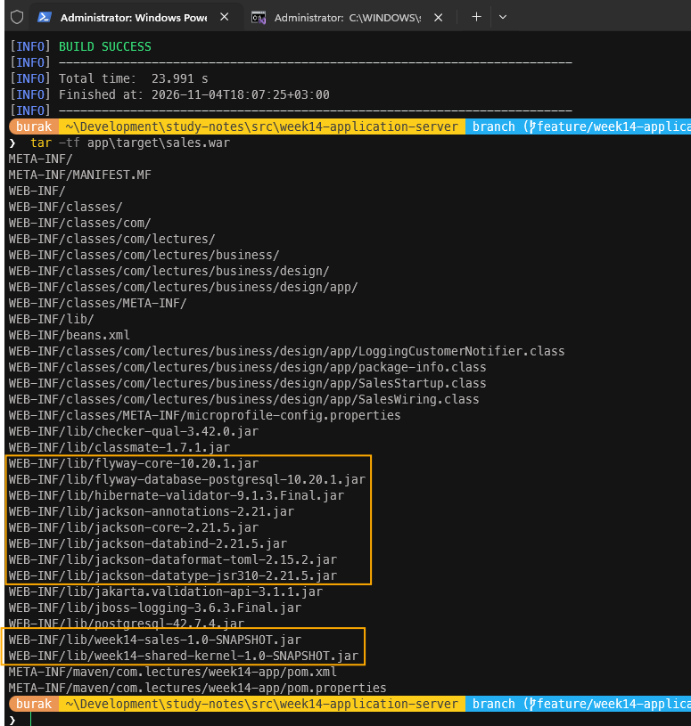

## CDI ile Nesneleri Bağlamak

**OrderService** sınıfının ihtiyaç duyduğu bağımlılıkları constructor üzerinden vermiş ve tüm nesneleri **SalesModule** içinde **new** çağrıları ile oluşturmuştuk. **CDI** *(Jakarta Contexts and Dependency Injection)* aynı işi bizim yerimize yapar. Sınıfları tarar, constructor parametrelerinin tiplerine bakar, uygun nesneyi bulur veya oluşturur ve bu nesnelerin ne kadar yaşayacağına karar verir. Bunun için CDI'ın hangi sınıfları yönetmesi gerektiğini bilmesi gerekiyor.

### `beans.xml` ve Keşif Modu

`sales` modülünde `src/main/resources/META-INF` klasörünü oluşturup içine aşağıdaki **beans.xml** dosyasını ekleyelim.

```xml
<?xml version="1.0" encoding="UTF-8"?>
<beans xmlns="https://jakarta.ee/xml/ns/jakartaee"
       xmlns:xsi="http://www.w3.org/2001/XMLSchema-instance"
       xsi:schemaLocation="https://jakarta.ee/xml/ns/jakartaee
                           https://jakarta.ee/xml/ns/jakartaee/beans_4_1.xsd"
       version="4.1"
       bean-discovery-mode="annotated">
</beans>
```

Aynı dosyanın bir kopyasını `app` modülünde `src/main/webapp/WEB-INF/beans.xml` olarak da ekleyelim. **bean-discovery-mode** değerinin **annotated** olması, CDI'ın sadece bean anotasyonu ile tanımlanmış sınıfları *(bean-defining annotation)* yöneteceği anlamına gelir. **all** seçeneği ise arşivdeki her sınıfı aday kabul eder. Bizim için bu tercih son derece önemli zira **CustomerRepository** arayüzünü uygulayan iki sınıfımız var. **JdbcCustomerRepository** ve **InMemoryCustomerRepository**. **all** modunda CDI bir **CustomerRepository** istendiğinde hangisini vereceğini bilemez ve uygulama açılırken *"ambiguous dependency"* hatası verir. **annotated** modunda ise sadece anotasyon eklediğimiz **JDBC** sınıfı bir bean enstrümanı haline gelir. Aynı durum **OrderIdGenerator** için de geçerlidir. Domain'deki **SequentialOrderIdGenerator** hiçbir anotasyon taşımadığı için CDI tarafında görülmez.

> Domain sınıflarına hiçbir CDI anotasyonu eklemeyeceğiz. ADR-0004'teki `domain_is_framework_free` kuralı `jakarta..` paketlerini domain ve shared-kernel için zaten yasaklıyor. Bir framework'e geçmek domain modelini değiştirmemeli. Değişiklikler domain'in etrafındaki paketlerde kalmalı.

### Kapsamlar *(Scopes)* ve Proxy Meselesi

Bir bean nesnesnin yaşam süresini belirleyen şey kapsamıdır. Bu bölümde iki kapsam ele almaktayız.

| **Kapsam** | **Ne zaman oluşturulur, ne kadar yaşar?** | **Proxy** |
| --- | --- | --- | --- |
| `@ApplicationScoped` | Uygulama boyunca tek bir örnek. İlk kullanımda oluşturulur. | Proxy vardır. Enjekte edilen şey asıl nesne değil ona yönlendiren bir **client proxy**'dir. |
| `@RequestScoped` | Her HTTP isteği için bir örnek. | Var |
| `@Dependent` | Enjekte edildiği her yer için yeni bir örnek. Yaşam süresi onu kullanan nesneye bağlıdır. | Yok |

`@ApplicationScoped` olarak işaretlenmiş bir bean'e erişen herkes aslında CDI'ın çalışma zamanında ürettiği bir alt sınıfa *(subclass)* erişir. Bu proxy, her çağrıda gerçek nesneyi bulup çağrıyı ona iletir. Bir alt sınıf üretilebilmesi için sınıfın **final** olmaması ve **private** olmayan, parametresiz bir constructor'a sahip olması gerekir. Şu anda bu tanıma uyan tüm sınıflarımızı **final** olarak yazdık. Bunu framework'ün bizden istediği ilk bedel olarak da düşünebiliriz.

**OrderService** uygulama boyunca tek bir örnek olarak yaşamalı. Sonradan ona bir **interceptor** *(`@Transactional`)* eklediğimizde bunun değeri ortaya çıkacak. **Interceptor**'ler de aynı alt sınıf tekniğiyle çalışır. Bu nedenle **OrderService** sınıfını aşağıdaki gibi düzenleyelim. Sınıfın geri kalanında bir değişiklik yok.

```java
import jakarta.enterprise.context.ApplicationScoped;
import jakarta.inject.Inject;

@ApplicationScoped
public class OrderService implements OrderingFacade {

    private static final Currency TRY = Currency.getInstance("TRY");

    private final OrderRepository orders;
    private final CustomerRepository customers;
    private final OrderFactory factory;
    private final OrderMapper mapper;
    private final Clock clock;
    private final DomainEventPublisher events;

    protected OrderService() {
        this.orders = null;
        this.customers = null;
        this.factory = null;
        this.mapper = null;
        this.clock = null;
        this.events = null;
    }

    @Inject
    public OrderService(OrderRepository orders, CustomerRepository customers,
            OrderFactory factory, OrderMapper mapper, Clock clock, DomainEventPublisher events) {
        // Diğer kodlar aynı
    }
    ...
}
```

Burada dikkat edilmesi gereken birkaç nokta var.

- **final** kelimesini sınıftan kaldırdık ama alanlardan kaldırmadık. Parametresiz constructor, alanlara **null** değer atıyor. Bu constructor sadece proxy nesnesi için çalışır ve proxy hiçbir çağrıyı kendisi karşılamadan gerçek nesneye iletir. Bu sayede ADR-0006'daki `application_collaborators_are_private_final` kuralı da bozulmamış olur.
- `@Inject` anotasyonu, CDI'ın gerçek nesneyi oluştururken hangi constructor'ı kullanacağını söyler. Constructor injection yaklaşımımız aynen devam ediyor ve **OrderService**'in birim testlerinde hiçbir değişiklik gerekmiyor. Testler yine `new OrderService(...)` ile uyumlu bir şekilde çalışıyor.
- Alan *(field)* üzerine `@Inject` yazarak bu constructor'lardan kurtulabilirdik. Ancak bu durumda alanlar **final** olamaz, testlerde nesneyi oluşturmak için reflection gerekir ve bağımlılılar sınıfın imzasından kaybolur.

Repository'ler ve **OrderMapper** ise herhangi bir durum *(state)* tutmayan sınıflar. Bunları `@Dependent` olarak işaretlemek yeterli. Proxy olmadığı için **final** kalabilirler. Aşağıda **JdbcOrderRepository** için yapılan değişikliği görebiliriz. **JdbcCustomerRepository** ve **SequenceOrderIdGenerator** sınıflarında da aynı değişiklikleri yaparak devam edelim.

```java
import jakarta.enterprise.context.Dependent;
import jakarta.inject.Inject;

@Dependent
public final class JdbcOrderRepository implements OrderRepository {

    ...

    @Inject
    public JdbcOrderRepository(DataSource dataSource) {
        this.dataSource = Objects.requireNonNull(dataSource, "dataSource must not be null");
    }
```

**OrderMapper** sınıfının bir constructor'ı yok. Sadece `@Dependent` anotasyonunu eklememiz yeterli. **SalesReport** sınıfını da aynı şekilde `@Dependent` ve constructor'ında `@Inject` olacak şekilde düzenleyelim. Henüz onu kullanan bir HTTP kaynağı yok ama hazırda bulunsun.

> `@Dependent` ile işaretlenmiş bir bean'i `@ApplicationScoped` bir bean'e enjekte ettiğimizde onun da uygulama boyunca yaşayacağını unutmayalım. Repository'lerimiz state tutmadıkları için sorun yok ancak durum tutan bir `@Dependent` sınıfın tek bir örneğinin birçok isteğe birden hizmet etmesi, eş zamanlılık *(concurrency)* problemlerine yol açabilir. Buna dikkat edelim.

Bu anotasyonlar `jakarta.jakartaee-web-api` kütüphanesinden geliyor. `sales` modülünün `pom.xml` dosyasına bu bağımlılığı ekleyelim. Scope'u ana pom'da **provided** olarak tanımlandığı için burada tekrar yazmamıza gerek yok.

```xml
<dependency>
    <groupId>jakarta.platform</groupId>
    <artifactId>jakarta.jakartaee-web-api</artifactId>
</dependency>
```

### Composition Root Kayboldu mu?

CDI, anotasyon taşıyan sınıfları kendisi oluşturabilir. Peki ya anotasyon ekleyemediğimiz sınıflar ne olacak? Örneğin **OrderFactory** sınıfı domain'de duruyor ve ona anotasyon eklemek ADR-0004 ile aldığımız kararı ihlal eder. **Clock** ise JDK'ya ait bir veri yapısı. Bu tür nesneleri CDI'a bir **producer** çağrısı ile tanıtabiliriz. Bu amaçla `app` modülüne aşağıda içeriği yer alan **SalesWiring** sınıfını ekleyelim.

```java
package com.lectures.business.design.app;

import com.lectures.business.design.sales.application.CustomerNotifier;
import com.lectures.business.design.sales.application.DomainEventPublisher;
import com.lectures.business.design.sales.application.InProcessEventPublisher;
import com.lectures.business.design.sales.application.OrderActivityLog;
import com.lectures.business.design.sales.application.ShipmentNotificationHandler;
import com.lectures.business.design.sales.domain.OrderEvent;
import com.lectures.business.design.sales.domain.OrderFactory;
import com.lectures.business.design.sales.domain.OrderIdGenerator;
import com.lectures.business.design.sales.domain.OrderShipped;
import jakarta.annotation.Resource;
import jakarta.annotation.sql.DataSourceDefinition;
import jakarta.enterprise.context.ApplicationScoped;
import jakarta.enterprise.inject.Produces;
import java.time.Clock;
import javax.sql.DataSource;

@DataSourceDefinition(
        name = "java:app/jdbc/sales",
        className = "org.postgresql.ds.PGSimpleDataSource",
        url = "${MPCONFIG=sales.datasource.url}",
        user = "${MPCONFIG=sales.datasource.user}",
        password = "${MPCONFIG=sales.datasource.password}")
@ApplicationScoped
public class SalesWiring {

    @Produces
    @Resource(lookup = "java:app/jdbc/sales")
    private DataSource dataSource;

    @Produces
    Clock clock() {
        return Clock.systemUTC();
    }

    @Produces
    OrderFactory orderFactory(OrderIdGenerator ids, Clock clock) {
        return new OrderFactory(ids, clock);
    }

    @Produces
    @ApplicationScoped
    DomainEventPublisher eventPublisher(CustomerNotifier notifier) {
        return new InProcessEventPublisher()
                .subscribe(OrderEvent.class, new OrderActivityLog())
                .subscribe(OrderShipped.class, new ShipmentNotificationHandler(notifier));
    }
}
```

**orderFactory** metodunun parametrelerine dikkat edelim. **OrderIdGenerator** parametresine CDI'ın kendi bulduğu **SequenceOrderIdGenerator** örneği, **Clock** parametresine ise hemen üstteki producer'ın ürettiği nesne örneği gelecek. **Producer** metotlarının parametreleri de birer enjeksiyon noktasıdır. **eventPublisher** metodu ise abonelikleri şimdilik aynı şekilde kurmakta. Sonraki adımlarda bu metodu tamamen silip yerine CDI olaylarını yerleştireceğiz. Durumu özetleyecek olursak:

| **SalesModule'de elle yaptığımızı** | **Şimdi kim yapıyor?** |
| --- | --- |
| `new OrderService(orders, customers, factory, mapper, clock, publisher)` | CDI *(`@Inject` constructor)* |
| `new JdbcOrderRepository(dataSource)`, `new JdbcCustomerRepository(dataSource)` | CDI *(`@Dependent` + `@Inject`)* |
| `new OrderMapper()`, `new SalesReport(orders, mapper)` | CDI |
| `new OrderFactory(ids, clock)` | **SalesWiring** *(producer)* |
| `Clock.systemUTC()` | **SalesWiring** *(producer)* |
| `inMemory(...)` ve `jdbc(...)` factory metotları ile hangi implementasyonun seçileceği | `bean-discovery-mode="annotated"` *(sadece JDBC sınıfları bean)* |
| `Database.fromEnvironment(System.getenv())` | `@DataSourceDefinition` + MicroProfile Config |

Görüldüğü üzere **composition root** ortadan kalkmadı, sadece küçüldü. Elimizde kalan şey, container'ın kendi başına tahmin edemeyeceği kararlardan ibaret. Hangi saatin kullanılacağı, domain nesnelerinin nasıl oluşturulacağı veya asıl veritabanına nasıl bağlanılacağı gibi.

### Output Port İçin Yeni Bir Adaptör

**ShipmentNotificationHandler** bir **CustomerNotifier** nesnesi bekliyor. Terminale bilgi yazan sınıf artık olmadığından `app` modülüne log'a yazan bir adaptör ekleyip standartlara daha uygun bir çözüm sunabiliriz. Bunun için aşağıdaki **LoggingCustomerNotifier** sınıfını yazarak devam edelim.

```java
package com.lectures.business.design.app;

import com.lectures.business.design.sales.application.CustomerNotifier;
import jakarta.enterprise.context.Dependent;

@Dependent
public class LoggingCustomerNotifier implements CustomerNotifier {

    private static final System.Logger LOG = System.getLogger(LoggingCustomerNotifier.class.getName());

    @Override
    public void notify(String customerId, String message) {
        LOG.log(System.Logger.Level.INFO, "[notify {0}] {1}", customerId, message);
    }
}
```

JDK'nın **System.Logger** arayüzünü kullanıyoruz. **Payara** bu kayıtları **Java Util Logging *(JUL)*** üzerinden `server.log` dosyasına ve konsola yönlendirir. İlerleyen zamanlardan başka bir notifier yazarsak *(örneğin e-posta gönderen bir adaptör)* sadece bu sınıfı değiştirmemiz yeterli olacak ve **ShipmentNotificationHandler** bu değişiklikten hiç etkilenmeyecektir.

## DataSource ve MicroProfile Config

Dikkat ederseniz **SalesWiring** sınıfında `@DataSourceDefinition` anotasyonu kullanılıyor. Bu anotasyon, uygulama sunucusundan bir **bağlantı havuzu** *(connection pool)* tanımlamasını ister. Her veritabanı çağrısından fiziksel bir bağlantı açmak yerine sunucunun oluşturduğu havuzu kullanmak daha verimli. Havuz, bağlantıları açık tutar ve tekrar tekrar kullandırır. Daha da önemlisi bu bağlantıları, sonradan ele alacağımız **JTA *(Java Transaction API)*** transaction'larına dahil edebilir *(enlistment)*. Anotasyonda kullanılan özelliklere kısaca bakalım.

- **name:** Havuzun JNDI *(Java Naming and Directory Interface)* adı. `java:app/` öneki, söz konusu ismin sadece bu uygulama içinde geçerli olduğunu belirtir. **dataSource** alanındaki `@Resource(lookup = ...)` ifadesi bu adı arar, `@Produces` ise bulduğu nesneyi CDI'a tanıtır. Böylece repository nesneleri constructor'larında bir **DataSource** isteyebilir ve JNDI'dan habersiz kalabilirler.
- **className:** Havuzun kullanacağı sürücü *(driver)* sınıfı. **PostgreSQL** sürücüsü WAR'ın içinde *(`WEB-INF/lib`)* olduğu için sunucuya ayrıca bir JAR eklememize gerek yok.
- **url, user, password:** Değerleri doğrudan yazmak yerine `${MPCONFIG=...}` ifadesini kullanıyoruz. Bu Payara'ya özgü bir değişken yerine koyma *(variable substitution)* söz dizimi. Payara, söz konusu değeri **MicroProfile Config** üzerinden okur.

**MicroProfile Config**, bir ayarı farklı kaynaklardan okuyup tek bir yerden sunan bir spesifikasyon olarak düşünülebilir. Her kaynağın bir önceliği *(ordinal)* vardır ve aynı anahtar birden fazla kaynakta tanımlıysa önceliği yüksek olan değer geçerli olur.

| **Kaynak** | **Öncelik *(ordinal)*** | **Örnek** |
| --- | :---: | --- |
| Sistem özellikleri *(System properties)* | 400 | `-Dsales.demo-data=true` |
| Ortam değişkenleri *(Environment variables)* | 300 | `SALES_DEMO_DATA=true` |
| Uygulamanın içindeki `META-INF/microprofile-config.properties` | 100 | `sales.demo-data=false` |

Ortam değişkenlerinin adlandırmasına dikkat edelim. `sales.demo-data` anahtarı için MicroProfile Config sırasıyla `sales.demo-data`, `sales_demo_data` ve `SALES_DEMO_DATA` adlarına bakar. Yani daha önceden terminal penceresinden tanımladığımız `SALES_DB_URL` gibi ortam *(environment)* değişkenleri hala çalışır ama artık onları okuyan kodu biz yazmıyoruz.

Burada dikkat edilmesi gereken bir nokta var. `@DataSourceDefinition` uygulama dağıtılırken *(deployment)* işlenir. O anda WAR'ın içindeki `microprofile-config.properties` dosyası henüz okunmamıştır. Bu yüzden bağlantı bilgilerini bu dosyaya yazsak bile `${MPCONFIG=...}` bilgisi çözümlenemez. Bağlantı bilgilerini sunucu seviyesinde, yani sistem özellikleri veya ortam değişkenleri olarak vermemiz gerekir. Zaten bir parolanın uygulama arşivinin içinde durmaMAsı gerektiği için bu durum bir avantaj olarak da görülebilir. Bu sebeple `week14-application-server` klasöründe `payara` isimli bir klasör açıp içine **local.properties** dosyasını ekleyelim. Bu çalışma özelinde değerlerin kök klasördeki `docker-compose.yml` dosyasıyla uyumlu olmasına da dikkat edelim.

```properties
# Local development settings for Payara Micro, matching the root docker-compose.yml.
# Usage: java -jar payara-micro.jar --systemProperties payara/local.properties --deploy app/target/sales.war
#
# They are read as system properties, so they are visible while the application
# is being deployed: @DataSourceDefinition resolves ${MPCONFIG=...} at that point,
# before the microprofile-config.properties inside the WAR can be read.
sales.datasource.url=jdbc:postgresql://localhost:5432/postgres
sales.datasource.user=johndoe
sales.datasource.password=somew0rds
sales.demo-data=true
```

Uygulama çalışırken okunan ayarlar için ise **WAR** içindeki dosya kullanılabilir. `app` modülünde `src/main/resources/META-INF/microprofile-config.properties` dosyasını oluşturalım. Demo verilerin varsayılan olarak kapalı olduğuna dikkat edelim. **local.properties** dosyası bu değeri daha yüksek öncelikle `true` yapıyor.

```properties
# Defaults packaged with the application (ordinal 100).
# System properties (400) and environment variables (300) override them:
#   sales.demo-data  <-  -Dsales.demo-data=true  or  SALES_DEMO_DATA=true
sales.demo-data=false
```

## Açılışta Migration ve Demo Müşteri Verileri

Şu anki **SalesApi** sınıfının **main** metodu önce **Flyway migration**'larını çalıştırıyor, ardından demo amaçlı iki müşteri kaydediyor. Lakin bir WAR'ın **main** metodu bulunmuyor. Bunun yerine **CDI**, uygulama hazır olduğunda bir **Startup** event yayınlar. Bu olayı dinleyen bir metot yazarak aynı işi gerçekleştirebiliriz. `app` modülüne SalesStartup isimli sınıfı ekleyelim.

```java
package com.lectures.business.design.app;

import com.lectures.business.design.sales.domain.Customer;
import com.lectures.business.design.sales.domain.CustomerId;
import com.lectures.business.design.sales.persistence.CustomerRepository;
import com.lectures.business.design.shared.kernel.Address;
import jakarta.enterprise.context.Dependent;
import jakarta.enterprise.event.Observes;
import jakarta.enterprise.event.Startup;
import jakarta.inject.Inject;
import java.util.Objects;
import javax.sql.DataSource;
import org.eclipse.microprofile.config.inject.ConfigProperty;
import org.flywaydb.core.Flyway;

@Dependent
public class SalesStartup {

    private static final System.Logger LOG = System.getLogger(SalesStartup.class.getName());

    private final DataSource dataSource;
    private final CustomerRepository customers;
    private final boolean demoData;

    @Inject
    public SalesStartup(DataSource dataSource, CustomerRepository customers,
            @ConfigProperty(name = "sales.demo-data", defaultValue = "false") boolean demoData) {
        this.dataSource = Objects.requireNonNull(dataSource, "dataSource must not be null");
        this.customers = Objects.requireNonNull(customers, "customers must not be null");
        this.demoData = demoData;
    }

    void onStartup(@Observes Startup startup) {
        var result = Flyway.configure()
                .dataSource(dataSource)
                .locations("classpath:db/migration/sales")
                .load()
                .migrate();
        LOG.log(System.Logger.Level.INFO, "sales schema at version {0}", result.targetSchemaVersion);

        if (demoData) {
            customers.save(new Customer(CustomerId.of("VINET"), "Vins et alcools Chevalier",
                    new Address("59 rue de l'Abbaye", "Reims", "51100", "France")));
            customers.save(new Customer(CustomerId.of("TOMSP"), "Toms Spezialitaten",
                    new Address("Luisenstr. 48", "Munster", "44087", "Germany")));
            LOG.log(System.Logger.Level.INFO, "demo customers VINET and TOMSP are in place");
        }
    }
}
```

Kod tarafındaki bazı detayları kısaca değerlendirelim.

- **@Observes Startup::** **InProcessEventPublisher** abonelerinin CDI'daki karşılığı olan bir gözlemci metottur *(observer method)*. Olayı kimin yayınladığını bilmez ve buna gerek de yoktur. Sadece olay tipini belirtir. İlerleyen aşamalarda domain olaylarımızı da tam olarak bu şekilde dağıtacağız.
- **@ConfigProperty:** Gerekli ayarları MicroProfile Config'ten okuyup constructor parametresine enjekte eder. Anahtar hiçbir kaynakta yoksa **defaultValue** kullanılır.
- **Migration yeri:** Migration dosyaları `sales` modülünün JAR'ında *(`WEB-INF/lib/week14-sales-1.0-SNAPSHOT.jar`)* durur. Flyway bu dosyaları sınıf yolundan *(classpath)* bulabilir. Bu arada şema *(schema)* sahipliği değişmedi. Tabloları halen `sales` modülü tanımlıyor ama onları ne zaman oluşturacağına uygulama karar veriyor.

> Migration'ı uygulama açılışında çalıştırmak tek seçenek değildir. Birden fazla sunucu örneği aynı anda açılırsa hepsi migration'ı çalıştırmaya deneyebilir *(Flyway bunu veritabanı kilidi ile güvenceye alır)*. Kalabalık ekipler migration'ı genellikle dağıtım hattının *(CI/CD pipeline)* ayrı bir adımı olarak, Flyway'in Maven eklentisi veya komut satırı aracıyla işletmeyi tercih eder. *(Burada uygulanan stratejileri bir araştıralım derim)*

Şu ana kadarki adımları tamamladıysak tüm testlerin de halen geçmesi gerekiyor. **Domain**, **application** ve **persistence** testlerinin hiçbiri CDI'ın varlığından haberdar değildir. Root klasörde aşağıdaki komutu kullanarak sonuçları değerlendirelim.

```powershell
mvn clean install
```

Uygulamayı henüz bir sunucuda çalıştırmıyoruz zira HTTP katmanımız hala JDK sunucusunu kullanıyor ve WAR içinde onu başlatan bir enstrüman da yok. Sunucu ile ilk tanışmamızı transaction yönetimini de taşıdıktan sonra yapacağız.

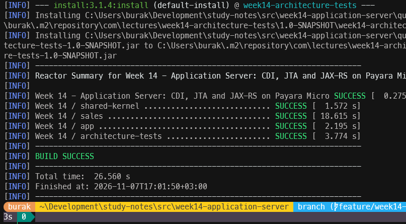

## Transaction Sınırını Senaryoya Taşıma

Hatırlayacağınız üzere daha önce tasarladığımız **JdbcOrderRepository** sınıfının **save** metodu kendi transaction'ını kendisi yönetiyordu. Bağlantıyı alıyor, **setAutoCommit** çağrısı ile otomatik onayı kapatıyor, sipariş başlığını ve satırlarını yazıyor ve her şey yolundaysa **commit**, değilse **rollback** işlemlerini icra ediyordu. Bu yaklaşım tek bir aggregate'i kaydetmek için oldukça yeterliydi. Ancak bu yaklaşımın bazı önemli zaafları da var.

- **Birden fazla yazma işlemi olabilir.** **placeOrder** metodu önce veritabanı sekansından *(sequence)* bir numara alıyor, ardından müşteriyi okuyor ve son olarak da siparişi kaydediyor. Yarın aynı senaryoya bir stok rezervasyonu veya bir outbox kaydı eklemek istediğimizde her repository kendi transaction'ını açıp kapatırsa bu işlemlerin hepsinin bir bütün olarak başarılı ya da başarısız olmasını garanti edemeyiz.
- **Commit kararını yanlış katman veriyor.** Bir işin ne zaman bittiğini bilen yer use case'dir. Repository sadece *"nasıl yazılır"* sorusunun cevabını bilmeli.
- **Uygulama sunucusunda bu kod çalışmaz!** Sunucu tarafındaki bağlantı *(connection)* havuzundan aldığımız bir bağlantı, devam eden bir **JTA transaction**'ına dahil edildiğinde *(enlisted)*, o bağlantı üzerinde **commit**, **rollback** veya **setAutoCommit** çağırmak yasaktır. Transaction'ın sahibi artık bağlantı değil, sunucunun **transaction yöneticisidir** *(Transaction Manager)*. Payara böyle bir çağrıda kuvvetle muhtemel **SQLException** fırlatacaktır.

Bu nedenlerden dolayı transaction yönetimini repository'den alıp kullanım senaryosunu ele aldığımız yere, yani **OrderService** sınıfına taşıyacağız.

### Repository Commit Etmeyi Bırakıyor

Yapmamız gereken tek şey **JdbcOrderRepository** sınıfındaki **save** metodunu aşağıdaki gibi sadeleştirmek.

```java
@Override
public void save(Order order) {
    Objects.requireNonNull(order, "order must not be null");
    try (Connection connection = dataSource.getConnection()) {
        if (writeOrder(connection, UPDATE_ORDER, order) == 0) {
            writeOrder(connection, INSERT_ORDER, order);
        }
        replaceLines(connection, order);
    } catch (SQLException e) {
        throw new RepositoryException("could not save order " + order.orderId(), e);
    }
}
```

SQL cümlelerine ve `update-then-insert` yaklaşımına dokunmadık. Sadece transaction ile ilgili satırlar kalktı. Bu değişikliğe göre test sonuçlarını tekrardan değerlendirelim.

```powershell
mvn -pl sales -am test "-Dtest=JdbcOrderRepositoryTest" "-Dsurefire.failIfNoSpecifiedTests=false"
```

Sözleşme testlerinden **saveIsAtomic**'in kırılması gerekiyor.

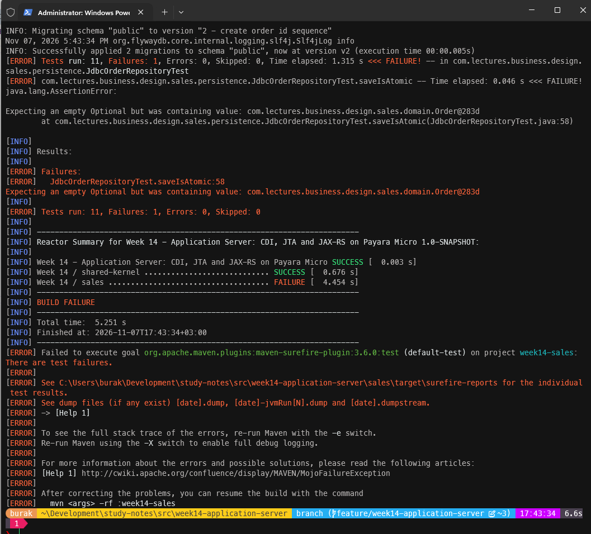

Bu test sipariş satırları tablosuna *"miktar 7 olamaz"* şeklinde sabote edici bir kısıt *(constraint)* ekleyerek kaydı yarıda kesen testti. Testin beklentisi yarım kalan bir kaydın veritabanında hiç iz bırakmamasıydı. Artık repository bir transaction açmadığı için bağlantı varsayılan **auto-commit** modunda çalışıyor. Sipariş başlığı yazılıp hemen onaylanıyor, satır eklenirken hata oluşuyor ve veritabanında satırları olmayan bir sipariş kalıyor. Yani test tam olarak olması gereken şeyi yakaladı. Bir başka deyişle atomiklik garantisi repository'den çıktı repository'yi çağıran tarafın sorumluluğuna bırakıldı.

### Test İçin Küçük Bir Transaction Yöneticisi

Şimdi durup düşünelim. Test tarafında bu garantiyi nasıl sağlayabiliriz? Sunucuda **JTA *(Java Transaction API)***'nın yaptığı şeyi kabaca şöyle özetleyebiliriz. Bir transaction başladığında bağlantı havuzu o thread'e bir fiziksel bağlantı ayırır. Transaction süresince aynı thread üzerinden yapılan her **getConnection** çağrısı bu bağlantıyı paylaşır *(connection sharing)*. Kodun bağlantıyı kapatması *(close)* transaction'ı sonlandırmaz, bunun yerine sadece bağlantıyı havuza iade edilmiş gibi gösterir. Transaction bittiğinde ise transaction yöneticisi **commit** veya **rollback** kararını verir.

Bu davranışı ispat edecek bir kodu test kodunda yazabiliriz. `sales` modülünün test kodlarındaki `persistence` paketine aşağıdaki **LocalTransactions** sınıfını ekleyelim.

```java
package com.lectures.business.design.sales.persistence;

import java.lang.reflect.InvocationTargetException;
import java.lang.reflect.Method;
import java.lang.reflect.Proxy;
import java.sql.Connection;
import java.sql.SQLException;
import java.util.Objects;
import javax.sql.DataSource;

public final class LocalTransactions {

    private final DataSource target;
    private final ThreadLocal<Connection> current = new ThreadLocal<>();

    public LocalTransactions(DataSource target) {
        this.target = Objects.requireNonNull(target, "target must not be null");
    }

    public DataSource dataSource() {
        return proxy(DataSource.class, (method, args) -> {
            Connection bound = current.get();
            if (bound != null && method.getName().equals("getConnection")) {
                return shared(bound);
            }
            return method.invoke(target, args);
        });
    }

    public void inTransaction(Runnable work) {
        Objects.requireNonNull(work, "work must not be null");
        try (Connection connection = target.getConnection()) {
            connection.setAutoCommit(false);
            current.set(connection);
            try {
                work.run();
                connection.commit();
            } catch (RuntimeException e) {
                connection.rollback();
                throw e;
            } finally {
                current.remove();
            }
        } catch (SQLException e) {
            throw new IllegalStateException("the test transaction failed", e);
        }
    }

    private static Connection shared(Connection connection) {
        return proxy(Connection.class, (method, args) -> method.getName().equals("close")
                ? null
                : method.invoke(connection, args));
    }

    @FunctionalInterface
    private interface Handler {

        Object handle(Method method, Object[] args) throws Exception;
    }

    private static <T> T proxy(Class<T> type, Handler handler) {
        return type.cast(Proxy.newProxyInstance(type.getClassLoader(), new Class<?>[]{type},
                (proxy, method, args) -> {
                    try {
                        return handler.handle(method, args);
                    } catch (InvocationTargetException e) {
                        throw e.getCause();
                    }
                }));
    }
}
```

Burada JDK'nın **dinamik proxy** *(`java.lang.reflect.Proxy`)* mekanizmasını kullanıyoruz. **dataSource** metodunun döndürdüğü nesne gerçek bir **DataSource** gibi davranıyor. Ancak bir transaction açıksa **getConnection** çağrılarına hep aynı bağlantıyı veriyor. **shared** metodu ise bağlantının **close** çağrısını tabir yerindeyse yutuyor. **ThreadLocal** kullanımı, transaction'ın thread'e bağlı olmasını sağlıyor. Sunucudaki transaction yöneticisi ise transaction'ı aynı şekilde o anki thread ile ilişkilendiriyor.

> Bu sınıfı üretim kodunda kullanmayacağız! Amacımız, sunucunun yaptığı işi bir kez kendimiz gözlemlemek ve repository'yi testte aynı koşullar altında da çalıştırabilmek. Burada da JTA'nın en temel işini elle yazmış olduk.

Şimdi **JdbcOrderRepositoryTest** sınıfını bu yapıyı kullanacak şekilde düzenleyelim. Önce bir alan ekleyip **createRepository** metodunda veri kaynağını ele alalım.

```java
private DataSource dataSource;
private LocalTransactions transactions;

...

@Override
protected OrderRepository createRepository() {
    transactions = new LocalTransactions(TestDatabases.h2());
    dataSource = transactions.dataSource();
    seedCustomers(dataSource);
    return new JdbcOrderRepository(dataSource);
}
```

Ardından kırılan **saveIsAtomic** testini iki teste ayıralım. Biri transaction içinde atomikliğin korunduğunu, diğeri ise transaction olmadan repository'nin artık atomik olmadığını belgeliyor. Aslında ikinci test bir hata değil, sadece repository'nin yeni sözleşmesini anlatıyor.

```java
@Test
@DisplayName("inside a transaction a failed save leaves no half-written aggregate behind")
void saveIsAtomicInsideATransaction() throws SQLException {
    sabotageQuantitySeven();

    assertThatThrownBy(() -> transactions.inTransaction(() -> repository.save(OrderBuilder.anOrder()
            .withId(10301).forCustomer("VINET").withLine(11, "14.00", 7).build())))
            .isInstanceOf(RepositoryException.class);
    assertThat(repository.findById(OrderId.of(10301))).isEmpty();
    assertThat(repository.count()).isEqualTo(4);
}

@Test
@DisplayName("without a transaction the repository writes statement by statement")
void saveIsNotAtomicOnItsOwn() throws SQLException {
    sabotageQuantitySeven();

    assertThatThrownBy(() -> repository.save(OrderBuilder.anOrder()
            .withId(10302).forCustomer("VINET").withLine(11, "14.00", 7).build()))
            .isInstanceOf(RepositoryException.class);
    assertThat(repository.findById(OrderId.of(10302)))
            .hasValueSatisfying(order -> assertThat(order.lines()).isEmpty());
}

private void sabotageQuantitySeven() throws SQLException {
    try (Connection connection = dataSource.getConnection(); Statement statement = connection.createStatement()) {
        statement.execute("ALTER TABLE order_lines ADD CONSTRAINT ck_sabotage CHECK (quantity <> 7)");
    }
}
```

Testleri tekrar çalıştırdığımızda hepsinin geçmesi gerekir. Sözleşme testlerinin geri kalanı transaction olmadan *(auto-commit modunda)* çalışmaya devam etmelidir. Zira onlar tek bir **SQL** cümlesinin yarıda kalabileceği senaryoları değil verinin doğru yazılıp doğru okunduğunu doğrular.

```powershell
mvc clean install
```

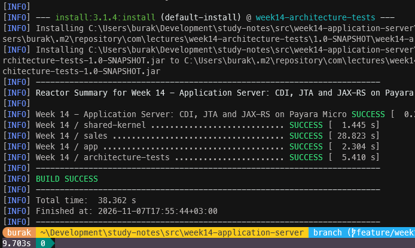

### @Transactional Anotasyonu ile Kullanım Senaryosu = Transaction

Sunucu tarafında bu işi **Jakarta Transactions** *(JTA)* spesifikasyonunun `@Transactional` anotasyonu devralacak. Buunun için **OrderService** sınıfını aşağıdaki gibi işaretlememiz yeterli.

```java
import jakarta.transaction.Transactional;

@ApplicationScoped
@Transactional
public class OrderService implements OrderingFacade {
```

Bu anotasyon bir **interceptor binding**. CDI, **OrderService** için ürettiği alt sınıfa her public metodun etrafını saran bir kod ekler. Metot çağrıldığında önce bir transaction başlatılır. Eğer metot beklendiği gibi normal şekilde dönüş yaparsa commit işlemler commit edilir ve transaction sonlanır, bir **RuntimeException** fırlatırsa **rollback** yapılır. *(Elle yazdığımız **LocalTransactions.inTransaction** metodunun yaptığı iş tam olarak buydu)* Anotasyonu sınıf seviyesinde kullandığımız için tüm kullanım senaryoları aynı kurala tabi oluyor.

Bir **placeOrder** çağrısında neler olduğunu adım adım değerlendirelim.

1. CDI proxy çağrıyı yakalar ve **Transactional** interceptor bir JTA transaction'ı başlatır.
2. **SequenceOrderIdGenerator**, **getConnection** ile havuzdan bir bağlantı alır. Payara bu bağlantıyı transaction'a dahil eder ve **nextval** sorgusu çalışır.
3. **JdbcCustomerRepository** müşteriyi okumak için tekrar **getConnection** çağırır. Aynı transaction içinde olduğumuz için **Payara** aynı fiziksel bağlantıyı taraflara arasında paylaştırır.
4. **JdbcOrderRepository** sipariş başlığını ve satırlarını yine aynı bağlantı üzerinden yazar ve bağlantıyı kapatır. Kapatma işlemi transaction'ı bitirmez.
5. Metot sonucu geri döner. Interceptor transaction'ı commit eder. *(Bir hata oluşmuşsa başlık ve satırların hepsi birlikte geri alınırdı)*

Bu noktada `@Transactional` anotasyonunun hangi hatada ne yaptığını bilmekte de yarar var. Aşağıdaki tabloda bu durumu özetleyelim.

| **Durum** | **Varsayılan davranış** | **Değiştirmek için** |
| --- | --- | --- |
| Metot normal şekilde döner | Commit | - |
| **RuntimeException** *(örneğin bir DomainException veya RepositoryException)* | Rollback, exception aynen fırlatılır | **dontRollbackOn** |
| Checked exception | **Commit**, exception aynen fırlatılır | **rollbackOn** |
| Commit sırasında hata *(örneğin veritabanı kısıtı)* | Rollback, **TransactionalException** fırlatılır | - |

Checked exception'larda commit yapılması ilk bakışta şaşırtıcı gelebilir. Checked exception'lar *"beklenen iş sonuçları"* olarak kabul edilir. Bizim domain exception'larımız **RuntimeException** sınıfından türediği için bu konuda bir sürprizle karşılaşmamamız gerekiyor. Diğer yandan anotasyonun bir de **value** niteliği *(TxType)* var. Varsayılan değeri `REQUIRED`, yani *"bir transaction varsa ona katıl, yoksa yeni bir tane başlat"*. Diğer seçenekler `REQUIRES_NEW`, `MANDATORY`, `SUPPORTS`, `NOT_SUPPORTED` ve `NEVER` şeklinde. *(Bu seçeneklerin hangi senaryolarda kullanıldığını araştıralım)*

Burada dikkat edilmesi gereken bir tuzak da var. Interceptor nesnesi proxy üzerinde çalıştığı için sınıfın kendi içinden yapılan çağrılar *(self-invocation)* interceptor'dan geçmez. Örneğin **confirm** metodu içinden `this.ship(...)` çağrılsaydı **ship** metodunun `@Transactional` ayarları hiç devreye girmezdi. Biz şu an tüm metotları sınıf seviyesinde aynı ayarla çalıştırdığımız ve ortak işi **private** bir metotta *(change)* topladığımız için bu tuzağa düşmüyoruz. Ancak metot bazında farklı **TxType** değerleri kullanmaya başladığımızda bu ayrıntı önem kazanacak *(Bu durumu test edip ispatlamaya çalışalım)*

Payara üzerinde bir JTA transaction'ı başlatıldıktan sonra ondan bağlantı alan veri kaynakları transaction'a otomatik olarak dahil edilir. Bizim `@DataSourceDefinition` ile tanımladığımız havuz XA *(extended architecture)* desteği olmayan sıradan bir **DataSource**. Tek bir veritabanıyla çalıştığımız için bu yeterli. İki farklı veritabanını veya bir veritabanı ile bir mesaj kuyruğunu aynı transaction'a dahil etmek istersek XA sürücülerine ve **iki aşamalı onay** *(two-phase commit)* gibi mekanizmalara da ihtiyaç duyarız. *(Bu kavramı ve neden pek sevilmediğini de bir araştıralım)*

> .NET tarafında bu yaklaşımın en yakın karşılığı **TransactionScope** sınıfıdır. `using var scope = new TransactionScope();` ile açılan bir kapsam içindeki ADO.NET bağlantıları ortam transaction'ına *(ambient transaction)* otomatik olarak dahil olur ve `scope.Complete()` çağrılmazsa her şey geri alınır. Fark, Jakarta EE'de bu kapsamı bir anotasyonla bildirmemiz ve sınırları kodun içine değil metot imzasına yerleştirmemizdir (Hangisi daha endüstriyel olarak tercih edilir tartışalım)

### Sequence Değerleri ve Geri Alma *(Rollback)*

Bir rollback her şeyi geri almaz. **placeOrder** sırasında müşteri bulunamazsa ya da bir sipariş satırı domain kuralını ihlal ederse transaction geri alınır ama `nextval('orders_seq')` ile alınan numara geri gelmez. Veritabanı sekansları performans nedeniyle transaction'lardan bağımsız çalışır. Sonuç olarak sipariş numaralarında boşluklar *(gaps)* oluşabilir. **10250** numaralı siparişten sonra **10253** gelebilir. Bu bir hata değil, sekansların bilinen ve kabul edilen bir özelliği olarak düşünülmelidir. Eğer iş kuralı boşluksuz bir numaralandırma istiyorsa *(örneğin fatura numaraları)* farklı bir çözüm üzerinde düşünmek gerekiyor.

### Henüz Çözmediğimiz Bir Sorun

**OrderService** sınıfındaki **change** metoduna tekrar bakalım.

```java
private OrderSummary change(int orderId, Consumer<Order> action) {
    Order order = orders.getById(OrderId.of(orderId));
    action.accept(order);
    orders.save(order);
    events.publishAll(order.pullEvents());
    return mapper.toSummary(order);
}
```

Olaylar **save** çağrısından sonra yayınlanıyor. Aslında bu sıralamayı bilinçli olarak seçmiştik. Ne var ki artık save çağrısı veritabanına bir şey onaylamıyor. Commit işlemi, metot çağrısından dönüldükten sonra interceptor tarafından yapılıyor. Yani **ShipmentNotificationHandler** müşteriye *"siparişiniz kargolandı"* mesajını gönderdiğinde, sipariş henüz veritabanında kargolanmış görünmüyor. Commit sırasında bir sorun çıkarsa müşteri hiç gerçekleşmemiş bir kargo için bildirim almış olacaktır. Bu sorunu CDI olayları ile çözmeyi deneyeceğiz.

## Sunucu ile İlk Tanışma

Artık elimizde nesneleri **CDI *(Contexts and Dependency Injection)*** ile bağlanan, bağlantısını sunucudan alan, transaction sınırını kullanım senaryosunda çizen ve açılışta kendi şemasını hazırlayan bir **WAR** var. **HTTP** katmanı henüz **JAX-RS**'e taşınmadığı için dışarıya açık bir adresi yok ama uygulamanın sunucuda ayağa kalktığını ve veritabanını hazırladığını pekala görebiliriz.

### Önce Hazırlıklar

Payara Micro tek bir JAR dosyasından ibaret. [Payara indirme sayfasından](https://www.payara.fish/downloads/payara-platform-community-edition/) **Payara Micro 7** sürümünü *(bu notları hazırlarken 7.2026.8 sürümünü kullandık)* indirip bir klasöre koymamız yeterli. Örneklerde bu klasör `C:\payara-micro` olarak geçiyor. Payara 7 en az **Java 21** ister. **PostgreSQL** için kök klasördeki `docker-compose.yml` dosyasını kullanabiliriz.

```powershell
# Repository kök klasöründe
docker compose up -d
```

Uygulamayı çalıştırmak içinse aşağıdaki terminal komutları ile ilerleyebiliriz.

```powershell
cd src\week14-application-server
mvn clean install
java -jar C:\payara-micro\payara-micro-7.2026.8.jar --nocluster --systemProperties payara\local.properties --deploy app\target\sales.war
```

Parametrelere de kısaca değinelim.

| **Parametre** | **Ne işe yarar?** |
| --- | --- |
| `--deploy app\target\sales.war` | Açılışta yüklenecek uygulama. Context root, arşivin adından gelir *(`/sales`)*. |
| `--systemProperties payara\local.properties` | Dosyadaki satırları sistem özelliği olarak yükler. `${MPCONFIG=...}` ifadeleri bu değerlerle çözümlenir. |
| `--nocluster` | Payara Micro varsayılan olarak ağdaki diğer Payara Micro örneklerini bulup onlarla bir küme *(cluster)* oluşturmaya çalışır. Tek başına çalışan bir geliştirme ortamında buna ihtiyacımız yok. |
| `--port 8080` | HTTP portu. Varsayılan değer zaten 8080 olduğu için yazmadık. |

Her şey yolunda giderse aşağıdakine benzer bir ekran görüntüsü görmeliyiz.

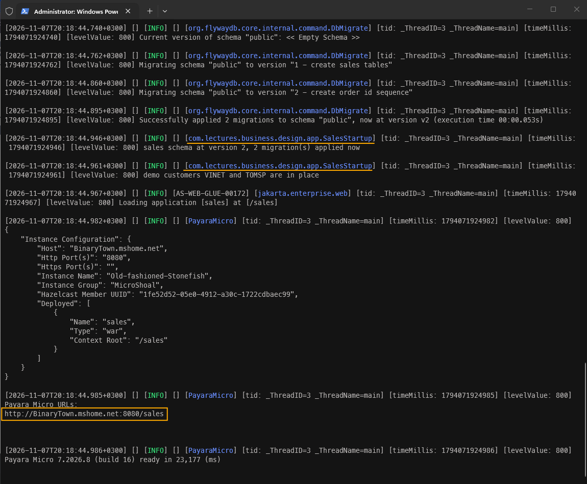

Teyit için şunları da göz önünde bulunduralım.

- **SalesStartup** loglarını görüyorsak CDI **Startup** olayını yayınlamış, **SalesStartup** nesnesini oluşturmuş ve constructor'ına bir **DataSource**, bir **CustomerRepository** ve bir **boolean** konfigurasyon değeri enjekte etmiş demektir.
- Flyway veritabanına bağlanabildiyse `@DataSourceDefinition` içindeki `${MPCONFIG=...}` ifadeleri **local.properties** dosyasındaki değerlerle çözümlenmiş ve bağlantı havuzu, **WAR**'ın içindeki **PostgreSQL** sürücüsünü bulabilmiş demektir.
- Demo müşteriler eklendiyse `sales.demo-data` anahtarı için sistem özelliği *(400)*, WAR'daki `false` değerini *(100)* ezmiş demektir.

> Uygulamayı **Ctrl+C** ile durdurup aynı komutla tekrar başlattığımızda, Flyway yeni bir migration çalıştırmamalı ve **JdbcCustomerRepository** `update-then-insert` yaklaşımı sayesinde demo müşteriler hata vermeden tekrar kayıt edilebilmelidir.

Veritabanının durumunu konteyner içindeki `psql` aracıyla da kontrol edebiliriz. Örnek olarak aşağıdaki terminal komutları denenebilir.

```powershell
docker exec -it java-study-notes-postgres psql -U johndoe -d postgres -c "SELECT version, description, success FROM flyway_schema_history"
docker exec -it java-study-notes-postgres psql -U johndoe -d postgres -c "SELECT customer_id, company_name FROM customers"
```

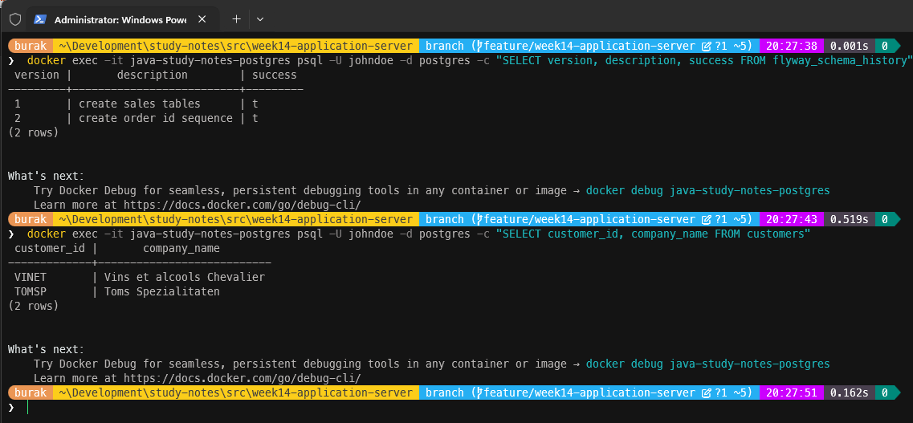

### Veritabanı Yoksa Ne Olur?

Bir de olumsuz senaryoyu deneyelim. PostgreSQL konteynerini durdurup *(`docker compose stop`)* uygulamayı tekrar başlatalım.

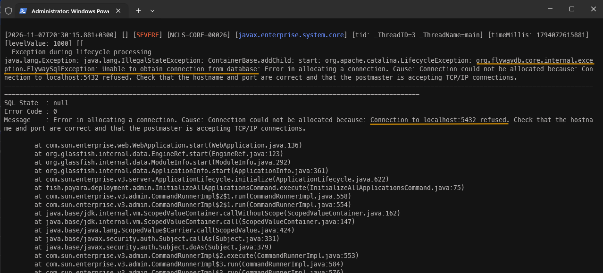

Uygulama hiç açılmamalıdır ki bu istediğimiz bir tepkidir *(fail fast)*. Migration çalışamadıysa şemanın hangi durumda olduğunu bilemeyiz ve istek kabul etmeye başlayan bir uygulama ilk siparişte çok daha anlaşılmaz bir hatayla karşılaşır. Sorunu açılışta, açık bir mesajla görmek her zaman daha iyidir. Konteyneri tekrar başlatıp *(`docker compose start`)* devam edebiliriz.

Tarayıcıdan `http://localhost:8080/sales` adresine gidersek bir **404** sayfası görürüz. Uygulama ayakta ama henüz hiçbir HTTP kaynağı yok. Bunu yapmadan önce domain olaylarını CDI tarafına taşıyacağız.

## Domain Olaylarını CDI'a Devretmek

Aggregate'lerin kaydettiği olayları *(domain events)* yayınlamak için **InProcessEventPublisher** sınıfını yazmıştık. Bu sınıf bir abonelik listesi tutuyor, her olayı listedeki aboneler arasında tipine göre dolaştırıyor ve uygun olanlara iletiyordu. Abonelikleri ise önce **SalesModule**, son olarak da **SalesWiring** içindeki bir producer metodu tek tek kuruyordu. **CDI** bu işin tamamını zaten yapabiliyor. Olayların commit'ten önce dağıtılması sorununa da bir çözüm olarak kullanabiliriz.

### Yayıncı: `Event<T>`

**OrderService** sınıfı olayları **DomainEventPublisher** arayüzü üzerinden yayınlıyor. Bu arayüzü değiştirmeyeceğiz. Sadece CDI'ın olay mekanizmasını kullanan yeni bir implementasyon yazacağız. Bunun için `sales` modülündeki `application` paketine aşağıdaki **CdiDomainEventPublisher** sınıfını ekleyelim.

```java
package com.lectures.business.design.sales.application;

import com.lectures.business.design.shared.kernel.DomainEvent;
import jakarta.enterprise.context.Dependent;
import jakarta.enterprise.event.Event;
import jakarta.inject.Inject;
import java.util.Objects;

@Dependent
public final class CdiDomainEventPublisher implements DomainEventPublisher {

    private final Event<DomainEvent> events;

    @Inject
    public CdiDomainEventPublisher(Event<DomainEvent> events) {
        this.events = Objects.requireNonNull(events, "events must not be null");
    }

    @Override
    public void publish(DomainEvent event) {
        events.fire(Objects.requireNonNull(event, "event must not be null"));
    }
}
```

`Event<DomainEvent>` tipindeki nesneyi CDI'ın kendisi sağlıyor. **fire** metodu çağrıldığında CDI, olay nesnesinin çalışma zamanındaki tipine *(runtime type)* bakar ve o tipi veya üst tiplerinden birini gözlemleyen tüm metotları bulup çağırır. *(**InProcessEventPublisher** sınıfındaki `type.isInstance(event)` kontrolüyle yapılan işin aynısı)*

Pek tabii **OrderService** içine doğrudan bir `Event<DomainEvent>` enjekte edip arayüzden kurtulmayı da düşünebilirdik. Fakat bu durumda **OrderService** birim testleri CDI'a bağımlı kalırdı. **DomainEventPublisher** arayüzü burada bir çıkış portu *(outgoing port)* görevi görmekte. Sunucuda CDI ile, testlerde ise basit bir lambda operatörü ya da bir liste ile çalışabiliyoruz. Böylece **OrderService** sınıfında tek bir satır bile değiştirmemize gerek kalmadı.

**InProcessEventPublisher** artık üretim kodunda kullanılmıyor. Ancak **OrderServiceEventsTest** sınıfı onu kullanarak olayların doğru sırayla ve bir kez yayınlandığını doğruluyor. Bu yüzden sınıfı silmek yerine test kodlarına taşımak çok daha mantıklı olacaktır. Paket adı aynı kaldığı için hiçbir test sınıfında değişiklik gerekmiyor.

```powershell
cd src\week14-application-server\sales\src
git mv main/java/com/lectures/business/design/sales/application/InProcessEventPublisher.java test/java/com/lectures/business/design/sales/application/InProcessEventPublisher.java
```

> Daha önceden yazdığımız bir üretim sınıfının bir test aracına *(test double)* dönüşmesi oldukça doğal. Framework'ün işini elle yazdığımız kodlar çoğu zaman testlerde yaşamaya devam edebilir. Bir önceki adımda yazdığımız **LocalTransactions** da aynı türden bir sınıftı.

### Gözlemciler ve `@Observes` Anotasyonu

Abonelikleri artık kimse elle hazırlamıyor. Herhangi bir olayla ilgilenen bir sınıfın bunu kendisinin söylediği bir mekanizma var. Buna göre `application` paketindeki **ShipmentNotificationHandler** sınıfını aşağıdaki gibi düzenleyelim.

```java
package com.lectures.business.design.sales.application;

import com.lectures.business.design.sales.domain.OrderShipped;
import jakarta.enterprise.context.Dependent;
import jakarta.enterprise.event.Observes;
import jakarta.enterprise.event.TransactionPhase;
import jakarta.inject.Inject;
import java.util.Objects;
import java.util.function.Consumer;

@Dependent
public final class ShipmentNotificationHandler implements Consumer<OrderShipped> {

    private final CustomerNotifier notifier;

    @Inject
    public ShipmentNotificationHandler(CustomerNotifier notifier) {
        this.notifier = Objects.requireNonNull(notifier, "notifier must not be null");
    }

    @Override
    public void accept(@Observes(during = TransactionPhase.AFTER_SUCCESS) OrderShipped event) {
        notifier.notify(event.customerId().value(),
                "Order " + event.orderId() + " shipped on " + event.shippedDate()
                + " to " + event.destination().city());
    }
}
```

Sınıf hala `Consumer<OrderShipped>` arayüzünü uyguluyor ve testlerde `new ShipmentNotificationHandler()` ile kullanılabiliyor. Değişen tek şey **accept** metodunun parametresine eklediğimiz `@Observes` anotasyonu. Bu anotasyon ilgili metodu gözlemci metoda *(observer method)* dönüştürüyor. Parametrenin tipi *(OrderShipped)* ise hangi olayların bu metoda geleceğini belirliyor. Asıl önemli kısım **during** niteliği.

### Bir Olay Ne Zaman Dağıtıma Çıkmalı?

Bir önceki adımın sonunda şöyle bir sorun tespit etmiştik. **OrderService** olayları `save` çağrısından sonra yayınlıyor ama commit, metot döndükten sonra interceptor tarafından yapılıyor. Yani gözlemciler veritabanında henüz onaylanmamış bir değişiklik için çalışıyor. **CDI**, bir gözlemcinin transaction akışının hangi anında çağrılacağını belirlememize olanak tanır. Bunu aşağıdaki tablo ile özetleyebiliriz.

| **TransactionPhase** | **Gözlemci ne zaman çağrılır?** |
| --- | --- |
| `IN_PROGRESS` *(varsayılan)* | Hemen, yani **fire** çağrısı sırasında. Transaction henüz devam ediyor. |
| `BEFORE_COMPLETION` | Commit'ten hemen önce. Gözlemci hala transaction'ın içinde ve onu geri aldırabilir. |
| `AFTER_COMPLETION` | Transaction bittikten sonra, sonuç ne olursa olsun. |
| `AFTER_SUCCESS` | Sadece transaction başarıyla commit edildiyse. |
| `AFTER_FAILURE` | Sadece transaction geri alındıysa. |

Müşteriye *"siparişiniz kargolandı"* demek, veritabanının bu bilgiyi kalıcı olarak kaydettiğinden emin olduktan sonra yapılması gereken bir iştir. Bu nedenle `AFTER_SUCCESS` seçeneğini kullanıyoruz. Transaction geri alınırsa gözlemci hiç çağrılmaz ve müşteri gerçekleşmemiş bir kargo için bildirim de almaz. Kullandığımız bu davranışın birkaç önemli sonucu da var.

- Birim testlerimizde ortada bir JTA transaction'ı olmadığı için `AFTER_SUCCESS` gözlemcisi **fire** çağrısı sırasında çalışır. Bu sayede testlerimiz hiçbir değişiklik olmadan geçmeye devam ediyor.
- `AFTER_SUCCESS` aşamasında commit çoktan yapılmıştır. Gözlemcide bir **exception** oluşursa **CDI** bunu loglar ama siparişin kargolanması geri alınmaz. Bu doğru bir davranıştır. Örneğin bir e-posta sunucusunun yavaş olması siparişin kargolanmasını engellememelidir.
- Commit sonrasında gözlemci veritabanına bir şey yazmak isterse yeni bir transaction'a ihtiyaç duyar *(örneğin `@Transactional(TxType.REQUIRES_NEW)` ile işaretlenmiş bir metot üzerinden)*.
- Commit başarılı olduktan hemen sonra, gözlemci çalışamadan sunucu çökerse bildirim hiç gönderilmez. Bu boşluğu kapatmak için olayı siparişle aynı transaction içinde bir tabloya yazıp *(outbox)* daha sonra ayrı bir süreçle göndermek düşünülebilir. *(Transactional Outbox deseni ayrıca tartışılması gereken bir konu)*

**OrderActivityLog** sınıfı da bir gözlemciye dönüşüyor. Normalde kayıtları bellekteki bir listede tutuyordu. Ancak bir sunucuda sonsuza kadar büyüyen bir liste tam anlamıyla bir bellek sızıntısıdır. Bu yüzden kayıtları sunucu loguna yazmak çok daha akılcı olacak. Dolayısıyla **OrderActivityLog** sınıfını aşağıdaki hale getirerek devam edelim.

```java
package com.lectures.business.design.sales.application;

import com.lectures.business.design.sales.domain.OrderCancelled;
import com.lectures.business.design.sales.domain.OrderConfirmed;
import com.lectures.business.design.sales.domain.OrderEvent;
import com.lectures.business.design.sales.domain.OrderShipped;
import jakarta.enterprise.context.Dependent;
import jakarta.enterprise.event.Observes;
import jakarta.enterprise.event.TransactionPhase;

@Dependent
public final class OrderActivityLog {

    private static final System.Logger LOG = System.getLogger(OrderActivityLog.class.getName());

    void record(@Observes(during = TransactionPhase.AFTER_SUCCESS) OrderEvent event) {
        LOG.log(System.Logger.Level.INFO, describe(event));
    }

    static String describe(OrderEvent event) {
        return switch (event) {
            case OrderConfirmed confirmed ->
                confirmed.orderId() + " confirmed, total " + confirmed.total();
            case OrderShipped shipped ->
                shipped.orderId() + " shipped on " + shipped.shippedDate();
            case OrderCancelled cancelled ->
                cancelled.orderId() + " cancelled while " + cancelled.previousStatus();
        };
    }
}
```

**record** metodu **OrderEvent** nesnesini gözlemler. **OrderEvent** bir arayüz tasarımıdır. **OrderConfirmed**, **OrderShipped**, **OrderCancelled** record'ları bu arayüzü uygular. CDI bir **OrderShipped** olayını hem **ShipmentNotificationHandler** hem de **OrderActivityLog** gözlemcisine iletebilir. Gözlemci metotların **public** olması gerekmez. Onları CDI çağırır ve başka bir sınıfın çağırması da beklenmez. Bu nedenle **record** metodunu **package-private** işaretleyerek bıraktık. **entries** metodu ortadan kalktığı için **OrderActivityLogTest** sınıfında da  düzeneleme yapmalıyız. Buradaki **describesEachEvent** metodunu aşağıdaki gibi yazabiliriz.

```java
@Test
@DisplayName("the log describes every kind of order event")
void describesEachEvent() {
    assertThat(OrderActivityLog.describe(
            new OrderConfirmed(OrderId.of(10248), CustomerId.of("VINET"), Money.tl("140.00"))))
            .isEqualTo("10248 confirmed, total 140.00 TRY");
    assertThat(OrderActivityLog.describe(
            new OrderCancelled(OrderId.of(10248), CustomerId.of("VINET"), OrderStatus.CONFIRMED)))
            .isEqualTo("10248 cancelled while CONFIRMED");
}
```

### SalesWiring Biraz Daha Küçülüyor

Yapılan bu değişiklilere göre **SalesWiring** sınıfında da iyileştirmeye gitmeliyiz. Örneğin abonelikleri hazırlayan producer metoduna artık ihtiyacımız kalmadı. Benzer şekilde **eventPublisher** metodunu ve gereksiz import bildilrimlerini de kaldırabiliriz. Buna göre `app` modülündeki **SalesWiring** sınıfının son hali aşağıdaki gibi olmalıdır.

```java
@DataSourceDefinition(
        name = "java:app/jdbc/sales",
        className = "org.postgresql.ds.PGSimpleDataSource",
        url = "${MPCONFIG=sales.datasource.url}",
        user = "${MPCONFIG=sales.datasource.user}",
        password = "${MPCONFIG=sales.datasource.password}",
        minPoolSize = 2,
        maxPoolSize = 10)
@ApplicationScoped
public class SalesWiring {

    @Produces
    @Resource(lookup = "java:app/jdbc/sales")
    private DataSource dataSource;

    @Produces
    Clock clock() {
        return Clock.systemUTC();
    }

    @Produces
    OrderFactory orderFactory(OrderIdGenerator ids, Clock clock) {
        return new OrderFactory(ids, clock);
    }
}
```

Composition root'tan geriye sadece üç karar kaldı. Hangi veritabanına bağlanılacağı, hangi zaman nesnesinin kullanılacağı ve domain'deki fabrikanın nasıl oluşturulacağı. **OrderService** artık bir **DomainEventPublisher** istediğinde CDI tek aday olan **CdiDomainEventPublisher** nesnesini verecektir.

> .NET dünyasında bu yaklaşımın en bilinen karşılığı **MediatR** kütüphanesinin **INotification** ve `**INotificationHandler<T>` yapılarıdır. Entity Framework Core kullanan projelerde domain olaylarını **SaveChanges** sonrasında dağıtmak da yaygın bir alışkanlıktır ve `AFTER_SUCCESS` ile aynı amaca hizmet eder.

Testleri çalıştırıp her şeyin yolunda olduğundan emin olmakta yarar var.

```powershell
cd src\week14-application-server
mvn clean install
```

### Commit ve Rollback'i Sunucuda Görmek

`AFTER_SUCCESS` davranışını birim testlerle doğrulamak mümkün değil zira orada bir **JTA transaction** yok. Henüz bir **HTTP** katmanımız da olmadığı için sunucuya istek de gönderemiyoruz. Bu nedenle `app` modülüne açılışta çalışan küçük bir deneme sınıfı ekleyip sonucu loglar üzerinden izleyebiliriz. Bu iki sınıfı sadece deneme amaçlı ve geçici olarak kullanacağız, denemeden sonra silmekte yarar var. 

Önce **EventProbeTx** sınıfı;

```java
package com.lectures.business.design.app;

import com.lectures.business.design.sales.api.OrderingFacade;
import jakarta.enterprise.context.ApplicationScoped;
import jakarta.inject.Inject;
import jakarta.transaction.Transactional;

@ApplicationScoped
public class EventProbeTx {

    @Inject
    OrderingFacade orders;

    @Transactional
    public void shipThenFail(int orderId) {
        orders.ship(orderId);
        throw new IllegalStateException("rolled back after ship");
    }
}
```

ve şimdi de **EventProbe** sınıfını ekleyelim;

```java
package com.lectures.business.design.app;

import com.lectures.business.design.sales.api.OrderLineRequest;
import com.lectures.business.design.sales.api.OrderingFacade;
import com.lectures.business.design.sales.api.PlaceOrderCommand;
import jakarta.annotation.Priority;
import jakarta.enterprise.context.ApplicationScoped;
import jakarta.enterprise.event.Observes;
import jakarta.enterprise.event.Startup;
import jakarta.inject.Inject;
import java.util.List;

@ApplicationScoped
public class EventProbe {

    private static final System.Logger LOG = System.getLogger("probe");

    @Inject
    OrderingFacade orders;
    @Inject
    EventProbeTx tx;

    void run(@Observes @Priority(3000) Startup startup) {
        int shipped = orders.placeOrder(new PlaceOrderCommand("VINET",
                List.of(OrderLineRequest.of(11, "14.00", 10)))).orderId();
        orders.confirm(shipped);
        LOG.log(System.Logger.Level.INFO, "probe: shipping " + shipped);
        orders.ship(shipped);
        LOG.log(System.Logger.Level.INFO, "probe: " + shipped + " is " + orders.getOrder(shipped).status());

        int rolledBack = orders.placeOrder(new PlaceOrderCommand("TOMSP",
                List.of(OrderLineRequest.of(42, "9.80", 3)))).orderId();
        orders.confirm(rolledBack);
        try {
            tx.shipThenFail(rolledBack);
        } catch (RuntimeException e) {
            LOG.log(System.Logger.Level.INFO, "probe: caught " + e.getMessage());
        }
        LOG.log(System.Logger.Level.INFO, "probe: " + rolledBack + " is " + orders.getOrder(rolledBack).status());
    }
}
```

**EventProbeTx** sınıfındaki **shipThenFail** metodu bir transaction başlatıyor. İçinden çağrılan **ship** metodu `TxType.REQUIRED` türünden olduğu için yeni bir transaction açmak yerine mevcut olana katılıyor. Sipariş kargolanıyor, **OrderShipped** olayı yayınlanıyor ve ardından bir **exception** nesnesi fırlatılıyor. Bu exception tüm transaction'ı geri aldırıyor. Uygulamayı derleyip **Payara Micro** ile başlattığımızda loglarda bazı ipuçlarını görmemiz gerekiyor.

```powershell
cd src\week14-application-server
mvn clean install
java -jar C:\payara-micro\payara-micro-7.2026.8.jar --nocluster --systemProperties payara\local.properties --deploy app\target\sales.war
```

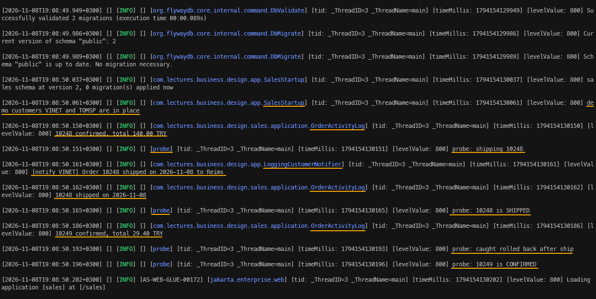

İlk sipariş için bildirim ve aktivite kaydı **ship** çağrısı tamamlandıktan, yani commit edildikten sonra yazılıyor. İkinci siparişte ise **OrderShipped** olayı yayınlandığı halde ne müşteri bildirimi ne de *"10249 shipped"* kaydı var. Sipariş veritabanında **CONFIRMED** durumunda kalmış. Gözlemciler `IN_PROGRESS` aşamasında çalışsaydı müşteri gerçekleşmemiş bir kargo için bildirim almış olacaktı *(Bunu da deneyip görelim)*.

> Sipariş numaraları sizin denemenizde farklı olabilir. Önceki çalıştırmalardan kalan siparişler ve geri alınan transaction'larda oluşan sequence değerleri de bu farkı yaratır.

Denemeden sonra iki sınıfı silmeyi unutmayalım.

```powershell
cd src\week14-application-server\app\src\main\java\com\lectures\business\design\app
Remove-Item EventProbe.java, EventProbeTx.java
```

## HTTP Katmanını JAX-RS'e Taşımak

**OrderResource**, **JsonCodec**, **RequestValidator** ve **ProblemMapper** sınıfları **Payara** gibi bir uygulama sunucusunda ele alındıklarında hangileri JAX-RS bileşeni olarak yaşamaya devam eder, hangileri ortadan kalkar? Aşağıdaki tabloda bu soruyu cevaplıyoruz.

| **Sınıf** | **Aksiyon?** | **Yerini ne alıyor?** |
| --- | --- | --- |
| **SalesHttpServer** | Siliniyor | Payara Micro ve `@ApplicationPath` |
| **JsonCodec** | Siliniyor | JSON-B *(Yasson)* ve küçük bir **JsonbConfiguration** sınıfı |
| **RequestValidator** | Siliniyor | Parametre üzerindeki `@Valid` |
| **MethodNotAllowed** | Siliniyor | JAX-RS runtime'ı HTTP 405 yanıtını kendisi üretir |
| **OrderResource** | Yeniden yazılıyor | `@Path`, `@GET`, `@POST` anotasyonları |
| **ProblemMapper** | Yaşamaya devam ediyor | İki küçük `ExceptionMapper` sınıfı onu kullanıyor |
| **ProblemDetail** | Yaşamaya devam ediyor | Jackson anotasyonu yerine JSON-B anotasyonu |
| **PlaceOrderRequest** | Yaşamaya devam ediyor | Expression Language geldiği için özel hata mesajları gereksiz |

Altyapıyla ilgili sınıfları ortadan kaldırıyoruz ve iş kararı veren *(hangi hatanın hangi duruma karşılık geldiği, istek gövdesinin biçimi)* sınıfları ise bırakıyoruz.

### Silinenler ve Bağımlılıklar

Önce artık ihtiyacımız olmayan sınıfları ve onların testini silelim. Şu aşamada aşağıdaki powershell komutunu kullanabiliriz.

```powershell
cd src\week14-application-server\sales\src
git rm main/java/com/lectures/business/design/sales/rest/JsonCodec.java `
       main/java/com/lectures/business/design/sales/rest/MethodNotAllowed.java `
       main/java/com/lectures/business/design/sales/rest/RequestValidator.java `
       main/java/com/lectures/business/design/sales/rest/SalesHttpServer.java `
       test/java/com/lectures/business/design/sales/rest/SalesHttpServerTest.java
```

Bu temizlik işlemleri ardından `sales` modülünün `pom.xml` dosyasından **Jackson** ve **Hibernate Validator** bağımlılıklarını kaldıralım. Bean Validation API'si *(`jakarta.validation`)*, JAX-RS API'si *(`jakarta.ws.rs`)* ve JSON-B API'si *(`jakarta.json.bind`)* zaten `jakarta.jakartaee-web-api` bağımlılığının içinde geliyor. Implementasyonlarını ise Payara ortamı sağlamakta. Ana `pom.xml` dosyasındaki `jackson.version` ve `hibernate-validator.version` özelliklerini ve onlara ait `dependencyManagement` kayıtlarını da silebiliriz.

Bu çalışma kapsamında kullandığımız **Payara Micro 7.2026.8** sürümü içinde gelen implementasyonlara bir göz atmakta yarar var. Bunları Payara Micro JAR dosyasının `MICRO-INF/runtime` klasöründe görebiliriz. **Apache NetBeans** ile **jar** dosyasını açmamız yeterlidir.

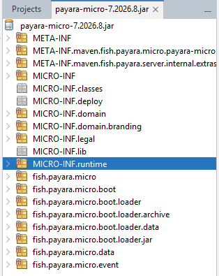

Şimdi sales WAR dosyası içerisine tekrardan bakalım.

```powershell
mvn clean install
tar -tf app\target\sales.war
```

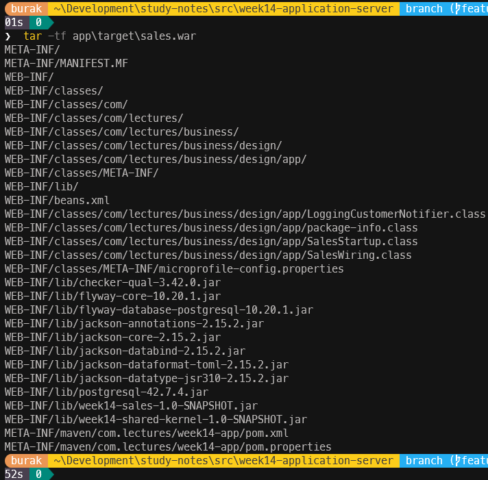

**Hibernate Validator** ve `jakarta.validation-api` JAR'ları kalkmış olmalı. Ancak dikkat edileceği üzere **Jackson** hala orada *(`jackson-databind`, `jackson-core`, `jackson-dataformat-toml`)* duruyor. Bunun sebebi `flyway-core` kütüphanesi. Flyway 10, TOML formatındaki yapılandırma dosyalarını okumak için Jackson'a bağımlı. Jackson'ı daha öncesinde biz eklediğimiz için `2.21.5` sürümü kullanılıyordu ve şimdi Flyway'in istediği `2.15.2` sürümü geliyor. Bizim kodumuz artık Jackson'ı kullanmıyor ve Jersey, JSON dönüşümleri için JSON-B'yi tercih ediyor. Bir bağımlılığın kimden geldiğini öğrenmek için Maven'in **dependency:tree** argümanı aşağıdaki gibi kullanılabilir.

```powershell
mvn -pl app dependency:tree "-Dincludes=com.fasterxml.jackson.core"
```

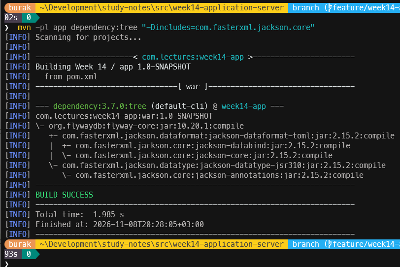

### JAX-RS Uygulamasını Açmak

`JAX-RS`'in bir WAR içinde devreye girmesi için **Application** sınıfından türeyen ve `@ApplicationPath` anotasyonu ile işaretlenmiş bir sınıf yeterli. Bu amaçla `rest` paketine aşağıdaki sınıfı ekleyelim.

```java
package com.lectures.business.design.sales.rest;

import jakarta.ws.rs.ApplicationPath;
import jakarta.ws.rs.core.Application;
import java.util.Map;
import java.util.Set;

@ApplicationPath("api")
public class SalesRestApplication extends Application {

    @Override
    public Set<Class<?>> getClasses() {
        return Set.of(OrderResource.class, FailureMapper.class, ConstraintViolationMapper.class,
                JsonbConfiguration.class);
    }

    // Jersey would describe the API as WADL (an XML format nobody consumes any
    // more) at /api/application.wadl; MicroProfile OpenAPI is the modern answer.
    @Override
    public Map<String, Object> getProperties() {
        return Map.of("jersey.config.server.wadl.disableWadl", true);
    }
}
```

**getClasses** metodunu ezmesek `JAX-RS` çalışma zamanı arşivdeki tüm `@Path` ve `@Provider` ile işaretlenmiş sınıfları kendisi bulurdu. Sınıfları açıkça listelemeyi iki nedenle tercih ediyoruz. Birincisi uygulamanın neyi yayınladığı tek bakışta görülebiliyor. İkincisi sonradan ekleyeceğimiz birim testler bu listeyi kullanarak sunucudakiyle birebir aynı uygulamayı ayağa kaldırabilecek. Böylece API'nin adresi `http://localhost:8080/sales/api/orders` olacak *(`/sales` context root'tan, `/api` bu anotasyondan, `/orders` ise kaynağın kendisinden geliyor)*

### Kaynak: OrderResource

`OrderResource` sınıfının içeriğini tamamen aşağıdaki kodla değiştirelim.

```java
package com.lectures.business.design.sales.rest;

import com.lectures.business.design.sales.api.OrderSummary;
import com.lectures.business.design.sales.api.OrderingFacade;
import jakarta.enterprise.context.ApplicationScoped;
import jakarta.inject.Inject;
import jakarta.validation.Valid;
import jakarta.validation.constraints.NotNull;
import jakarta.ws.rs.Consumes;
import jakarta.ws.rs.GET;
import jakarta.ws.rs.POST;
import jakarta.ws.rs.Path;
import jakarta.ws.rs.PathParam;
import jakarta.ws.rs.Produces;
import jakarta.ws.rs.core.Context;
import jakarta.ws.rs.core.MediaType;
import jakarta.ws.rs.core.Response;
import jakarta.ws.rs.core.UriInfo;
import java.net.URI;
import java.util.Objects;

@Path("orders")
@Produces(MediaType.APPLICATION_JSON)
@ApplicationScoped
public class OrderResource {

    private final OrderingFacade orders;

    protected OrderResource() {
        this.orders = null;
    }

    @Inject
    public OrderResource(OrderingFacade orders) {
        this.orders = Objects.requireNonNull(orders, "orders must not be null");
    }

    @POST
    @Consumes(MediaType.APPLICATION_JSON)
    public Response place(@NotNull @Valid PlaceOrderRequest request, @Context UriInfo uri) {
        OrderSummary placed = orders.placeOrder(request.toCommand());
        URI location = uri.getAbsolutePathBuilder().path(String.valueOf(placed.orderId())).build();
        return Response.created(location).entity(placed).build();
    }

    @GET
    @Path("{id: \\d+}")
    public OrderSummary get(@PathParam("id") int id) {
        return orders.getOrder(id);
    }

    @POST
    @Path("{id: \\d+}/confirm")
    public OrderSummary confirm(@PathParam("id") int id) {
        return orders.confirm(id);
    }

    @POST
    @Path("{id: \\d+}/ship")
    public OrderSummary ship(@PathParam("id") int id) {
        return orders.ship(id);
    }

    @POST
    @Path("{id: \\d+}/cancel")
    public OrderSummary cancel(@PathParam("id") int id) {
        return orders.cancel(id);
    }
}
```

Yaptığımız önemli değişiklikler var. Bunları kısaca değerlendirelim.

- **Routing:** Üç regex ifadesi *(COLLECTION, ITEM, ACTION)* ve `if-else` zinciri yerine her metodun üzerinde bir `@Path` ve bir **HTTP** metodu anotasyonu var. `{id: \\d+}` ifadesi, adresin yol parametresinin sadece rakamlardan oluşabileceğini söylüyor. Buna göre `/orders/abc` gibi bir adres hiçbir metotla eşleşmiyor ve HTTP 404 dönüyor. Yani regex ifadelerini halen kullanıyoruz ama artık yönlendirmeyi çalışma zamanı yapıyor.
- **HTTP metodu kontrolü:** **requireMethod** metoduna ve **MethodNotAllowed** sınıfına artık gerek yok. `/orders/10248/ship` adresine **GET** ile gelen bir istek için **Jersey**, adresin var olduğunu ama GET'i desteklemediğini kendisi anlıyor ve `Allow: POST, OPTIONS` başlığıyla bir HTTP 405 yanıtı hazırlıyor.
- **Doğrulama:** `@Valid` anotasyonu, Jersey'e talep ile gelen gövdeyi *(body)* metodu çağırmadan önce Bean Validation ile doğrulamasını söylüyor. `@NotNull` ise gövdenin tamamen boş *(`null`)* olarak gelmesini engelliyor. Normalde bunu **RequestValidator.validate** metodunun ilk satırında kendi yazdığımız kodlarla kontrol ediyorduk.
- **JSON dönüşümü:** Ne gövdeyi okumak ne de yanıtı yazmak için bir kod parçası var. `@Consumes` ve `@Produces` anotasyonları medya tipini belirtiyor ve dönüşüm işini `JSON-B` yapıyor.
- **Location başlığı:** **UriInfo** nesnesi isteğin tam adresini bilir. **getAbsolutePathBuilder** metodu ile `http://localhost:8080/sales/api/orders/10248` gibi mutlak bir adres üretiliyor.
- **CDI:** Kaynak da bir CDI bean'i ve **OrderingFacade** arayüzünü constructor üzerinden alıyor. **OrderService** gibi `@ApplicationScoped` tanımlandığından proxy'nin ihtiyaç duyduğu parametresiz constructor'ı da ekledik. Kaynak herhangi bir state bilgisi tutmadığı için tek bir örneğin tüm isteklere hizmet etmesinde sakınca yok.

### JSON-B Yapılandırması

Önceden **JsonCodec** sınıfında Jackson için dört ayar yapmıştık. `JSON-B`'de bunların üçü varsayılan davranış. Tarihler zaten `ISO-8601` biçiminde yazılıyor, **BigDecimal** değerleri bilimsel gösterime çevrilmiyor ve `java.time` tipleri ek bir modül gerektirmiyor. Sadece bilinmeyen alanlar için katı davranmasını söylememiz yeterli olacak. Bunu sağlamak için `rest` paketine aşağıda kodları görülen JsonBConfiguration sınıfı ekleyelim.

```java
package com.lectures.business.design.sales.rest;

import jakarta.json.bind.Jsonb;
import jakarta.json.bind.JsonbBuilder;
import jakarta.json.bind.JsonbConfig;
import jakarta.ws.rs.ext.ContextResolver;
import jakarta.ws.rs.ext.Provider;

@Provider
public final class JsonbConfiguration implements ContextResolver<Jsonb> {

    private static final String FAIL_ON_UNKNOWN_PROPERTIES = "jsonb.fail-on-unknown-properties";

    private final Jsonb jsonb = JsonbBuilder.create(new JsonbConfig()
            .setProperty(FAIL_ON_UNKNOWN_PROPERTIES, true));

    @Override
    public Jsonb getContext(Class<?> type) {
        return jsonb;
    }
}
```

**ContextResolver**, `JAX-RS` bir bileşene ihtiyaç duyduğunda *"bunun özel bir yapılandırması var mı?"* diye sorduğu bir uzantı noktası. Jersey JSON dönüşümü yapacağı zaman bu sınıftan bir **Jsonb** nesnesi istiyor.

**ProblemDetail** record'unda da küçük bir değişiklik yapacağız. Jackson'ın `@JsonInclude` anotasyonu yerine `JSON-B`'nin `@JsonbPropertyOrder` anotasyonunu kullanacağız.

```java
package com.lectures.business.design.sales.rest;

import jakarta.json.bind.annotation.JsonbPropertyOrder;
import java.util.List;

@JsonbPropertyOrder({"type", "title", "status", "detail", "instance", "code", "errors"})
public record ProblemDetail(
        String type,
        String title,
        int status,
        String detail,
        String instance,
        String code,
        List<FieldError> errors) {

    public static final String MEDIA_TYPE = "application/problem+json";
    static final String TYPE_BASE = "https://northwind.example/problems/";

    public record FieldError(String field, String message) {

    }

    static ProblemDetail of(int status, String slug, String title, String detail, String instance) {
        return new ProblemDetail(TYPE_BASE + slug, title, status, detail, instance, slug, null);
    }

    ProblemDetail withErrors(List<FieldError> fieldErrors) {
        return new ProblemDetail(type, title, status, detail, instance, code, List.copyOf(fieldErrors));
    }
}
```

`JSON-B` iki konuda Jackson'dan farklı davranıyor. Birincisi alanları varsayılan olarak alfabetik sırayla yazıyor. Problem gövdesinde `RFC 9457`'deki sırayı korumak için `@JsonbPropertyOrder` kullanıyoruz. **OrderSummary** ise `api` paketinde duruyor ve bu paketin hiçbir framework'ü tanımaMAsı gerekiyor. Bu yüzden onun alanları alfabetik sırayla yazılacak. JSON nesnelerinde alan sırasının bir anlamı olmadığı için bu bir sorun değil. Diğer konu ise şu; `JSON-B` **null** değerli alanları varsayılan olarak hiç yazmıyor ama boş listeleri yazıyor. Bu nedenle doğrulama hatası olmayan problemlerde **errors** alanına boş liste yerine **null** veriyoruz.

### Expression Language Kullanımı

**PlaceOrderRequest** record'undaki `@DecimalMin` ve `@DecimalMax` anotasyonlarına kendi hata mesajlarımızı yazmıştık. Bu anotasyonların varsayılan mesajları **Expression Language *(EL)*** gerektiriyordu ve yalın **Java** uygulamamızda bir **EL** implementasyonu yoktu. Payara'da ise **Expressly** hazır olarak geliyor. Bu yüzden özel mesajları artık kaldırabiliriz.

```java
@DecimalMin("0")
@DecimalMax("1")
@Digits(integer = 1, fraction = 2)
BigDecimal discount) {
```

İndirim değeri olarak `1.5` gönderildiğinde artık *"must be less than or equal to 1"* mesajını göreceğiz.

### Hataları Eşlemek: ExceptionMapper

**OrderResource.handle** metodundaki tek bir **catch** bloğu, her hatayı **ProblemMapper** üzerinden bir problem gövdesine çeviriyordu. `JAX-RS`'te bu işi `ExceptionMapper<T>` arayüzünü uygulayan ve `@Provider` ile işaretlenen sınıflar yapar. Çalışma zamanı bir exception yakaladığında, ilgili exception tipine en yakın olan eşleyiciyi bulur ve yanıtı ona ürettirir.

Burada dikkat edilmesi gereken bir nokta var. Tüm hataları yakalamak için `ExceptionMapper<Throwable>` yazmak yeterli gibi görünebilir. Ancak **Jersey**'in **Bean Validation** desteği, doğrulama hataları için kendi `ExceptionMapper<ValidationException>` sınıfıyla gelmekte. **ConstraintViolationException** için **ValidationException** tipi **Throwable** tipinden daha yakın olduğu için **Jersey** kendi eşleyicisini seçer ve bizim problem formatımız devre dışı kalır. Bu yüzden iki mapper sınıfı yazacağız. Ortak işi ise küçük bir yardımcı sınıfta toplayacağız.

ProblemResponse sınıfı;

```java
package com.lectures.business.design.sales.rest;

import jakarta.ws.rs.WebApplicationException;
import jakarta.ws.rs.core.Response;
import jakarta.ws.rs.core.UriInfo;

final class ProblemResponses {

    private final ProblemMapper problems = new ProblemMapper();

    Response toResponse(Throwable failure, UriInfo request) {
        ProblemDetail problem = problems.toProblem(failure, request.getRequestUri().getPath());
        Response.ResponseBuilder builder = failure instanceof WebApplicationException rejected
                ? Response.fromResponse(rejected.getResponse())
                : Response.status(problem.status());
        return builder.status(problem.status())
                .type(ProblemDetail.MEDIA_TYPE)
                .entity(problem)
                .build();
    }
}
```

FailureMapper sınıfı;

```java
package com.lectures.business.design.sales.rest;

import jakarta.ws.rs.core.Context;
import jakarta.ws.rs.core.Response;
import jakarta.ws.rs.core.UriInfo;
import jakarta.ws.rs.ext.ExceptionMapper;
import jakarta.ws.rs.ext.Provider;

@Provider
public final class FailureMapper implements ExceptionMapper<Throwable> {

    private final ProblemResponses responses = new ProblemResponses();

    @Context
    private UriInfo request;

    @Override
    public Response toResponse(Throwable failure) {
        return responses.toResponse(failure, request);
    }
}
```

ve ConstraintViolationMapper sınıfı;

```java
package com.lectures.business.design.sales.rest;

import jakarta.validation.ConstraintViolationException;
import jakarta.ws.rs.core.Context;
import jakarta.ws.rs.core.Response;
import jakarta.ws.rs.core.UriInfo;
import jakarta.ws.rs.ext.ExceptionMapper;
import jakarta.ws.rs.ext.Provider;

@Provider
public final class ConstraintViolationMapper implements ExceptionMapper<ConstraintViolationException> {

    private final ProblemResponses responses = new ProblemResponses();

    @Context
    private UriInfo request;

    @Override
    public Response toResponse(ConstraintViolationException failure) {
        return responses.toResponse(failure, request);
    }
}
```

- **@Context UriInfo:** Mapper sınıfları uygulama boyunca tek örnek olarak yaşar ama **UriInfo** her istekte farklıdır. `JAX-RS` bu alana o anki isteğe yönlendiren bir proxy enjekte eder. Problem gövdesindeki **instance** alanı isteğin path bilgisinden üretilir *(`/sales/api/orders/10248/ship`)*.
- **WebApplicationException:** `JAX-RS` çalışma zamanı tarafından üretilen hatalar *(eşleşen adres yok, metot desteklenmiyor, medya tipi desteklenmiyor gibi)* bu tipten türeyen exception'lar olarak gelir ve hazırlanmış bir **Response** nesnesi taşır. `Response.fromResponse` çağrısı ile bu yanıtın başlıklarını *(örneğin 405'teki **Allow**)* koruyup sadece gövdesini değiştiriyoruz.

ProblemMapper sınıfında da yapmamız gereken bazı değişiklikler var. Sadece üç tane. Sınıfın son hali aşağıdaki gibi.

```java
package com.lectures.business.design.sales.rest;

import com.lectures.business.design.shared.kernel.DomainException;
import jakarta.json.bind.JsonbException;
import jakarta.validation.ConstraintViolationException;
import jakarta.validation.ElementKind;
import jakarta.validation.Path;
import jakarta.ws.rs.ProcessingException;
import jakarta.ws.rs.WebApplicationException;
import java.util.Comparator;
import java.util.EnumSet;
import java.util.List;
import java.util.Set;

final class ProblemMapper {

    private static final System.Logger LOG = System.getLogger(ProblemMapper.class.getName());

    private static final Set<ElementKind> NOT_PART_OF_THE_BODY = EnumSet.of(
            ElementKind.METHOD, ElementKind.CONSTRUCTOR, ElementKind.PARAMETER,
            ElementKind.CROSS_PARAMETER, ElementKind.RETURN_VALUE);

    ProblemDetail toProblem(Throwable failure, String instance) {
        return switch (failure) {
            case ConstraintViolationException invalid ->
                validation(invalid, instance);
            case WebApplicationException rejectedByJaxRs ->
                http(rejectedByJaxRs.getResponse().getStatus(), rejectedByJaxRs, instance);
            case JsonbException malformed ->
                malformed(instance);
            case ProcessingException wrapped when wrapped.getCause() instanceof JsonbException ->
                malformed(instance);
            case DomainException refused ->
                domain(refused, instance);
            case IllegalArgumentException invalid ->
                ProblemDetail.of(400, "invalid-argument",
                "Invalid argument", invalid.getMessage(), instance);
            default ->
                unexpected(failure, instance);
        };
    }

    private static ProblemDetail validation(ConstraintViolationException invalid, String instance) {
        List<ProblemDetail.FieldError> errors = invalid.getConstraintViolations().stream()
                .map(v -> new ProblemDetail.FieldError(field(v.getPropertyPath()), v.getMessage()))
                .sorted(Comparator.comparing(ProblemDetail.FieldError::field))
                .toList();
        return ProblemDetail.of(400, "validation-failed", "Request validation failed",
                errors.size() + " field(s) are invalid", instance).withErrors(errors);
    }

    private static String field(Path path) {
        StringBuilder field = new StringBuilder();
        for (Path.Node node : path) {
            if (NOT_PART_OF_THE_BODY.contains(node.getKind())) {
                continue;
            }
            if (node.isInIterable()) {
                field.append('[').append(node.getIndex() != null ? node.getIndex() : node.getKey()).append(']');
            }
            if (node.getKind() == ElementKind.PROPERTY) {
                field.append(field.isEmpty() ? "" : ".").append(node.getName());
            }
        }
        return field.isEmpty() ? "body" : field.toString();
    }

    private static ProblemDetail http(int status, WebApplicationException failure, String instance) {
        return switch (status) {
            case 400 ->
                malformed(instance);
            case 404 ->
                ProblemDetail.of(404, "no-such-route", "Resource not found",
                "no resource at " + instance, instance);
            case 405 ->
                ProblemDetail.of(405, "method-not-allowed", "Method not allowed",
                "this resource does not support the request method", instance);
            case 415 ->
                ProblemDetail.of(415, "unsupported-media-type", "Unsupported media type",
                "send the body as application/json", instance);
            default ->
                ProblemDetail.of(status, "http-" + status, "HTTP " + status, failure.getMessage(), instance);
        };
    }

    private static ProblemDetail malformed(String instance) {
        return ProblemDetail.of(400, "malformed-request",
                "Malformed request body", "the body is not valid JSON for this resource", instance);
    }

    private static ProblemDetail domain(DomainException refused, String instance) {
        return switch (refused.kind()) {
            case NOT_FOUND ->
                problem(404, "Resource not found", refused, instance);
            case CONFLICT ->
                problem(409, "Conflict with the current state", refused, instance);
            case RULE_VIOLATION ->
                problem(422, "Business rule violated", refused, instance);
        };
    }

    private static ProblemDetail problem(int status, String title, DomainException refused, String instance) {
        return ProblemDetail.of(status, refused.code(), title, refused.getMessage(), instance);
    }

    private static ProblemDetail unexpected(Throwable failure, String instance) {
        LOG.log(System.Logger.Level.ERROR, "unhandled failure on " + instance, failure);
        return ProblemDetail.of(500, "internal-error", "Internal server error",
                "an unexpected error occurred", instance);
    }
}
```

Neler değiştiğini özetleyelim.

- **MethodNotAllowed** ve Jackson'ın **JacksonException** dalları kaldırıldı. Yerlerine `JAX-RS`'in **WebApplicationException** tipi ve `JSON-B`'nin **JsonbException** tipi geldi. **Jersey**, `JSON-B`'nin fırlattığı hatayı bazen bir **ProcessingException** içine sarar. Bunun için **when** koşul içeren bir dal *(guarded pattern)* kullandık.
- **http** metodu, runtime'ın ürettiği durum kodlarını kendi hata kodlarımıza *(`no-such-route`, `method-not-allowed`, `unsupported-media-type`)* çeviriyor. İstemciler için hiçbir şey değişmiyor. Daha önceden yazdığımız hata kodları aynen korunuyor.
- **field** metodu, doğrulama hatalarındaki alan adını temizliyor. Jersey `@Valid` parametresini doğrularken Bean Validation'ın **metot doğrulama** *(executable validation)* özelliğini kullanıyor. Bu yüzden hatanın yolu `place.arg0.lines[0].quantity` şeklinde metot ve parametre adlarıyla başlar. İstemcinin Java metot adlarıyla bir işi yok. Bu düğümleri *(node)* atlayıp sadece gövdeye ait kısmı *(`lines[0].quantity`)* bırakmak oldukça mantıklı. Gövdenin tamamı **null** ise geriye hiçbir düğüm kalmıyor ve alan adı olarak da **body** yazılır.

Son olarak `rest` paketinin **package-info.java** dosyasındaki açıklamayı da güncelleyelim.

```java
/**
 * The HTTP edge of the sales module, on Jakarta REST (JAX-RS).
 *
 * <p>
 * Sees {@code api} and {@code shared.kernel} only - never domain, application
 * or persistence (ADR-0009). The only package allowed to use JAX-RS, JSON-B
 * and Bean Validation; nobody depends on it.
 */
package com.lectures.business.design.sales.rest;
```

### Payara Üzerinde Deneyelim

`app` modülünde hiçbir değişiklik yapmadık. `sales` modülünün JAR'ı WAR'ın içinde duruyor ve Payara açılırken **SalesRestApplication** sınıfını otomatikman buluyor. Uygulamayı derleyip başlattıktan sonra daha önceden yaptığımız denemeleri tekrarlayabiliriz.

```powershell
cd src\week14-application-server
mvn clean install
java -jar C:\payara-micro\payara-micro-7.2026.8.jar --nocluster --systemProperties payara\local.properties --deploy app\target\sales.war
```

Ayrıca şunları da deneyebiliriz.

- Var olmayan bir sipariş *(`GET .../orders/99999`, 404 `order-not-found`)*,
- var olmayan bir adres *(`GET .../orders/10248/refund`, 404 `no-such-route`)*,
- rakam olmayan bir kimlik *(`GET .../orders/abc`, 404 `no-such-route`)*,
- yanlış yazılmış bir alan *(`customerID`, 400 `malformed-request`)*,
- ve JSON olmayan bir body *(`Content-Type: text/plain`, 415 `unsupported-media-type`)*.

### Testler: JerseyTest

Önceki bölümde yazdığımız **SalesHttpServerTest** sınıfı, sunucuyu gerçek bir soket üzerinde başlatıp **JDK**'nın **HttpClient** sınıfı ile istek gönderiyordu. Aynı beklentileri Payara sunucusunu başlatmadan test edebilmek için **Jersey Test Framework** aracını kullanacağız. Bu araç, Payara'nın `JAX-RS` için kullandığı Jersey ortamını daha küçük bir HTTP sunucusu üzerinde ayağa kaldırıyor. Sunucu olarak da *(ne tesadüf ki)* JDK'nın `com.sun.net.httpserver` paketini kullanan bir provider seçeceğiz. Öncelikle ana `pom.xml` dosyasının `properties` kısmına aşağıdaki sürümleri ekleyelim.

```xml
<jersey.version>4.0.2</jersey.version>
<expressly.version>6.0.0</expressly.version>
<yasson.version>3.0.4</yasson.version>
<hibernate-validator.version>9.0.1.Final</hibernate-validator.version>
```

**dependencyManagement** kısmına da Jersey'in BOM *(Bill of Materials)* dosyasını ve diğer iki kütüphaneyi ekleyelim. BOM, Jersey'in onlarca modülünün birbiriyle uyumlu sürümlerini tek bir yerden yönetmemizi sağlıyor.

```xml
<dependency>
    <groupId>org.glassfish.jersey</groupId>
    <artifactId>jersey-bom</artifactId>
    <version>${jersey.version}</version>
    <type>pom</type>
    <scope>import</scope>
</dependency>
<dependency>
    <groupId>org.eclipse</groupId>
    <artifactId>yasson</artifactId>
    <version>${yasson.version}</version>
</dependency>
<!-- jersey-bean-validation brings 8.0.x; Payara 7 runs 9.0.1 -->
<dependency>
    <groupId>org.hibernate.validator</groupId>
    <artifactId>hibernate-validator</artifactId>
    <version>${hibernate-validator.version}</version>
</dependency>
<dependency>
    <groupId>org.glassfish.expressly</groupId>
    <artifactId>expressly</artifactId>
    <version>${expressly.version}</version>
</dependency>
```

Sürümleri bilerek `Payara Micro 7.2026.8` içindekilerle aynı seçtik. Testlerin sunucudakinden farklı bir **Jersey** veya **Yasson** sürümüyle çalışması, sadece testte görülen ya da sadece sunucuda görülen hatalara yol açabilir. `sales` modülünün `pom.xml` dosyasına ise aşağıdaki test bağımlılıklarını eklememiz gerekiyor.

```xml
<dependency>
    <groupId>org.glassfish.jersey.test-framework.providers</groupId>
    <artifactId>jersey-test-framework-provider-jdk-http</artifactId>
    <scope>test</scope>
</dependency>
<dependency>
    <groupId>org.glassfish.jersey.inject</groupId>
    <artifactId>jersey-hk2</artifactId>
    <scope>test</scope>
</dependency>
<dependency>
    <groupId>org.glassfish.jersey.media</groupId>
    <artifactId>jersey-media-json-binding</artifactId>
    <scope>test</scope>
</dependency>
<dependency>
    <groupId>org.glassfish.jersey.ext</groupId>
    <artifactId>jersey-bean-validation</artifactId>
    <scope>test</scope>
</dependency>
<dependency>
    <groupId>org.eclipse</groupId>
    <artifactId>yasson</artifactId>
    <scope>test</scope>
</dependency>
<dependency>
    <groupId>org.glassfish.expressly</groupId>
    <artifactId>expressly</artifactId>
    <scope>test</scope>
</dependency>
```

| **Dependency** | **Payara'daki karşılığı** |
| --- | --- |
| `jersey-test-framework-provider-jdk-http` | Payara'nın HTTP katmanı *(Grizzly)* |
| `jersey-hk2` | Jersey'in kendi bağımlılık enjeksiyonu *(HK2)*. Payara'da **CDI** ile birlikte çalışır. |
| `jersey-media-json-binding` ve **yasson** | `JSON-B` desteği |
| `jersey-bean-validation` | `@Valid` desteği ve Hibernate Validator |
| `expressly` | Expression Language |

Şimdi `sales` modülünün test kodlarındaki `rest` paketine **OrderResourceTest** sınıfını ekleyelim. Test metotlarının neredeyse tamamı **SalesHttpServerTest** sınıfından gelecektir. Değişen kısımları aşağıda ayrıca açıklayacağız.

```java
package com.lectures.business.design.sales.rest;

import com.lectures.business.design.sales.api.OrderingFacade;
import com.lectures.business.design.sales.application.OrderMapper;
import com.lectures.business.design.sales.application.OrderService;
import com.lectures.business.design.sales.application.SteppingClock;
import com.lectures.business.design.sales.domain.Customer;
import com.lectures.business.design.sales.domain.CustomerId;
import com.lectures.business.design.sales.domain.OrderFactory;
import com.lectures.business.design.sales.domain.SequentialOrderIdGenerator;
import com.lectures.business.design.sales.persistence.CustomerRepository;
import com.lectures.business.design.sales.persistence.InMemoryCustomerRepository;
import com.lectures.business.design.sales.persistence.InMemoryOrderRepository;
import com.lectures.business.design.shared.kernel.Address;
import jakarta.ws.rs.core.Application;
import java.io.IOException;
import java.net.URI;
import java.net.http.HttpClient;
import java.net.http.HttpRequest;
import java.net.http.HttpResponse;
import org.glassfish.jersey.inject.hk2.AbstractBinder;
import org.glassfish.jersey.server.ResourceConfig;
import org.glassfish.jersey.test.JerseyTest;
import org.junit.jupiter.api.AfterEach;
import org.junit.jupiter.api.BeforeEach;
import org.junit.jupiter.api.DisplayName;
import org.junit.jupiter.api.Test;
import static org.assertj.core.api.Assertions.assertThat;

class OrderResourceTest {

    private static final String VALID_ORDER = """
            {"customerId": "VINET",
             "lines": [{"productId": 11, "unitPrice": 14.00, "quantity": 10},
                       {"productId": 42, "unitPrice": 9.80, "quantity": 5, "discount": 0.10}]}
            """;

    private final HttpClient client = HttpClient.newHttpClient();
    private JerseyTest jersey;

    @BeforeEach
    void startJersey() throws Exception {
        SteppingClock clock = new SteppingClock("1996-07-04T09:00:00Z");
        CustomerRepository customers = new InMemoryCustomerRepository();
        customers.save(new Customer(CustomerId.of("VINET"), "Vins et alcools Chevalier",
                new Address("59 rue de l'Abbaye", "Reims", "51100", "France")));
        OrderService service = new OrderService(new InMemoryOrderRepository(), customers,
                new OrderFactory(new SequentialOrderIdGenerator(10248), clock),
                new OrderMapper(), clock, event -> {
                });

        jersey = new JerseyTest() {
            @Override
            protected Application configure() {
                SalesRestApplication application = new SalesRestApplication();
                return new ResourceConfig(application.getClasses())
                        .addProperties(application.getProperties())
                        .register(new AbstractBinder() {
                            @Override
                            protected void configure() {
                                bind(service).to(OrderingFacade.class);
                            }
                        });
            }
        };
        jersey.setUp();
    }

    @AfterEach
    void stopJersey() throws Exception {
        jersey.tearDown();
    }

    private HttpResponse<String> post(String path, String body) throws IOException, InterruptedException {
        return client.send(HttpRequest.newBuilder(uri(path))
                .header("Content-Type", "application/json")
                .POST(HttpRequest.BodyPublishers.ofString(body))
                .build(), HttpResponse.BodyHandlers.ofString());
    }

    private HttpResponse<String> get(String path) throws IOException, InterruptedException {
        return client.send(HttpRequest.newBuilder(uri(path)).GET().build(), HttpResponse.BodyHandlers.ofString());
    }

    private URI uri(String path) {
        return jersey.target().getUri().resolve(path);
    }

    @Test
    @DisplayName("POST /orders answers 201, a Location header and the summary")
    void placeOrderReturnsCreated() throws Exception {
        HttpResponse<String> response = post("/orders", VALID_ORDER);

        assertThat(response.statusCode()).isEqualTo(201);
        assertThat(response.headers().firstValue("Location"))
                .hasValueSatisfying(location -> assertThat(location).endsWith("/orders/10248"));
        assertThat(response.headers().firstValue("Content-Type")).contains("application/json");
        assertThat(response.body())
                .contains("\"orderId\":10248", "\"status\":\"DRAFT\"",
                        "\"orderDate\":\"1996-07-04\"", "\"total\":184.10");
    }

    @Test
    @DisplayName("the whole lifecycle over HTTP: place, confirm, ship, read")
    void lifecycleOverHttp() throws Exception {
        post("/orders", VALID_ORDER);

        assertThat(post("/orders/10248/confirm", "").body()).contains("\"status\":\"CONFIRMED\"");
        assertThat(post("/orders/10248/ship", "").body()).contains("\"status\":\"SHIPPED\"");
        assertThat(get("/orders/10248").body()).contains("\"status\":\"SHIPPED\"");
    }

    @Test
    @DisplayName("every invalid field is reported at once, as a 400 problem")
    void validationFailuresAreCollected() throws Exception {
        HttpResponse<String> response = post("/orders", """
                {"customerId": " ",
                 "lines": [{"productId": 0, "unitPrice": 14.001, "quantity": 0, "discount": 1.5}]}
                """);

        assertThat(response.statusCode()).isEqualTo(400);
        assertThat(response.headers().firstValue("Content-Type")).contains(ProblemDetail.MEDIA_TYPE);
        assertThat(response.body())
                .contains("\"code\":\"validation-failed\"", "\"detail\":\"5 field(s) are invalid\"")
                .contains("\"field\":\"customerId\"", "\"field\":\"lines[0].productId\"",
                        "\"field\":\"lines[0].quantity\"", "\"field\":\"lines[0].unitPrice\"",
                        "\"field\":\"lines[0].discount\"", "must be less than or equal to 1")
                .doesNotContain("${", "place.", "arg0");
    }

    @Test
    @DisplayName("a missing body is a validation failure of the body itself")
    void nullBody() throws Exception {
        HttpResponse<String> response = post("/orders", "null");

        assertThat(response.statusCode()).isEqualTo(400);
        assertThat(response.body()).contains("\"field\":\"body\"");
    }

    @Test
    @DisplayName("shape is checked at the edge, invariants in the domain: a bad id format is still a 400")
    void domainValueObjectRejectionIsA400() throws Exception {
        HttpResponse<String> response = post("/orders", """
                {"customerId": "VIN3T", "lines": [{"productId": 11, "unitPrice": 14.00, "quantity": 1}]}
                """);

        assertThat(response.statusCode()).isEqualTo(400);
        assertThat(response.body()).contains("\"code\":\"invalid-argument\"", "five letters");
    }

    @Test
    @DisplayName("broken JSON and unknown fields are a 400, not a 500")
    void malformedBodies() throws Exception {
        assertThat(post("/orders", "{\"customerId\": ").statusCode()).isEqualTo(400);

        HttpResponse<String> typo = post("/orders", """
                {"customerID": "VINET", "lines": []}
                """);
        assertThat(typo.statusCode()).isEqualTo(400);
        assertThat(typo.body()).contains("\"code\":\"malformed-request\"");
    }

    @Test
    @DisplayName("domain refusals map by kind: NOT_FOUND is 404, CONFLICT is 409")
    void domainRefusalsMapByKind() throws Exception {
        HttpResponse<String> unknownCustomer = post("/orders", """
                {"customerId": "ALFKI", "lines": [{"productId": 11, "unitPrice": 14.00, "quantity": 1}]}
                """);
        assertThat(unknownCustomer.statusCode()).isEqualTo(404);
        assertThat(unknownCustomer.body()).contains("\"code\":\"customer-not-found\"",
                "\"type\":\"https://northwind.example/problems/customer-not-found\"");

        assertThat(get("/orders/99999").statusCode()).isEqualTo(404);

        post("/orders", VALID_ORDER);
        HttpResponse<String> shipDraft = post("/orders/10248/ship", "");
        assertThat(shipDraft.statusCode()).isEqualTo(409);
        assertThat(shipDraft.body()).contains("\"code\":\"invalid-state-transition\"",
                "\"instance\":\"/orders/10248/ship\"");
    }

    @Test
    @DisplayName("a known route with the wrong verb is a 405 with an Allow header")
    void wrongVerb() throws Exception {
        HttpResponse<String> response = get("/orders/10248/ship");

        assertThat(response.statusCode()).isEqualTo(405);
        assertThat(response.headers().firstValue("Allow"))
                .hasValueSatisfying(allow -> assertThat(allow).contains("POST"));
        assertThat(response.body()).contains("\"code\":\"method-not-allowed\"");
    }

    @Test
    @DisplayName("a body that is not JSON is a 415")
    void wrongMediaType() throws Exception {
        HttpResponse<String> response = client.send(HttpRequest.newBuilder(uri("/orders"))
                .header("Content-Type", "text/plain")
                .POST(HttpRequest.BodyPublishers.ofString("hello"))
                .build(), HttpResponse.BodyHandlers.ofString());

        assertThat(response.statusCode()).isEqualTo(415);
        assertThat(response.body()).contains("\"code\":\"unsupported-media-type\"");
    }

    @Test
    @DisplayName("an unknown route is a 404 problem, too")
    void unknownRoute() throws Exception {
        HttpResponse<String> response = get("/orders/10248/refund");

        assertThat(response.statusCode()).isEqualTo(404);
        assertThat(response.body()).contains("\"code\":\"no-such-route\"");
    }
}
```

**JerseyTest** sınıfı JUnit 4 döneminde yazılmış bir base class. JUnit Jupiter ile kullanırken ondan türeyen anonim bir sınıf oluşturup **setUp** ve **tearDown** metotlarını kendimiz çağırıyoruz. **configure** metodu, **SalesRestApplication** sınıfının listelediği sınıflarla bir **ResourceConfig** oluşturuyor. Yani test, sunucunun çalıştırdığı uygulamanın birebir aynısını ayağa kaldırıyor. Diğer yandan testte CDI yok. **OrderResource** sınıfının constructor'ı bir **OrderingFacade** bekliyor. Jersey'in kendi enjeksiyon mekanizması olan HK2'ye **AbstractBinder** ile *"bu arayüz istendiğinde bu nesneyi ver"* diyoruz. HK2 de `@Inject` anotasyonunu tanıdığı için **OrderResource** sınıfında hiçbir değişiklik gerekmiyor.

Test sunucusu varsayılan olarak `http://localhost:9998/` adresinden çalışıyor ve `@ApplicationPath` değerini kullanmıyor. Bu yüzden istekleri `/sales/api/orders` yerine doğrudan `/orders` adresine gönderiyoruz. **instance** alanı da `/orders/10248/ship` olarak geliyor.

> Bu testin bir sınırı var. Testte CDI olmadığı için **OrderResource** bir CDI bean'i olarak değil, Jersey'in kendi nesnesi olarak oluşturuluyor. `@Transactional` gibi interceptor'lar da devreye girmiyor. CDI ve JTA ile birlikte gerçek sunucu davranışını test etmek için uygulamanın Payara üzerinde çalıştırılması gerekir. Bunun bir yolu, Testcontainers ile `payara/micro` imajını ve PostgreSQL'i birlikte ayağa kaldıran bir entegrasyon testi yazmaktır *(Bunun nasıl yapılabileceğini araştıralım ve deneyelim)*

Testleri terminalden ya da Apache Netbeans'ten çalıştıralım. İlk çalıştırmada Maven, Jersey test bağımlılıklarını indireceği için bu biraz zaman alabilir.

```powershell
mvn clean install
```

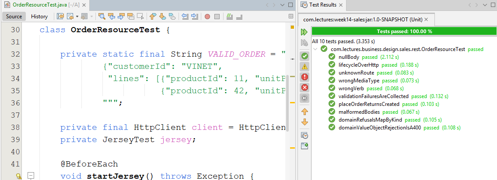

### OpenAPI Desteğinin Eklenmesi

**Payara Micro**, **MicroProfile OpenAPI** spesifikasyonunu da uygular. Uygulamadaki `JAX-RS` kaynaklarını tarayıp API'nin **OpenAPI** formatındaki tarifini `/openapi` adresinde yayınlar. Bunun için tek satır kod yazmamız gerekmez. Uygulamayı başlattıktan sonra `localhost:8080/openapi` adresin gidilebilir.

```yaml
openapi: 3.1.0
info:
  title: Deployed Resources
  version: 1.0.0
servers:
- url: http://localhost:8080/sales
  description: Default Server.
paths: {}
components: {}
```

Olası problemlerden birisi **paths** kısmının boş gelmesidir. Payara hiçbir kaynağı bulamadığında bunun sebebi kaynaklarımızın nerede durduğu ile ilgilidir. **OrderResource** sınıfı `sales` modülünde, yani WAR'ın içindeki `WEB-INF/lib/week14-sales-1.0-SNAPSHOT.jar` dosyasında yaşıyor. Payara'nın OpenAPI tarayıcısı ise varsayılan olarak sadece `WEB-INF/classes` klasörüne bakar. Bu davranışı Payara'ya özgü `mp.openapi.extensions.scan.lib` ayarı ile değiştirebiliriz. Söz konusu ayar **MicroProfile Config** üzerinden okunduğu ve uygulama çalışırken kullanıldığı için WAR'ın içindeki dosyaya yazabiliriz. Bunun için `app` modülündeki `microprofile-config.properties` dosyasının sonuna aşağıdaki satırları eklememiz gerekiyor.

```properties
# OpenAPI document at /openapi
# Payara scans WEB-INF/classes only by default; the JAX-RS resources live in
# the sales jar under WEB-INF/lib.
mp.openapi.extensions.scan.lib=true
# The api package knows no framework, so the schema of LocalDate is given here
mp.openapi.schema.java.time.LocalDate={ "name": "LocalDate", "type": "string", "format": "date", "example": "1996-07-04" }
```

> Payara'nın OpenAPI ayarlarının tam listesini Payara Micro JAR'ının içindeki `microprofile-openapi.jar` dosyasında, **OpenApiConfiguration** sınıfının sabitlerinde görebiliriz. `javap -constants` komutu ile bu sabitlere bakmak, dokümantasyonda aradığımız bir ayarı bulmanın kestirme yollarından biri.

İkinci satır, **OrderSummary** record'undaki **orderDate** alanıyla ilgili. Tarayıcı `java.time.LocalDate` tipini tanımıyor ve onu `type: object` olarak tarif ediyordu. Oysa `JSON-B` bu alanı `"1996-07-04"` gibi bir metin olarak yazıyor. Normalde bu tür düzeltmeler `@Schema` anotasyonuyla yapılır. Ancak **OrderSummary** `api` paketinde duruyor ve bu paket hiçbir framework'ü tanımamalı. MicroProfile OpenAPI, bir Java tipinin şemasını yapılandırma üzerinden vermemize de izin vermekte.

Belgenin başlığını değiştirmek için **SalesRestApplication** sınıfına `@OpenAPIDefinition` anotasyonunu ekleyebiliriz. Bu sınıf `rest` paketinde duruyor ve `rest` paketi zaten framework'leri tanıyan tek paketimiz.

```java
import org.eclipse.microprofile.openapi.annotations.OpenAPIDefinition;
import org.eclipse.microprofile.openapi.annotations.info.Info;

@ApplicationPath("api")
@OpenAPIDefinition(info = @Info(
        title = "Northwind Sales API",
        version = "1.0",
        description = "Places orders and moves them through confirm, ship and cancel."))
public class SalesRestApplication extends Application {
```

Anotasyon MicroProfile OpenAPI API'sinden geliyor. Ana `pom.xml` dosyasının `properties` kısmına `<microprofile-openapi.version>3.1.1</microprofile-openapi.version>` satırını, `dependencyManagement` kısmına ise aşağıdaki bağımlılığı ekleyelim.

```xml
<dependency>
    <groupId>org.eclipse.microprofile.openapi</groupId>
    <artifactId>microprofile-openapi-api</artifactId>
    <version>${microprofile-openapi.version}</version>
    <scope>provided</scope>
</dependency>
```

`sales` modülünün `pom.xml` dosyasına da sürüm belirtmeden aynı bağımlılığı ekleyelim.

```xml
<dependency>
    <groupId>org.eclipse.microprofile.openapi</groupId>
    <artifactId>microprofile-openapi-api</artifactId>
</dependency>
```

Uygulamayı yeniden başlatıp `/openapi` adresine tekrar baktığımızda bu kez beş işlemin tamamını görebiliyor olmalıyız.

```yaml
paths:
  /api/orders:
    post: ...
  '/api/orders/{id: \d+}':
    get: ...
  '/api/orders/{id: \d+}/confirm':
    post: ...
```

Ancak halen daha bir problem var. **Paths** parametresindeki regex ifadesi belgeye olduğu gibi yansımış durumda. OpenAPI standartlarına göre yol şablonu sadece `{id}` biçiminde olabilir. `{id: \d+}` geçerli bir şablon değil ve bu belgeden istemci kodu üretmeye çalışan araçlar burada hata alacaktır. Peki bu regex ifadesine gerçekten ihtiyacımız var mı? `JAX-RS` spesifikasyonu göre `/orders/abc` adresi regex olmadan da 404 döner. Regex bize bir şey kazandırmıyor gibi. Sadece belgeyi bozuyor. Öyleyse **OrderResource** sınıfındaki dört `@Path` ifadesini de sadeleştirelim.

```java
@GET
@Path("{id}")
public OrderSummary get(@PathParam("id") int id) {
    return orders.getOrder(id);
}

@POST
@Path("{id}/confirm")
public OrderSummary confirm(@PathParam("id") int id) {
    return orders.confirm(id);
}

// {id}/ship ve {id}/cancel da aynı şekilde
```

Bu davranışı testle sabitlemek de akıllıca olur. **OrderResourceTest** sınıfındaki **unknownRoute** testinin sonuna aşağıdaki ifadeyi ekleyebiliriz.

```java
assertThat(get("/orders/abc").statusCode()).isEqualTo(404);
```

Artık belgede servis adresleri `/api/orders/{id}`, `/api/orders/{id}/ship` gibi geçerli şablonlarla yazılıyor. **orderDate** alanı da `LocalDate` şemasına, yani `type: string, format: date` tarifine bağlanıyor. Bean Validation kısıtlarının *(`@Positive`, `@Size(max = 50)`, `@DecimalMax("1")`)* şemaya `exclusiveMinimum`, `maxItems`, `maximum` olarak kendiliğinden yansıdığına da dikkat edelim. Belgenin JSON halini `Accept: application/json` başlığıyla isteyebiliriz. **Insomnia** veya **Postman** gibi araçlar bu adresi doğrudan içe aktarıp tüm istekleri hazır hale getirebilir.

> Bu noktada 8080 portunda yaşanan bir problem nedeniyle uygulamayı 8081 portundan başlattım.

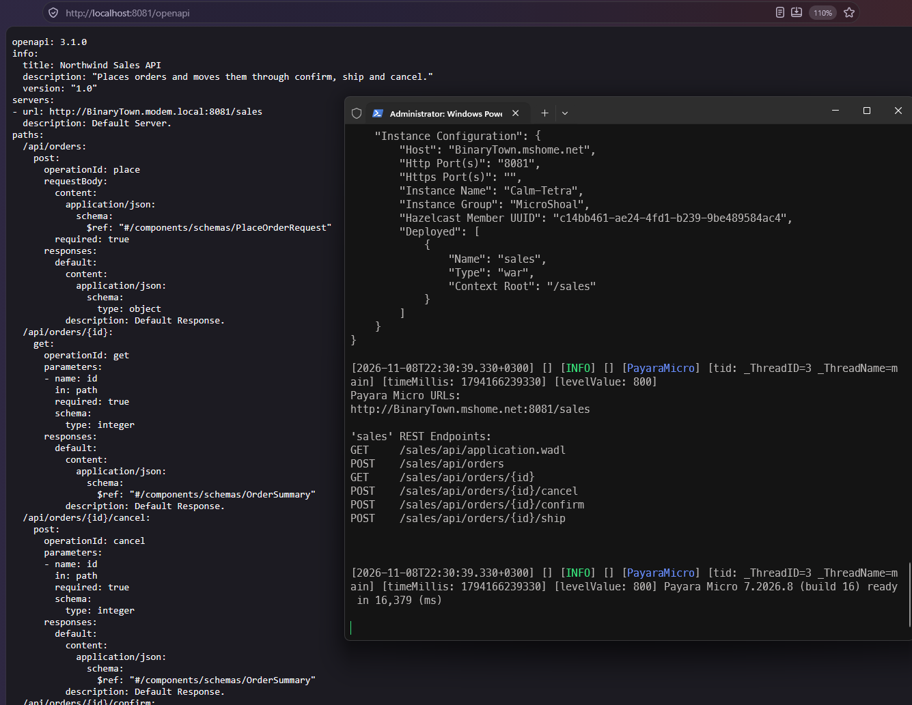

> Aslında belgemiz hala eksik. Her işlem için sadece `default` yanıtı tarif ediliyor. Sipariş oluşturmanın 201 döndüğü, doğrulama hatasının 400, durum çatışmasının 409 olduğu ve hata gövdesinin `application/problem+json` tipinde bir **ProblemDetail** olduğu belgede yazmıyor. Bu bilgileri `@APIResponse` anotasyonlarıyla eklemek mümkün. Bunu bölüm sorularında bir alıştırma olarak bırakacağız. Ayrıca Payara Micro bir Swagger UI arayüzü ile gelmiyor. Belgeyi görsel olarak incelemek için onu `editor.swagger.io` gibi bir araca yapıştırabiliriz.

## Mimari Kurallar ve ADR-0010

Bu bölümde aldığımız kararları [ADR-0010-Uygulama Sunucusu: CDI, JTA ve JAX-RS](docs/adr/ADR-0010.md) isimli belgede topluyoruz. Kararların bir kısmı önceki ADR'ları güncelliyor. Composition root artık **SalesModule** değil *(ADR-0006)*, olaylar **InProcessEventPublisher** ile değil CDI ile dağıtılıyor *(ADR-0007)*, transaction'ı repository değil use case nesnesi yönetiyor *(ADR-0008)* ve **HTTP** katmanı `JAX-RS` üzerinde çalışıyor *(ADR-0009)*. ADR'lar kabul edildikten sonra değiştirilmediği için bu belgelere ADR-0003'te yaptığımız gibi birer not düşmekte ve yeni kararı ADR-0010'da yazmakta yarar var.

Kararların bazıları kodun içinde bir kural olarak korunabilir. Bunun için **ArchitectureTest** sınıfına yeni kurallar ekleyeceğiz. Kurallar `jakarta.transaction.Transactional` ve `jakarta.enterprise.event.Observes` gibi tiplere referans verdiği için önce `quality/architecture-tests` modülünün `pom.xml` dosyasına `Jakarta EE API`'sini test kapsamında ekleyelim.

```xml
<dependency>
    <groupId>jakarta.platform</groupId>
    <artifactId>jakarta.jakartaee-web-api</artifactId>
    <scope>test</scope>
</dependency>
```

Ardından **ArchitectureTest** sınıfındaki `web_libraries_stay_in_rest` kuralını `JAX-RS`, `JSON-B` ve MicroProfile OpenAPI paketlerini de kapsayacak şekilde değiştirelim. **Jackson** ve **JDK HTTP** sunucusu paketlerini listeden çıkarmıyoruz. Biri yanlışlıkla bu kütüphaneleri tekrar kullanmaya başlarsa kural yine yakalanabilmeli.

```java
@ArchTest
static final ArchRule web_libraries_stay_in_rest = noClasses()
        .that().resideOutsideOfPackage("..sales.rest..")
        .should().dependOnClassesThat()
        .resideInAnyPackage("com.fasterxml.jackson..", "com.sun.net.httpserver..", "jakarta.validation..",
                "jakarta.ws.rs..", "jakarta.json..", "org.eclipse.microprofile.openapi..");
```

Sınıfın sonuna da aşağıdaki birim test metotlarını ekleyelim.

```java
@ArchTest
static final ArchRule api_knows_no_framework = noClasses()
        .that().resideInAPackage("..sales.api..")
        .should().dependOnClassesThat().resideInAnyPackage("jakarta..", "org.eclipse.microprofile..");

@ArchTest
static final ArchRule use_cases_are_transactional = classes()
        .that().implement(OrderingFacade.class)
        .should().beAnnotatedWith(Transactional.class);

@ArchTest
static final ArchRule only_application_demarcates_transactions = noClasses()
        .that().resideOutsideOfPackage("..sales.application..")
        .should().dependOnClassesThat().resideInAPackage("jakarta.transaction..");

@ArchTest
static final ArchRule repositories_leave_commit_to_the_caller = noClasses()
        .should().callMethod(Connection.class, "commit")
        .orShould().callMethod(Connection.class, "rollback")
        .orShould().callMethod(Connection.class, "setAutoCommit", boolean.class);

@ArchTest
static final ArchRule domain_event_observers_wait_for_commit = methods()
        .that().areDeclaredInClassesThat().resideInAPackage("..sales..")
        .should(observeDomainEventsOnlyAfterSuccess());

private static ArchCondition<JavaMethod> observeDomainEventsOnlyAfterSuccess() {
    return new ArchCondition<>("observe domain events only after a successful commit") {
        @Override
        public void check(JavaMethod method, ConditionEvents events) {
            for (JavaParameter parameter : method.getParameters()) {
                parameter.tryGetAnnotationOfType(Observes.class)
                        .filter(observes -> parameter.getRawType().isAssignableTo(DomainEvent.class))
                        .filter(observes -> observes.during() != TransactionPhase.AFTER_SUCCESS)
                        .ifPresent(observes -> events.add(SimpleConditionEvent.violated(method,
                        method.getFullName() + " observes " + parameter.getRawType().getSimpleName()
                        + " during " + observes.during())));
            }
        }
    };
}
```

Eklediğimiz yeni birim test metotlarını aşağıdaki tabloyla özetleyebiliriz.

| **Kural *(ArchRule alanı)*** | **ADR** | **Neyi Doğrular?** |
| --- | :---: | --- |
| **web_libraries_stay_in_rest** | 0009, 0010 | Jackson, JDK HTTP sunucusu, Bean Validation, JAX-RS, JSON-B ve MicroProfile OpenAPI tiplerinin yalnızca `sales.rest` paketinde kullanıldığını doğrular. |
| **api_knows_no_framework** | 0010 | `sales.api` paketinin hiçbir Jakarta veya MicroProfile tipine bağımlı olmadığını doğrular. **OrderSummary** gibi tiplerin OpenAPI şemasını bu yüzden anotasyonla değil yapılandırma ile verdik. |
| **use_cases_are_transactional** | 0010 | **OrderingFacade** arayüzünü uygulayan her sınıfın `@Transactional` ile işaretlendiğini doğrular. Biri anotasyonu silerse kullanım senaryoları atomik olmaktan çıkar ve hiçbir birim test bunu fark etmez. |
| **only_application_demarcates_transactions** | 0010 | `jakarta.transaction` paketini sadece `sales.application` paketinin kullandığını doğrular. Bir repository'nin kendi transaction'ını başlatması *(ya da bir HTTP kaynağının transaction açması)* bu kurala takılır. |
| **repositories_leave_commit_to_the_caller** | 0008, 0010 | Hiçbir sınıfın JDBC bağlantısı üzerinde **commit**, **rollback** veya **setAutoCommit** çağırmadığını doğrular. Bu çağrılar sunucuda, JTA'ya dahil edilmiş bir bağlantıda zaten hata verir. Kural bu hatayı derleme sonrası testlerde, sunucuya gitmeden yakalar. |
| **domain_event_observers_wait_for_commit** | 0007, 0010 | Bir domain olayını gözlemleyen her metodun `AFTER_SUCCESS` aşamasını kullandığını doğrular. |

Son kural ArchUnit'in hazır söz dizimiyle ifade edilemiyor. ArchUnit metotların ve sınıfların anotasyonlarını kolayca sorgulayabilir ama bir parametrenin anotasyonunun bir özelliğine *(`during`)* bakan hazır bir kural yok. Bu yüzden kendi koşulumuzu *(ArchCondition)* yazdık. **check** metodu analiz edilen her metot için çağrılıyor. Parametrelerden biri `@Observes` ile işaretlenmişse ve tipi bir **DomainEvent** ise anotasyonun `during` değerine bakılıyor. Değer `AFTER_SUCCESS` değilse bir ihlal kaydediyor. **tryGetAnnotationOfType** metodu, ArchUnit'in bytecode'dan okuduğu anotasyonu gerçek bir Java anotasyon nesnesine dönüştürüyor. Bu sayede `observes.during()` metodunu tip güvenli bir şekilde çağırabiliyoruz.

### Kuralları Kırarak Deneyelim

Bir kuralın gerçekten neyi koruduğunu anlamanın en iyi yolu onu kırmayı denemektir. Aşağıdaki değişiklikleri geçici olarak yapıp mimari testleri çalıştıralım.

1. **OrderService** sınıfındaki `@Transactional` anotasyonunu silelim.
2. **ShipmentNotificationHandler** sınıfında `TransactionPhase.AFTER_SUCCESS` yerine `TransactionPhase.IN_PROGRESS` yazalım.
3. **JdbcOrderRepository** sınıfının **save** metodunda `replaceLines(connection, order);` satırından sonra `connection.commit();` ekleyelim.
4. **JdbcCustomerRepository** sınıfının **save** metodunu `@Transactional` ile işaretleyelim.

```powershell
mvn -pl quality/architecture-tests -am test "-Dtest=ArchitectureTest" "-Dsurefire.failIfNoSpecifiedTests=false"
```

Dört kural da beklendiği gibi kırılmalı.

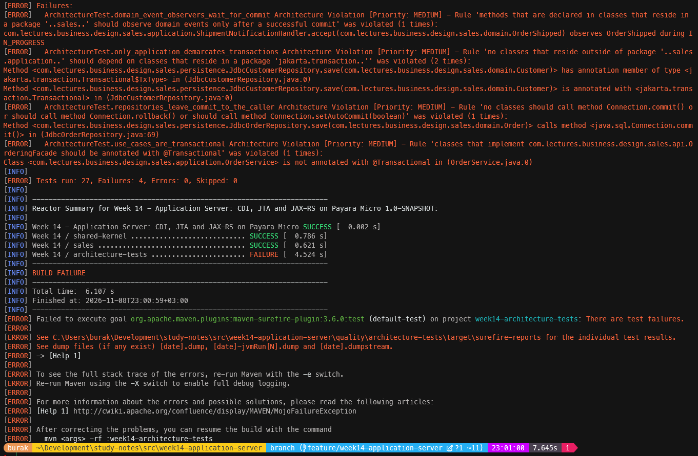

İlk iki madde dikkat çekici. `@Transactional` anotasyonunu sildiğimizde ya da yanlış katmana taşıdığımızda birim testlerin hiçbiri kırılmaz. Çünkü birim testlerde zaten bir JTA transaction'ı yok. Bu hatalar normal şartlarda ancak sunucuda, üstelik sadece bir şeyler ters gittiğinde *(yarım kalan bir kayıt, gönderilmemesi gereken bir bildirim)* fark edilirdi. Mimari testler bu tür *"sadece üretimde görünen"* hataları derleme hattına taşımakta. Denemeden sonra değişiklikleri geri almayı unutmayalım.

// DEVAM EDECEK

<!-- nav:bottom:start -->
---

| ← Önceki Bölüm | İçindekiler | Sonraki Bölüm → |
| :--- | :---: | ---: |
| [Bölüm 13: HTTP Boundary, DTO, Validasyon ve Hata Sözleşmeleri](java-chapter-13.md#top) | [Ders Notları](README.md#top) | |
<!-- nav:bottom:end -->
