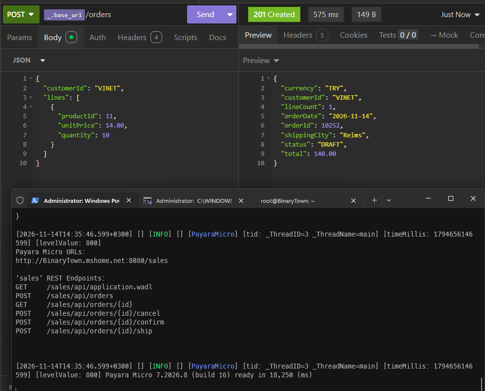
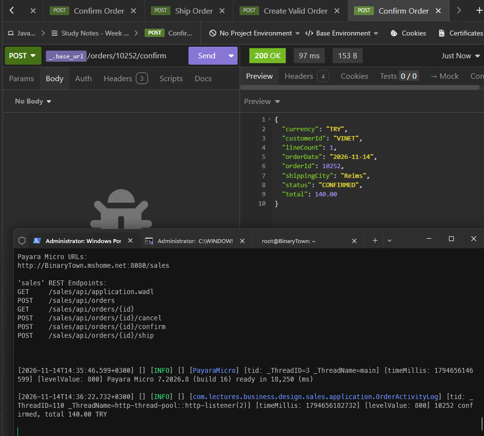
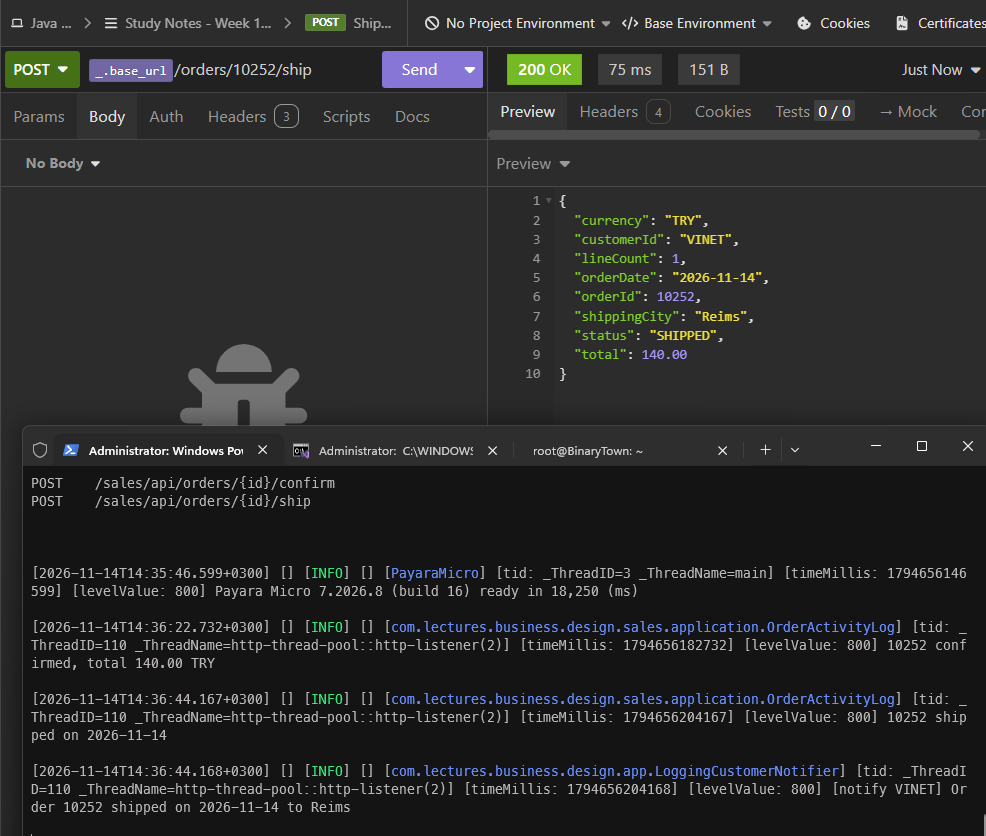
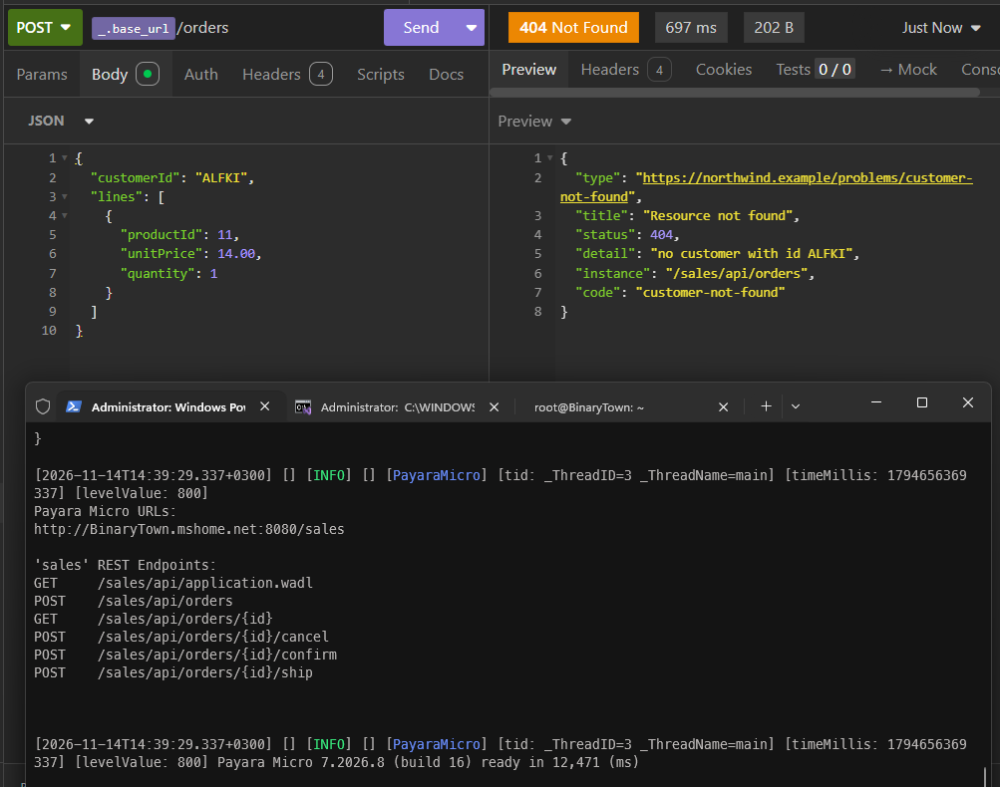

<a id="top"></a>

# Bölüm 15: JPA ile Persistence: Entity'ler, Eşleme ve İyimser Kilitleme

<!-- nav:top:start -->
[← Bölüm 14](java-chapter-14.md#top) · [İçindekiler](README.md#top)
<!-- nav:top:end -->

Artık elimizde **JPA *(Java Persistence API)***'yı değerlendirebileceğimiz her şey var. Repository sözleşmeleri, **InMemory**, **H2** ve **PostgreSQL** üzerinde çalışan sözleşme testleri *(contract tests)*, transaction sınırını çizen bir `@Transactional` kullanım senaryosu ve tüm bunları çalıştıran uygulama sunucusu.

Bu bölümde ise **JdbcOrderRepository** ve **JdbcCustomerRepository** sınıflarını **Jakarta Persistence** *(JPA)* ile yeniden yazacağız. **Payara**, JPA spesifikasyonunun implementasyonu olarak **EclipseLink** kullanıyor. Daha önceden yaptığımız birçok şeyin JPA tarafında karşılığı var.

| **Manuel İşlem** | **JPA karşılığı** |
| --- | --- |
| SQL cümleleri ve **PreparedStatement** parametreleri | Entity sınıfları ve mapping anotasyonları *(`@Entity`, `@Table`, `@Column`)* |
| Önce güncelle, olmazsa ekle *(update-then-insert)* yaklaşımı | `EntityManager.merge(...)` |
| Sipariş kalemlerini silip yeniden yazmak | `@ElementCollection` ve koleksiyon değişiklik takibi |
| **ResultSet** satırlarından `reconstitute()` metodunu çağırmak | Entity'den domain nesnesine dönüşüm |
| İki sorgu ile N+1 probleminden kaçınmak | JPQL'de **JOIN FETCH** |
| **SQLException** → **RepositoryException** dönüşümü | **PersistenceException** |
| Aynı siparişi eş zamanlı güncelleyen iki işlemde son yazanın kazanması *(lost update)* | `@Version` ile iyimser kilit *(optimistic locking)* |

Burada en önemli konu domain modelimizle ilgili. **Order**, **OrderLine** ve **Customer** sınıfları **final** alanlara sahip, parametresiz yapıcıları *(default constructor)* olmayan ve setter içermeyen zengin nesneler *(rich domain objects)* şeklinde tasarlandılar. **JPA** ise ele aldığı sınıflardan tam tersini bekliyor. Ayrıca `ADR-0004`'da domain paketinin **jakarta** paketlerini görmesini yasaklıyoruz. Buna göre aşağıdaki yaklaşımlardan birini seçmemiz gerekiyor.

| **Yaklaşım** | **Nasıl çalışır?** | **Bedeli Nedir?** |
| --- | --- | --- |
| Domain sınıflarına JPA anotasyonları eklemek | **Order** bir `@Entity` olur | Domain bir framework'e bağlanır ve **final** alanlar ve protected constructor'lar için tavizler gerekir. `ADR-0004` değiştirmek gerekir. |
| `orm.xml` ile eşleştirmek | Domain sınıfları anotasyonsuz kalır, eşleme bir **XML** dosyasında yapılır | Domain koda yansımasa da JPA'nın beklentilerine *(parametresiz constructor, final işaretlenmemiş alanlar)* uymak zorunda kalınır. |
| Ayrı persistence entity'leri | **persistence** paketinde **OrderEntity** ve **CustomerEntity** sınıfları olur. Repository domain nesnesi ile entity arasında köprü vazifesi görür. | Bir mapper yazmak gerekebilir. |

Biz üçüncü yolu seçeceğiz. Domain modeli değişmeyecek. Bu kararın nedenlerini ve alternatiflerini ise yeni bir ADR belgesinde toplamalıyız.

## İlk Adım: Customer

İşe sadece bir tablodan oluşan ve hiçbir koleksiyon taşımayan **Customer** aggregate'i ile başlayabiliriz. Böylece **JPA**'nın temel parçalarını *(persistence unit, entity, EntityManager)* sipariş satırları gibi gereksinimler olmadan anlayabiliriz. **Order** için **JdbcOrderRepository** bir sonraki adıma kadar yerinde kalsın. Yani bu adımın sonunda aynı uygulamada **JPA** ile **JDBC** yan yana ve hatta aynı transaction içinde çalışıyor olacak.

### EclipseLink Bağımlılığı

JPA API'si *(`jakarta.persistence`)* zaten `jakarta.jakartaee-web-api` içinde gelmektedir ve implementasyonunu **Payara** sağlar. Ancak repository'leri sunucu olmadan test edebilmek için testlerde de bir JPA implementasyonuna ihtiyacımız var. Payara Micro içinde EclipseLink bulunuyor *(Payara Micro JAR'ının `MICRO-INF/runtime/org.eclipse.persistence.core.jar` dosyasının MANIFEST'inden kontrol edebiliriz)*. Sadece testlerde de aynı sürümü kullanmaya dikkat etsek yeterli. Ana `pom.xml` dosyasının **properties** kısmına ilgili sürümü aşağıdaki gibi ekleyelim.

```xml
<eclipselink.version>5.0.0</eclipselink.version>
```

**dependencyManagement** kısmına da bağımlılığın kendisini ekleyelim.

```xml
<dependency>
    <groupId>org.eclipse.persistence</groupId>
    <artifactId>org.eclipse.persistence.jpa</artifactId>
    <version>${eclipselink.version}</version>
</dependency>
```

`sales` modülünün `pom.xml` dosyasında ise bu bağımlılığı test kapsamında ekleyelim.

```xml
<dependency>
    <groupId>org.eclipse.persistence</groupId>
    <artifactId>org.eclipse.persistence.jpa</artifactId>
    <scope>test</scope>
</dependency>
```

### Persistence Unit

JPA, hangi sınıfların hangi veritabanına eşlendiğini bir **persistence unit** tanımından bulur. `sales` modülünün `src/main/resources/META-INF` klasörüne aşağıdaki **persistence.xml** dosyasını ekleyerek devam edelim.

```xml
<?xml version="1.0" encoding="UTF-8"?>
<persistence xmlns="https://jakarta.ee/xml/ns/persistence"
             xmlns:xsi="http://www.w3.org/2001/XMLSchema-instance"
             xsi:schemaLocation="https://jakarta.ee/xml/ns/persistence
                                 https://jakarta.ee/xml/ns/persistence/persistence_3_2.xsd"
             version="3.2">
    <persistence-unit name="sales" transaction-type="JTA">
        <jta-data-source>java:app/jdbc/sales</jta-data-source>
        <class>com.lectures.business.design.sales.persistence.CustomerEntity</class>
        <class>com.lectures.business.design.sales.persistence.AddressColumns</class>
        <exclude-unlisted-classes>true</exclude-unlisted-classes>
        <shared-cache-mode>NONE</shared-cache-mode>
        <properties>
            <property name="jakarta.persistence.schema-generation.database.action" value="none"/>
        </properties>
    </persistence-unit>
</persistence>
```

Peki bu ayarlar ne anlama geliyor? Aşağıdaki tablo ile değerlendirelim.

| **Ayar** | **Anlamı** |
| --- | --- |
| `transaction-type="JTA"` | EntityManager, `@Transactional` anotasyonu ile başlatılan JTA transaction'larına dahil olur. Kendi transaction kapsamını yönetmez. |
| `jta-data-source` | `@DataSourceDefinition` anotasyonu ile tanımladığımız bağlantı havuzu. JPA da aynı havuzu kullanıyor. |
| `<class>` ve `exclude-unlisted-classes` | Eşlenecek sınıfları açıkça listeliyoruz. JPA'nın arşivi taramasına izin vermiyoruz. *(`bean-discovery-mode="annotated"` ve `SalesRestApplication.getClasses()` ile aynı mantık diyebiliriz)* |
| `shared-cache-mode="NONE"` | **EclipseLink**, ikinci seviye önbelleği *(L2 cache)* varsayılan olarak açık getirir. Bu önbellek, veritabanında başka bir yoldan *(Flyway, başka bir uygulama, elle yazılan bir SQL betiği)* yapılan değişiklikleri görmemizi engelleyebilir. Önbelleği bilinçli olarak kapatıyoruz. Bunun ne anlama geldiğini anlamak için Payara üzerinde bir deneye de yapacağız. |
| `schema-generation.database.action="none"` | JPA, tabloları oluşturmaya veya değiştirmeye çalışmaz. Şemanın sahibi **Flyway**. Entity'ler şemayı tariflemez var olan mevcut şemaya uyar. |

> Hibernate kullanan bir projeden geliyorsak L2 önbelleğin varsayılan olarak açık olması şaşırtıcı gelebilir. Hibernate'te L2 önbelleği açıkça etkinleştirmek gerekirken, EclipseLink'te kapatmak gerekir. Aynı spesifikasyonu uygulayan iki implementasyonun varsayılan yaklaşımları farklı olabilir. Bu da spesifikasyon dışındaki davranışları belgelemenin ve test etmenin neden önemli olduğunu gösterir.

### Adres Kolonları ve Müşteri Entity'si

**Address** veri yapısı bir value object olarak tasarlandı. Hem müşterilerde hem de siparişlerin teslimat adresinde kullanılıyor. JPA'da bu tür değer nesneleri `@Embeddable` sınıflarla eşlenir. Gömülen *(embedded)* sınıfın kendi tablosu ve kimliği olmaz, kolonları onu içeren entity'nin tablosunda durur. Bu nedenle **persistence** paketine aşağıdaki sınıfı eklememiz gerekiyor.

```java
package com.lectures.business.design.sales.persistence;

import com.lectures.business.design.shared.kernel.Address;
import jakarta.persistence.Column;
import jakarta.persistence.Embeddable;

@Embeddable
public class AddressColumns {

    @Column(name = "street", length = 60)
    private String street;

    @Column(name = "city", length = 15)
    private String city;

    @Column(name = "postal_code", length = 10)
    private String postalCode;

    @Column(name = "country", length = 15)
    private String country;

    protected AddressColumns() {
    }

    static AddressColumns from(Address address) {
        AddressColumns columns = new AddressColumns();
        columns.street = address.street();
        columns.city = address.city();
        columns.postalCode = address.postalCode();
        columns.country = address.country();
        return columns;
    }

    Address toAddress() {
        return new Address(street, city, postalCode, country);
    }
}
```

Ardından da müşteri tablosunu eşleyen entity sınıfını...

```java
package com.lectures.business.design.sales.persistence;

import com.lectures.business.design.sales.domain.Customer;
import com.lectures.business.design.sales.domain.CustomerId;
import jakarta.persistence.Column;
import jakarta.persistence.Embedded;
import jakarta.persistence.Entity;
import jakarta.persistence.Id;
import jakarta.persistence.Table;

@Entity
@Table(name = "customers")
public class CustomerEntity {

    @Id
    @Column(name = "customer_id", length = 5)
    private String customerId;

    @Column(name = "company_name", nullable = false, length = 40)
    private String companyName;

    @Column(name = "contact_name", length = 30)
    private String contactName;

    @Embedded
    private AddressColumns address;

    protected CustomerEntity() {
    }

    static CustomerEntity from(Customer customer) {
        CustomerEntity entity = new CustomerEntity();
        entity.customerId = customer.customerId().value();
        entity.companyName = customer.companyName();
        entity.contactName = customer.contactName().orElse(null);
        entity.address = AddressColumns.from(customer.address());
        return entity;
    }

    Customer toDomain() {
        Customer customer = new Customer(CustomerId.of(customerId), companyName, address.toAddress());
        if (contactName != null) {
            customer.assignContact(contactName);
        }
        return customer;
    }
}
```

Bu iki sınıf tasarımı, domain sınıflarının sahip olmadığı her şeye sahip. Her şeyden önce **final** değiller, parametresiz yapıcı metotları var, alanları değiştirilebilir ve herhangi bir iş kuralı içermiyorlar. **JPA**'nın beklediği şekil tam olarak bu. Bir entity'nin **final** olmama sebebini şöyle izah edebiliriz. JPA implementasyonu geç yükleme *(lazy loading)* ve değişiklik takibi *(dirty checking)* için alt sınıflar üretebilir. Bunun için parametresiz yapıcılar gerekir. Zira bu yapıcılar JPA'nın veritabanından okuduğu satırı nesneye dönüştürürken kullandığı parçadır. Bu nedenle parametresiz yapıcıyı `protected` yaparak kodun geri kalanından gizlemek de gerekir. Diğer yandan dikkat etmemiz gereken birkaç nokta daha var.

- **Alan erişimi *(field access)*:** `@Id` anotasyonunu bir alanın üzerine yazdığımız için JPA bu sınıfın tüm durumunu alanlar üzerinden okuyup yazar. Getter ve setter metotlarına ihtiyaç yoktur.
- **Dönüşüm metotları:** **from** ve **toDomain** metotları **package-private**'tır *(yani aynı paket içerisinden erişilebilir)*. Entity'yi sadece aynı paketteki repository görebiliyor ve dönüşümü sadece o yapabiliyor. Entity'ler persistence paketinin dışına hiçbir zaman çıkmaz.
- **Identity ve value object:** **CustomerId** domain'de türlendirilmiş bir kimlik tarifler *(typed identity)*. Entity'de ise düz bir **String** olarak. Türlendirilmiş kimlik ve değer nesneleri için JPA'nın **AttributeConverter** ve `@Embeddable` gibi enstrümanları vardır ama ayrı entity yaklaşımında bu dönüşümü zaten **from** ve **toDomain** içinde biz yapıyoruz.
- **Kolon tanımları:** **length** ve **nullable** değerleri V1 migration'ındaki şemayla aynıdır. Şema oluşturmayı kapattığımız için JPA bu değerleri tabloyu oluşturmak için kullanmaz. Ancak belgeleme açısından ve ileride bir şema doğrulaması yapmak istersek değerlidir.

### JpaCustomerRepository

Repository'nin kendisi oldukça kısa. `persistence` paketine aşağıdaki sınıfı eklememiz yeterli.

```java
package com.lectures.business.design.sales.persistence;

import com.lectures.business.design.sales.domain.Customer;
import com.lectures.business.design.sales.domain.CustomerId;
import jakarta.enterprise.context.Dependent;
import jakarta.inject.Inject;
import jakarta.persistence.EntityManager;
import java.util.Objects;
import java.util.Optional;

@Dependent
public final class JpaCustomerRepository implements CustomerRepository {

    private final EntityManager entityManager;

    @Inject
    public JpaCustomerRepository(EntityManager entityManager) {
        this.entityManager = Objects.requireNonNull(entityManager, "entityManager must not be null");
    }

    @Override
    public void save(Customer customer) {
        Objects.requireNonNull(customer, "customer must not be null");
        entityManager.merge(CustomerEntity.from(customer));
    }

    @Override
    public Optional<Customer> findById(CustomerId customerId) {
        Objects.requireNonNull(customerId, "customerId must not be null");
        return Optional.ofNullable(entityManager.find(CustomerEntity.class, customerId.value()))
                .map(CustomerEntity::toDomain);
    }
}
```

**JdbcCustomerRepository** sınıfında iki SQL ifadesi, iki **PreparedStatement**, bir **ResultSet** okuyucusu ve `update-then-insert` mantığı bulunuyordu. Burada ise iki satır kaldı.

- **merge:** Verilen entity'nin kimliğine bakar. Bu kimlikle bir kayıt varsa onu yükleyip alanlarını günceller, eğer yoksa yeni bir kayıt olarak ekler *(önce güncelle, olmazsa ekle yaklaşımının JPA karşılığı)*. Tabii arada önemli bir fark var. **merge** önce bir **SELECT** ifadesi çalıştırır. JDBC'deki yaklaşımımız ise doğrudan **UPDATE** işlemiyle başlıyordu.
- **find:** Birincil anahtarla *(primary key)* tek bir kayıt okur. Eğer kayıt bulunamazsa **null** döner. Bunu **Optional** ile sarmalayıp domain nesnesine dönüştürüyoruz.

Repository her okumada yeni bir domain nesnesi oluşturduğu için sözleşme testlerinin yakaladığı *"in-memory repository referans saklıyor"* sorunu burada kendiliğinden çözülmüş olacaktır. Domain nesnesi üzerinde yapılan bir değişiklik, **save** çağrılmadıkça hiçbir yere yansımaz/yansımamalıdır.

> **merge** çağrıldığında veritabanına hemen bir şey yazılmaz. JPA çalışma zamanı, ilgili değişiklikleri **persistence context** içinde biriktirir ve transaction commit edilirken *(veya bir sorgudan önce)* topluca veritabanına gönderir *(flush)*. *(write-behind konusunu araştıralım)*. Bu yaklaşımın doğal bir sonucu da şudur; Bir kısıt ihlali *(örneğin olmayan bir müşteriye ait sipariş)* **save** çağrısı sırasında değil, commit sırasında ortaya çıkar. JDBC repository'mizde bu hatayı **save** içinde yakalayıp **RepositoryException** ile ele almıştık. JPA'da ise hata, commit'i yapan `@Transactional` interceptor tarafından gelir. Bu farkı siparişleri taşırken tekrar ele alalım.

Bu değişiklikle birlikte **JdbcCustomerRepository** sınıfına artık ihtiyacımız kalmadı. Onu silebiliriz.

### EntityManager Nereden Geliyor?

Dikkat edilecek olursa **JpaCustomerRepository** sınıfı yapıcı metodunda **EntityManager** bekliyor. Bunu bildirmek için **SalesWiring** sınıfına bir producer alanı aşağıdaki gibi eklenebilir elbette.

```java
@Produces
@PersistenceContext(unitName = "sales")
private EntityManager entityManager;
```

Ancak bu durumda CDI tarafı aynı tip için iki aday bulur. Biri bizim producer'ımız, diğeri ise Payara'nın kendi **PersistenceExtension** bileşeninin ürettiği bir bean nesnesi. Jakarta'nın güncel sürümleri ile gelen Jakarta Persistence, uygulamadaki her persistence unit için bir **EntityManager** bean'ini otomatik olarak tanımlıyor. Yani `@Inject EntityManager` artık hiçbir producer yazmadan da çalışabiliyor. Dolayısıyla producer'ı eklemimize gerek yok. **SalesWiring** sınıfını değiştirmeden bırakabiliriz *(Bu konuyu ispat etmeye çalışabilirsiniz)*

> Not: Uygulamada birden fazla persistence unit olsaydı hangisinin enjekte edileceğini bir qualifier ile belirtmemiz gerekirdi. Bunun için `persistence.xml` dosyasında `<qualifier>` elemanını tanımlamamız gerekir *(Bunu bir araştıralım)*.

Container'ın verdiği **EntityManager** bir proxy'dir ve transaction kapsamında çalışır *(transaction-scoped)*. Her JTA transaction'ı için ayrı bir persistence context açılır ve transaction bitince kapatılır. Bu yüzden **JpaCustomerRepository** tek bir örnek olarak **OrderService** içinde yaşasa bile her kullanım vakasında kendi persistence context'ini kullanır.

### Testler: EclipseLink'i Sunucusuz Çalıştırmak

Sözleşme testleri sunucusuz çalışıyor. Bu yüzden testte kendimiz **EntityManager** nesnemizi oluşturmamız ve transaction'ları manuel olarak yönetmemiz gerekiyor. Bu nedenle aşağıdaki **JpaUnit** sınıfını, `sales` modülünün test kodlarındaki `persistence` paketine ekleyelim.

```java
package com.lectures.business.design.sales.persistence;

import jakarta.persistence.EntityManager;
import jakarta.persistence.EntityManagerFactory;
import jakarta.persistence.EntityTransaction;
import jakarta.persistence.Persistence;
import java.lang.reflect.InvocationTargetException;
import java.lang.reflect.Proxy;
import java.util.Map;
import java.util.Objects;
import javax.sql.DataSource;

public final class JpaUnit {

    private final EntityManager entityManager;

    private JpaUnit(EntityManager entityManager) {
        this.entityManager = entityManager;
    }

    public static JpaUnit on(DataSource dataSource) {
        Objects.requireNonNull(dataSource, "dataSource must not be null");
        EntityManagerFactory factory = Persistence.createEntityManagerFactory("sales", Map.of(
                "jakarta.persistence.transactionType", "RESOURCE_LOCAL",
                "jakarta.persistence.jtaDataSource", "",
                "jakarta.persistence.nonJtaDataSource", dataSource,
                "eclipselink.weaving", "false",
                "eclipselink.logging.level", "WARNING"));
        return new JpaUnit(factory.createEntityManager());
    }

    public EntityManager entityManager() {
        return entityManager;
    }

    public <T> T transactional(Class<T> contract, T target) {
        Objects.requireNonNull(target, "target must not be null");
        return contract.cast(Proxy.newProxyInstance(contract.getClassLoader(), new Class<?>[]{contract},
                (proxy, method, args) -> {
                    EntityTransaction transaction = entityManager.getTransaction();
                    transaction.begin();
                    try {
                        Object result = method.invoke(target, args);
                        transaction.commit();
                        return result;
                    } catch (InvocationTargetException e) {
                        transaction.rollback();
                        throw e.getCause();
                    } finally {
                        entityManager.clear();
                    }
                }));
    }
}
```

Koddaki önemli noktalara bir bakalım;

- **Aynı persistence unit, farklı transaction türü:** **on** metodu, üretim kodundaki `persistence.xml` dosyasını kullanır fakat birkaç ayarı ezerek değiştirir. Sunucuda **JTA** ve **JNDI** yok. Bu yüzden transaction türünü `RESOURCE_LOCAL` yapıp, JTA veri kaynağını boşaltıp testin oluşturduğu **DataSource** nesnesini *(H2 veya Testcontainers ile PostgreSQL)* doğrudan veriyoruz. Böylece eşlemeler sunucudakiyle birebir aynı kalabilir.
- **Weaving:** EclipseLink, sunucuda entity sınıflarının bytecode'unu değişiklik takibi ve lazy yükleme için yeniden yazar *(weaving)*. Testlerde buna ihtiyacımız olmadığı için kapatıyoruz.
- **transactional metodu:** Bir arayüzün her metodunu bir transaction içinde çalıştıran dinamik bir proxy üretiyor. Metot başarılı biterse commit, exception fırlatırsa rollback yapar. Sunucudaki `@Transactional` interceptor'ının hafif bir versiyonu. **finally** bloğundaki `entityManager.clear()` metodu ise persistence context'i her çağrıdan sonra temizler. Sunucudaki transaction odaklı **EntityManager** de transaction bitince persistence context'ini kapatıyordu. Bu satır olmasaydı bir test, veritabanından değil önbellekteki nesneden okuma yapabilirdi.

Müşteri sözleşme testi, JDBC implementasyonu yerine JPA implementasyonunu çalıştıracak şekilde değiştirilmeli. Bu nedenle **CustomerRepositoryContractTest** sınıfındaki **repositories** metodunu aşağıdaki gibi düzenleyelim.

```java
static Stream<Arguments> repositories() {
    return Stream.of(
            Arguments.of("in-memory", (Supplier<CustomerRepository>) InMemoryCustomerRepository::new),
            Arguments.of("jpa-h2", (Supplier<CustomerRepository>) () -> {
                JpaUnit unit = JpaUnit.on(TestDatabases.h2());
                return unit.transactional(CustomerRepository.class,
                        new JpaCustomerRepository(unit.entityManager()));
            }));
}
```

Sipariş testleri ise müşterileri kaydetmek için **JdbcCustomerRepository** sınıfını kullanıyordu. Siparişler müşteri tablosuna bir foreign key üzerinden bağlı olduğu için müşterilerin önceden var olması gerekir. Bu ihtiyaç için bir repository'ye bağımlı olmak yerine **TestDatabases** sınıfına basit SQL ifadesi içeren yardımcı bir metot ekleyebiliriz.

```java
public static DataSource withDemoCustomers(DataSource dataSource) {
    try (Connection connection = dataSource.getConnection(); Statement statement = connection.createStatement()) {
        statement.executeUpdate("""
                INSERT INTO customers (customer_id, company_name, street, city, postal_code, country)
                VALUES ('VINET', 'Vins et alcools Chevalier', '59 rue de l''Abbaye', 'Reims', '51100', 'France'),
                       ('TOMSP', 'Toms Spezialitaten', 'Luisenstr. 48', 'Munster', '44087', 'Germany')
                """);
    } catch (SQLException e) {
        throw new IllegalStateException("could not insert the demo customers", e);
    }
    return dataSource;
}
```

**JdbcOrderRepositoryTest** sınıfındaki **seedCustomers** metodunu silip **createRepository** içinde `TestDatabases.withDemoCustomers(dataSource);` satırını kullanalım. **PostgresOrderRepositoryTest** sınıfında da `JdbcOrderRepositoryTest.seedCustomers(dataSource);` satırını aynı çağrıyla değiştirelim.

### Demo Müşteriler ve TransactionRequiredException

Daha önceden ele aldığımız **SalesStartup** sınıfı, demo müşterileri **CustomerRepository** nesnesi üzerinden kaydediyordu. Bu kodu değiştirmeden uygulamayı başlatırsak **TransactionRequiredException** ile karşılabiliriz *(Bunu deneyip görmeye çalışın)*

**JdbcCustomerRepository** transaction olmadan da çalışabiliyordu. Bağlantı `auto-commit` modundaydı ve her SQL cümlesi kendi başına onaylanıyordu. Transaction kapsamlı bir **EntityManager** ise **merge** gibi yazma işlemlerini sadece bir **JTA** transaction'ı içinde kabul edebiliyor. Buna göre açılış gözlemcisi bir kullanım senaryosu olmadığı için `@Transactional` değil diyebiliriz.

**onStartup** metodunu `@Transactional` ile işaretlemeyi düşünebilirdik. Lakin bu durumda Flyway migration'ları da JTA transaction'ının içinde çalışırdı. Flyway bağlantı üzerinde kendi **commit** ve **setAutoCommit** çağrılarını yapacaktır. Bu ise JTA'ya dahil edilmiş bir bağlantıda bir ihlal kabul ediliyor. Dolayısıyla iki işi ayırmamız gerekmekte. `app` modülüne demo müşterileri kendi transaction'ı içinde kaydeden ayrı bir bean nesnesi ekleyelim.

```java
package com.lectures.business.design.app;

import com.lectures.business.design.sales.domain.Customer;
import com.lectures.business.design.sales.domain.CustomerId;
import com.lectures.business.design.sales.persistence.CustomerRepository;
import com.lectures.business.design.shared.kernel.Address;
import jakarta.enterprise.context.Dependent;
import jakarta.inject.Inject;
import jakarta.transaction.Transactional;
import java.util.Objects;

@Dependent
public class DemoCustomers {

    private final CustomerRepository customers;

    @Inject
    public DemoCustomers(CustomerRepository customers) {
        this.customers = Objects.requireNonNull(customers, "customers must not be null");
    }

    @Transactional
    public void putInPlace() {
        customers.save(new Customer(CustomerId.of("VINET"), "Vins et alcools Chevalier",
                new Address("59 rue de l'Abbaye", "Reims", "51100", "France")));
        customers.save(new Customer(CustomerId.of("TOMSP"), "Toms Spezialitaten",
                new Address("Luisenstr. 48", "Munster", "44087", "Germany")));
    }
}
```

**SalesStartup** sınıfında **CustomerRepository** yerine bu bean'i enjekte edip, demo müşterileri kaydeden satırları `putInPlace()` çağrısıyla değiştirelim. Bu sınıf `app` modülünde olduğu için ArchUnit kapsamının dışında ve ADR-0010'daki `only_application_demarcates_transactions` kuralına takılmıyor. Açılış sırasında çalışan bu iş, `sales` modülünün bir kullanım senaryosu değil, uygulama kurulumunun bir parçası.

### Payara Üzerinde Deneyelim

Uygulamayı derleyip başlatalım.

```powershell
cd src\week15-jpa-persistence
mvn clean install
java -jar C:\payara-micro\payara-micro-7.2026.8.jar --nocluster --systemProperties payara\local.properties --deploy app\target\sales.war
```

Demo müşteriler bu kez JPA ile kaydediliyor ve uygulama her yeniden başlatıldığında **merge** çağrısı onları güncelliyor. Bir sipariş oluşturup onaylayıp, kargolamayı deneyelim.

```curl
curl -i -X POST localhost:8080/sales/api/orders -H "Content-Type: application/json" \
     -d '{"customerId":"VINET","lines":[{"productId":11,"unitPrice":14.00,"quantity":10}]}'
```



```curl
curl -i -X POST localhost:8080/sales/api/orders/10252/confirm
```



```curl
curl -i -X POST localhost:8080/sales/api/orders/10252/ship
```



Bu isteklerin her biri ilginç bir şey yapıyor. **placeOrder** kullanım senaryosu tek bir JTA transaction'ı içinde önce müşteriyi JPA ile *(`entityManager.find`)* okuyor, ardından sekanstan bir numara alıp siparişi JDBC ile yazıyor. İki farklı teknoloji aynı bağlantı havuzunu ve aynı transaction'ı paylaşıyor. Daha önce Payara'nın bir transaction içinde aynı havuzdan istenen bağlantıları paylaştırdığından bahsetmiştik. Burada bunun pratik bir faydasını da görüyoruz. Repository'leri teker teker JPA'ya taşıyabiliyoruz ve geçiş sırasında kullanım senaryolarında hiçbir şey değişmiyor.

```curl
curl -i -X POST localhost:8080/sales/api/orders -H "Content-Type: application/json" \
     -d '{"customerId":"ALFKI","lines":[{"productId":11,"unitPrice":14.00,"quantity":1}]}'
```



Olmayan bir müşteri için yine `customer-not-found` koduyla bir 404 problemi dönüyor. **CustomerRepository** sözleşmesindeki **getById** metodu değişmediği için **CustomerNotFoundException** fırlatılmaya devam ediyor.

// DEVAM EDECEK

<!-- nav:bottom:start -->
---

| ← Önceki Bölüm | İçindekiler | Sonraki Bölüm → |
| :--- | :---: | ---: |
| [Bölüm 14: Uygulama Sunucusuna Geçiş: CDI, JTA ve JAX-RS ile Payara Micro](java-chapter-14.md#top) | [Ders Notları](README.md#top) | |
<!-- nav:bottom:end -->
