<a id="top"></a>

# Bölüm 15: JPA ile Persistence: Entity'ler, Eşleme ve İyimser Kilitleme

<!-- nav:top:start -->
[← Bölüm 14](java-chapter-14.md#top) · [İçindekiler](README.md#top)
<!-- nav:top:end -->

Artık elimizde **JPA *(Java Persistence API)***'yı değerlendirebileceğimiz her şey var. Repository sözleşmeleri, **InMemory**, **H2** ve **PostgreSQL** üzerinde çalışan sözleşme testleri *(contract tests)*, transaction sınırını çizen bir `@Transactional` kullanım senaryosu ve tüm bunları çalıştıran uygulama sunucusu.

Bu bölümde ise **JdbcOrderRepository** ve **JdbcCustomerRepository** sınıflarını **Jakarta Persistence** *(JPA)* ile yeniden yazacağız. **Payara**, JPA spesifikasyonunun implementasyonu olarak **EclipseLink** kullanıyor. Daha önceden yaptığımız birçok şeyin JPA tarafında karşılığı var.

| **Manuel İşlem** | **JPA karşılığı** |
| --- | --- |
| SQL cümleleri ve **PreparedStatement** parametreleri | Entity sınıfları ve mapping anotasyonları *(`@Entity`, `@Table`, `@Column`)* |
| Önce güncelle, olmazsa ekle *(update-then-insert)* yaklaşımı | `EntityManager.merge(...)` |
| Sipariş kalemlerini silip yeniden yazmak | `@ElementCollection` ve koleksiyon değişiklik takibi |
| **ResultSet** satırlarından `reconstitute()` metodunu çağırmak | Entity'den domain nesnesine dönüşüm |
| İki sorgu ile N+1 probleminden kaçınmak | JPQL'de **JOIN FETCH** |
| **SQLException** → **RepositoryException** dönüşümü | **PersistenceException** |
| Aynı siparişi eş zamanlı güncelleyen iki işlemde son yazanın kazanması *(lost update)* | `@Version` ile iyimser kilit *(optimistic locking)* |

Burada en önemli konu domain modelimizle ilgili. **Order**, **OrderLine** ve **Customer** sınıfları **final** alanlara sahip, parametresiz yapıcıları *(default constructor)* olmayan ve setter içermeyen zengin nesneler *(rich domain objects)* şeklinde tasarlandılar. **JPA** ise ele aldığı sınıflardan tam tersini bekliyor. Ayrıca `ADR-0004`'da domain paketinin **jakarta** paketlerini görmesini yasaklıyoruz. Buna göre aşağıdaki yaklaşımlardan birini seçmemiz gerekiyor.

| **Yaklaşım** | **Nasıl çalışır?** | **Bedeli Nedir?** |
| --- | --- | --- |
| Domain sınıflarına JPA anotasyonları eklemek | **Order** bir `@Entity` olur | Domain bir framework'e bağlanır ve **final** alanlar ve protected constructor'lar için tavizler gerekir. `ADR-0004` değiştirmek gerekir. |
| `orm.xml` ile eşleştirmek | Domain sınıfları anotasyonsuz kalır, eşleme bir **XML** dosyasında yapılır | Domain koda yansımasa da JPA'nın beklentilerine *(parametresiz constructor, final işaretlenmemiş alanlar)* uymak zorunda kalınır. |
| Ayrı persistence entity'leri | **persistence** paketinde **OrderEntity** ve **CustomerEntity** sınıfları olur. Repository domain nesnesi ile entity arasında köprü vazifesi görür. | Bir mapper yazmak gerekebilir. |

Biz üçüncü yolu seçeceğiz. Domain modeli değişmeyecek. Bu kararın nedenlerini ve alternatiflerini ise yeni bir ADR belgesinde toplamalıyız.

## İlk Adım: Customer

İşe sadece bir tablodan oluşan ve hiçbir koleksiyon taşımayan **Customer** aggregate'i ile başlayabiliriz. Böylece **JPA**'nın temel parçalarını *(persistence unit, entity, EntityManager)* sipariş satırları gibi gereksinimler olmadan anlayabiliriz. **Order** için **JdbcOrderRepository** bir sonraki adıma kadar yerinde kalsın. Yani bu adımın sonunda aynı uygulamada **JPA** ile **JDBC** yan yana ve hatta aynı transaction içinde çalışıyor olacak.

### EclipseLink Bağımlılığı

JPA API'si *(`jakarta.persistence`)* zaten `jakarta.jakartaee-web-api` içinde gelmektedir ve implementasyonunu **Payara** sağlar. Ancak repository'leri sunucu olmadan test edebilmek için testlerde de bir JPA implementasyonuna ihtiyacımız var. Payara Micro içinde EclipseLink bulunuyor *(Payara Micro JAR'ının `MICRO-INF/runtime/org.eclipse.persistence.core.jar` dosyasının MANIFEST'inden kontrol edebiliriz)*. Sadece testlerde de aynı sürümü kullanmaya dikkat etsek yeterli. Ana `pom.xml` dosyasının **properties** kısmına ilgili sürümü aşağıdaki gibi ekleyelim.

```xml
<eclipselink.version>5.0.0</eclipselink.version>
```

**dependencyManagement** kısmına da bağımlılığın kendisini ekleyelim.

```xml
<dependency>
    <groupId>org.eclipse.persistence</groupId>
    <artifactId>org.eclipse.persistence.jpa</artifactId>
    <version>${eclipselink.version}</version>
</dependency>
```

`sales` modülünün `pom.xml` dosyasında ise bu bağımlılığı test kapsamında ekleyelim.

```xml
<dependency>
    <groupId>org.eclipse.persistence</groupId>
    <artifactId>org.eclipse.persistence.jpa</artifactId>
    <scope>test</scope>
</dependency>
```

### Persistence Unit

JPA, hangi sınıfların hangi veritabanına eşlendiğini bir **persistence unit** tanımından bulur. `sales` modülünün `src/main/resources/META-INF` klasörüne aşağıdaki **persistence.xml** dosyasını ekleyerek devam edelim.

```xml
<?xml version="1.0" encoding="UTF-8"?>
<persistence xmlns="https://jakarta.ee/xml/ns/persistence"
             xmlns:xsi="http://www.w3.org/2001/XMLSchema-instance"
             xsi:schemaLocation="https://jakarta.ee/xml/ns/persistence
                                 https://jakarta.ee/xml/ns/persistence/persistence_3_2.xsd"
             version="3.2">
    <persistence-unit name="sales" transaction-type="JTA">
        <jta-data-source>java:app/jdbc/sales</jta-data-source>
        <class>com.lectures.business.design.sales.persistence.CustomerEntity</class>
        <class>com.lectures.business.design.sales.persistence.AddressColumns</class>
        <exclude-unlisted-classes>true</exclude-unlisted-classes>
        <shared-cache-mode>NONE</shared-cache-mode>
        <properties>
            <property name="jakarta.persistence.schema-generation.database.action" value="none"/>
        </properties>
    </persistence-unit>
</persistence>
```

Peki bu ayarlar ne anlama geliyor? Aşağıdaki tablo ile değerlendirelim.

| **Ayar** | **Anlamı** |
| --- | --- |
| `transaction-type="JTA"` | EntityManager, `@Transactional` anotasyonu ile başlatılan JTA transaction'larına dahil olur. Kendi transaction kapsamını yönetmez. |
| `jta-data-source` | `@DataSourceDefinition` anotasyonu ile tanımladığımız bağlantı havuzu. JPA da aynı havuzu kullanıyor. |
| `<class>` ve `exclude-unlisted-classes` | Eşlenecek sınıfları açıkça listeliyoruz. JPA'nın arşivi taramasına izin vermiyoruz. *(`bean-discovery-mode="annotated"` ve `SalesRestApplication.getClasses()` ile aynı mantık diyebiliriz)* |
| `shared-cache-mode="NONE"` | **EclipseLink**, ikinci seviye önbelleği *(L2 cache)* varsayılan olarak açık getirir. Bu önbellek, veritabanında başka bir yoldan *(Flyway, başka bir uygulama, elle yazılan bir SQL betiği)* yapılan değişiklikleri görmemizi engelleyebilir. Önbelleği bilinçli olarak kapatıyoruz. Bunun ne anlama geldiğini anlamak için Payara üzerinde bir deneye de yapacağız. |
| `schema-generation.database.action="none"` | JPA, tabloları oluşturmaya veya değiştirmeye çalışmaz. Şemanın sahibi **Flyway**. Entity'ler şemayı tariflemez var olan mevcut şemaya uyar. |

> Hibernate kullanan bir projeden geliyorsak L2 önbelleğin varsayılan olarak açık olması şaşırtıcı gelebilir. Hibernate'te L2 önbelleği açıkça etkinleştirmek gerekirken, EclipseLink'te kapatmak gerekir. Aynı spesifikasyonu uygulayan iki implementasyonun varsayılan yaklaşımları farklı olabilir. Bu da spesifikasyon dışındaki davranışları belgelemenin ve test etmenin neden önemli olduğunu gösterir.

### Adres Kolonları ve Müşteri Entity'si

**Address** veri yapısı bir value object olarak tasarlandı. Hem müşterilerde hem de siparişlerin teslimat adresinde kullanılıyor. JPA'da bu tür değer nesneleri `@Embeddable` sınıflarla eşlenir. Gömülen *(embedded)* sınıfın kendi tablosu ve kimliği olmaz, kolonları onu içeren entity'nin tablosunda durur. Bu nedenle **persistence** paketine aşağıdaki sınıfı eklememiz gerekiyor.

```java
package com.lectures.business.design.sales.persistence;

import com.lectures.business.design.shared.kernel.Address;
import jakarta.persistence.Column;
import jakarta.persistence.Embeddable;

@Embeddable
public class AddressColumns {

    @Column(name = "street", length = 60)
    private String street;

    @Column(name = "city", length = 15)
    private String city;

    @Column(name = "postal_code", length = 10)
    private String postalCode;

    @Column(name = "country", length = 15)
    private String country;

    protected AddressColumns() {
    }

    static AddressColumns from(Address address) {
        AddressColumns columns = new AddressColumns();
        columns.street = address.street();
        columns.city = address.city();
        columns.postalCode = address.postalCode();
        columns.country = address.country();
        return columns;
    }

    Address toAddress() {
        return new Address(street, city, postalCode, country);
    }
}
```

Ardından da müşteri tablosunu eşleyen entity sınıfını...

```java
package com.lectures.business.design.sales.persistence;

import com.lectures.business.design.sales.domain.Customer;
import com.lectures.business.design.sales.domain.CustomerId;
import jakarta.persistence.Column;
import jakarta.persistence.Embedded;
import jakarta.persistence.Entity;
import jakarta.persistence.Id;
import jakarta.persistence.Table;

@Entity
@Table(name = "customers")
public class CustomerEntity {

    @Id
    @Column(name = "customer_id", length = 5)
    private String customerId;

    @Column(name = "company_name", nullable = false, length = 40)
    private String companyName;

    @Column(name = "contact_name", length = 30)
    private String contactName;

    @Embedded
    private AddressColumns address;

    protected CustomerEntity() {
    }

    static CustomerEntity from(Customer customer) {
        CustomerEntity entity = new CustomerEntity();
        entity.customerId = customer.customerId().value();
        entity.companyName = customer.companyName();
        entity.contactName = customer.contactName().orElse(null);
        entity.address = AddressColumns.from(customer.address());
        return entity;
    }

    Customer toDomain() {
        Customer customer = new Customer(CustomerId.of(customerId), companyName, address.toAddress());
        if (contactName != null) {
            customer.assignContact(contactName);
        }
        return customer;
    }
}
```

Bu iki sınıf tasarımı, domain sınıflarının sahip olmadığı her şeye sahip. Her şeyden önce **final** değiller, parametresiz yapıcı metotları var, alanları değiştirilebilir ve herhangi bir iş kuralı içermiyorlar. **JPA**'nın beklediği şekil tam olarak bu. Bir entity'nin **final** olmama sebebini şöyle izah edebiliriz. JPA implementasyonu geç yükleme *(lazy loading)* ve değişiklik takibi *(dirty checking)* için alt sınıflar üretebilir. Bunun için parametresiz yapıcılar gerekir. Zira bu yapıcılar JPA'nın veritabanından okuduğu satırı nesneye dönüştürürken kullandığı parçadır. Bu nedenle parametresiz yapıcıyı `protected` yaparak kodun geri kalanından gizlemek de gerekir. Diğer yandan dikkat etmemiz gereken birkaç nokta daha var.

- **Alan erişimi *(field access)*:** `@Id` anotasyonunu bir alanın üzerine yazdığımız için JPA bu sınıfın tüm durumunu alanlar üzerinden okuyup yazar. Getter ve setter metotlarına ihtiyaç yoktur.
- **Dönüşüm metotları:** **from** ve **toDomain** metotları **package-private**'tır *(yani aynı paket içerisinden erişilebilir)*. Entity'yi sadece aynı paketteki repository görebiliyor ve dönüşümü sadece o yapabiliyor. Entity'ler persistence paketinin dışına hiçbir zaman çıkmaz.
- **Identity ve value object:** **CustomerId** domain'de türlendirilmiş bir kimlik tarifler *(typed identity)*. Entity'de ise düz bir **String** olarak. Türlendirilmiş kimlik ve değer nesneleri için JPA'nın **AttributeConverter** ve `@Embeddable` gibi enstrümanları vardır ama ayrı entity yaklaşımında bu dönüşümü zaten **from** ve **toDomain** içinde biz yapıyoruz.
- **Kolon tanımları:** **length** ve **nullable** değerleri V1 migration'ındaki şemayla aynıdır. Şema oluşturmayı kapattığımız için JPA bu değerleri tabloyu oluşturmak için kullanmaz. Ancak belgeleme açısından ve ileride bir şema doğrulaması yapmak istersek değerlidir.

### JpaCustomerRepository

Repository'nin kendisi oldukça kısa. `persistence` paketine aşağıdaki sınıfı eklememiz yeterli.

```java
package com.lectures.business.design.sales.persistence;

import com.lectures.business.design.sales.domain.Customer;
import com.lectures.business.design.sales.domain.CustomerId;
import jakarta.enterprise.context.Dependent;
import jakarta.inject.Inject;
import jakarta.persistence.EntityManager;
import java.util.Objects;
import java.util.Optional;

@Dependent
public final class JpaCustomerRepository implements CustomerRepository {

    private final EntityManager entityManager;

    @Inject
    public JpaCustomerRepository(EntityManager entityManager) {
        this.entityManager = Objects.requireNonNull(entityManager, "entityManager must not be null");
    }

    @Override
    public void save(Customer customer) {
        Objects.requireNonNull(customer, "customer must not be null");
        entityManager.merge(CustomerEntity.from(customer));
    }

    @Override
    public Optional<Customer> findById(CustomerId customerId) {
        Objects.requireNonNull(customerId, "customerId must not be null");
        return Optional.ofNullable(entityManager.find(CustomerEntity.class, customerId.value()))
                .map(CustomerEntity::toDomain);
    }
}
```

**JdbcCustomerRepository** sınıfında iki SQL ifadesi, iki **PreparedStatement**, bir **ResultSet** okuyucusu ve `update-then-insert` mantığı bulunuyordu. Burada ise iki satır kaldı.

- **merge:** Verilen entity'nin kimliğine bakar. Bu kimlikle bir kayıt varsa onu yükleyip alanlarını günceller, eğer yoksa yeni bir kayıt olarak ekler *(önce güncelle, olmazsa ekle yaklaşımının JPA karşılığı)*. Tabii arada önemli bir fark var. **merge** önce bir **SELECT** ifadesi çalıştırır. JDBC'deki yaklaşımımız ise doğrudan **UPDATE** işlemiyle başlıyordu.
- **find:** Birincil anahtarla *(primary key)* tek bir kayıt okur. Eğer kayıt bulunamazsa **null** döner. Bunu **Optional** ile sarmalayıp domain nesnesine dönüştürüyoruz.

Repository her okumada yeni bir domain nesnesi oluşturduğu için sözleşme testlerinin yakaladığı *"in-memory repository referans saklıyor"* sorunu burada kendiliğinden çözülmüş olacaktır. Domain nesnesi üzerinde yapılan bir değişiklik, **save** çağrılmadıkça hiçbir yere yansımaz/yansımamalıdır.

> **merge** çağrıldığında veritabanına hemen bir şey yazılmaz. JPA çalışma zamanı, ilgili değişiklikleri **persistence context** içinde biriktirir ve transaction commit edilirken *(veya bir sorgudan önce)* topluca veritabanına gönderir *(flush)*. *(write-behind konusunu araştıralım)*. Bu yaklaşımın doğal bir sonucu da şudur; Bir kısıt ihlali *(örneğin olmayan bir müşteriye ait sipariş)* **save** çağrısı sırasında değil, commit sırasında ortaya çıkar. JDBC repository'mizde bu hatayı **save** içinde yakalayıp **RepositoryException** ile ele almıştık. JPA'da ise hata, commit'i yapan `@Transactional` interceptor tarafından gelir. Bu farkı siparişleri taşırken tekrar ele alalım.

Bu değişiklikle birlikte **JdbcCustomerRepository** sınıfına artık ihtiyacımız kalmadı. Onu silebiliriz.

### EntityManager Nereden Geliyor?

Dikkat edilecek olursa **JpaCustomerRepository** sınıfı yapıcı metodunda **EntityManager** bekliyor. Bunu bildirmek için **SalesWiring** sınıfına bir producer alanı aşağıdaki gibi eklenebilir elbette.

```java
@Produces
@PersistenceContext(unitName = "sales")
private EntityManager entityManager;
```

Ancak bu durumda CDI tarafı aynı tip için iki aday bulur. Biri bizim producer'ımız, diğeri ise Payara'nın kendi **PersistenceExtension** bileşeninin ürettiği bir bean nesnesi. Jakarta'nın güncel sürümleri ile gelen Jakarta Persistence, uygulamadaki her persistence unit için bir **EntityManager** bean'ini otomatik olarak tanımlıyor. Yani `@Inject EntityManager` artık hiçbir producer yazmadan da çalışabiliyor. Dolayısıyla producer'ı eklemimize gerek yok. **SalesWiring** sınıfını değiştirmeden bırakabiliriz *(Bu konuyu ispat etmeye çalışabilirsiniz)*

> Not: Uygulamada birden fazla persistence unit olsaydı hangisinin enjekte edileceğini bir qualifier ile belirtmemiz gerekirdi. Bunun için `persistence.xml` dosyasında `<qualifier>` elemanını tanımlamamız gerekir *(Bunu bir araştıralım)*.

Container'ın verdiği **EntityManager** bir proxy'dir ve transaction kapsamında çalışır *(transaction-scoped)*. Her JTA transaction'ı için ayrı bir persistence context açılır ve transaction bitince kapatılır. Bu yüzden **JpaCustomerRepository** tek bir örnek olarak **OrderService** içinde yaşasa bile her kullanım vakasında kendi persistence context'ini kullanır.

### Testler: EclipseLink'i Sunucusuz Çalıştırmak

Sözleşme testleri sunucusuz çalışıyor. Bu yüzden testte kendimiz **EntityManager** nesnemizi oluşturmamız ve transaction'ları manuel olarak yönetmemiz gerekiyor. Bu nedenle aşağıdaki **JpaUnit** sınıfını, `sales` modülünün test kodlarındaki `persistence` paketine ekleyelim.

```java
package com.lectures.business.design.sales.persistence;

import jakarta.persistence.EntityManager;
import jakarta.persistence.EntityManagerFactory;
import jakarta.persistence.EntityTransaction;
import jakarta.persistence.Persistence;
import java.lang.reflect.InvocationTargetException;
import java.lang.reflect.Proxy;
import java.util.Map;
import java.util.Objects;
import javax.sql.DataSource;

public final class JpaUnit {

    private final EntityManager entityManager;

    private JpaUnit(EntityManager entityManager) {
        this.entityManager = entityManager;
    }

    public static JpaUnit on(DataSource dataSource) {
        Objects.requireNonNull(dataSource, "dataSource must not be null");
        EntityManagerFactory factory = Persistence.createEntityManagerFactory("sales", Map.of(
                "jakarta.persistence.transactionType", "RESOURCE_LOCAL",
                "jakarta.persistence.jtaDataSource", "",
                "jakarta.persistence.nonJtaDataSource", dataSource,
                "eclipselink.weaving", "false",
                "eclipselink.logging.level", "WARNING"));
        return new JpaUnit(factory.createEntityManager());
    }

    public EntityManager entityManager() {
        return entityManager;
    }

    public <T> T transactional(Class<T> contract, T target) {
        Objects.requireNonNull(target, "target must not be null");
        return contract.cast(Proxy.newProxyInstance(contract.getClassLoader(), new Class<?>[]{contract},
                (proxy, method, args) -> {
                    EntityTransaction transaction = entityManager.getTransaction();
                    transaction.begin();
                    try {
                        Object result = method.invoke(target, args);
                        transaction.commit();
                        return result;
                    } catch (InvocationTargetException e) {
                        transaction.rollback();
                        throw e.getCause();
                    } finally {
                        entityManager.clear();
                    }
                }));
    }
}
```

Koddaki önemli noktalara bir bakalım;

- **Aynı persistence unit, farklı transaction türü:** **on** metodu, üretim kodundaki `persistence.xml` dosyasını kullanır fakat birkaç ayarı ezerek değiştirir. Sunucuda **JTA** ve **JNDI** yok. Bu yüzden transaction türünü `RESOURCE_LOCAL` yapıp, JTA veri kaynağını boşaltıp testin oluşturduğu **DataSource** nesnesini *(H2 veya Testcontainers ile PostgreSQL)* doğrudan veriyoruz. Böylece eşlemeler sunucudakiyle birebir aynı kalabilir.
- **Weaving:** EclipseLink, sunucuda entity sınıflarının bytecode'unu değişiklik takibi ve lazy yükleme için yeniden yazar *(weaving)*. Testlerde buna ihtiyacımız olmadığı için kapatıyoruz.
- **transactional metodu:** Bir arayüzün her metodunu bir transaction içinde çalıştıran dinamik bir proxy üretiyor. Metot başarılı biterse commit, exception fırlatırsa rollback yapar. Sunucudaki `@Transactional` interceptor'ının hafif bir versiyonu. **finally** bloğundaki `entityManager.clear()` metodu ise persistence context'i her çağrıdan sonra temizler. Sunucudaki transaction odaklı **EntityManager** de transaction bitince persistence context'ini kapatıyordu. Bu satır olmasaydı bir test, veritabanından değil önbellekteki nesneden okuma yapabilirdi.

Müşteri sözleşme testi, JDBC implementasyonu yerine JPA implementasyonunu çalıştıracak şekilde değiştirilmeli. Bu nedenle **CustomerRepositoryContractTest** sınıfındaki **repositories** metodunu aşağıdaki gibi düzenleyelim.

```java
static Stream<Arguments> repositories() {
    return Stream.of(
            Arguments.of("in-memory", (Supplier<CustomerRepository>) InMemoryCustomerRepository::new),
            Arguments.of("jpa-h2", (Supplier<CustomerRepository>) () -> {
                JpaUnit unit = JpaUnit.on(TestDatabases.h2());
                return unit.transactional(CustomerRepository.class,
                        new JpaCustomerRepository(unit.entityManager()));
            }));
}
```

Sipariş testleri ise müşterileri kaydetmek için **JdbcCustomerRepository** sınıfını kullanıyordu. Siparişler müşteri tablosuna bir foreign key üzerinden bağlı olduğu için müşterilerin önceden var olması gerekir. Bu ihtiyaç için bir repository'ye bağımlı olmak yerine **TestDatabases** sınıfına basit SQL ifadesi içeren yardımcı bir metot ekleyebiliriz.

```java
public static DataSource withDemoCustomers(DataSource dataSource) {
    try (Connection connection = dataSource.getConnection(); Statement statement = connection.createStatement()) {
        statement.executeUpdate("""
                INSERT INTO customers (customer_id, company_name, street, city, postal_code, country)
                VALUES ('VINET', 'Vins et alcools Chevalier', '59 rue de l''Abbaye', 'Reims', '51100', 'France'),
                       ('TOMSP', 'Toms Spezialitaten', 'Luisenstr. 48', 'Munster', '44087', 'Germany')
                """);
    } catch (SQLException e) {
        throw new IllegalStateException("could not insert the demo customers", e);
    }
    return dataSource;
}
```

**JdbcOrderRepositoryTest** sınıfındaki **seedCustomers** metodunu silip **createRepository** içinde `TestDatabases.withDemoCustomers(dataSource);` satırını kullanalım. **PostgresOrderRepositoryTest** sınıfında da `JdbcOrderRepositoryTest.seedCustomers(dataSource);` satırını aynı çağrıyla değiştirelim.

### Demo Müşteriler ve TransactionRequiredException

Daha önceden ele aldığımız **SalesStartup** sınıfı, demo müşterileri **CustomerRepository** nesnesi üzerinden kaydediyordu. Bu kodu değiştirmeden uygulamayı başlatırsak **TransactionRequiredException** ile karşılabiliriz *(Bunu deneyip görmeye çalışın)*

**JdbcCustomerRepository** transaction olmadan da çalışabiliyordu. Bağlantı `auto-commit` modundaydı ve her SQL cümlesi kendi başına onaylanıyordu. Transaction kapsamlı bir **EntityManager** ise **merge** gibi yazma işlemlerini sadece bir **JTA** transaction'ı içinde kabul edebiliyor. Buna göre açılış gözlemcisi bir kullanım senaryosu olmadığı için `@Transactional` değil diyebiliriz.

**onStartup** metodunu `@Transactional` ile işaretlemeyi düşünebilirdik. Lakin bu durumda Flyway migration'ları da JTA transaction'ının içinde çalışırdı. Flyway bağlantı üzerinde kendi **commit** ve **setAutoCommit** çağrılarını yapacaktır. Bu ise JTA'ya dahil edilmiş bir bağlantıda bir ihlal kabul ediliyor. Dolayısıyla iki işi ayırmamız gerekmekte. `app` modülüne demo müşterileri kendi transaction'ı içinde kaydeden ayrı bir bean nesnesi ekleyelim.

```java
package com.lectures.business.design.app;

import com.lectures.business.design.sales.domain.Customer;
import com.lectures.business.design.sales.domain.CustomerId;
import com.lectures.business.design.sales.persistence.CustomerRepository;
import com.lectures.business.design.shared.kernel.Address;
import jakarta.enterprise.context.Dependent;
import jakarta.inject.Inject;
import jakarta.transaction.Transactional;
import java.util.Objects;

@Dependent
public class DemoCustomers {

    private final CustomerRepository customers;

    @Inject
    public DemoCustomers(CustomerRepository customers) {
        this.customers = Objects.requireNonNull(customers, "customers must not be null");
    }

    @Transactional
    public void putInPlace() {
        customers.save(new Customer(CustomerId.of("VINET"), "Vins et alcools Chevalier",
                new Address("59 rue de l'Abbaye", "Reims", "51100", "France")));
        customers.save(new Customer(CustomerId.of("TOMSP"), "Toms Spezialitaten",
                new Address("Luisenstr. 48", "Munster", "44087", "Germany")));
    }
}
```

**SalesStartup** sınıfında **CustomerRepository** yerine bu bean'i enjekte edip, demo müşterileri kaydeden satırları `putInPlace()` çağrısıyla değiştirelim. Bu sınıf `app` modülünde olduğu için ArchUnit kapsamının dışında ve ADR-0010'daki `only_application_demarcates_transactions` kuralına takılmıyor. Açılış sırasında çalışan bu iş, `sales` modülünün bir kullanım senaryosu değil, uygulama kurulumunun bir parçası.

### Payara Üzerinde Deneyelim

Uygulamayı derleyip başlatalım.

```powershell
cd src\week15-jpa-persistence
mvn clean install
java -jar C:\payara-micro\payara-micro-7.2026.8.jar --nocluster --systemProperties payara\local.properties --deploy app\target\sales.war
```

Demo müşteriler bu kez JPA ile kaydediliyor ve uygulama her yeniden başlatıldığında **merge** çağrısı onları güncelliyor. Bir sipariş oluşturup onaylayıp, kargolamayı deneyelim.

```curl
curl -i -X POST localhost:8080/sales/api/orders -H "Content-Type: application/json" \
     -d '{"customerId":"VINET","lines":[{"productId":11,"unitPrice":14.00,"quantity":10}]}'
```

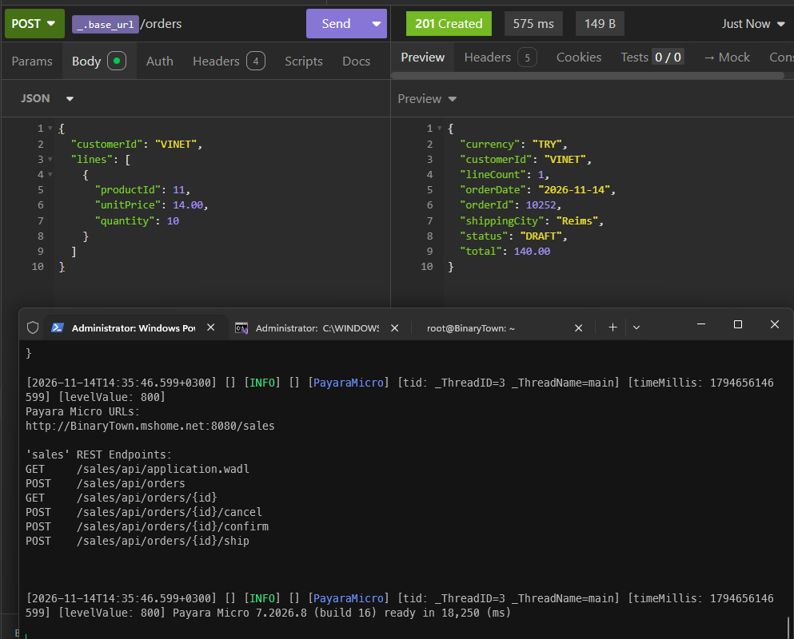

```curl
curl -i -X POST localhost:8080/sales/api/orders/10252/confirm
```

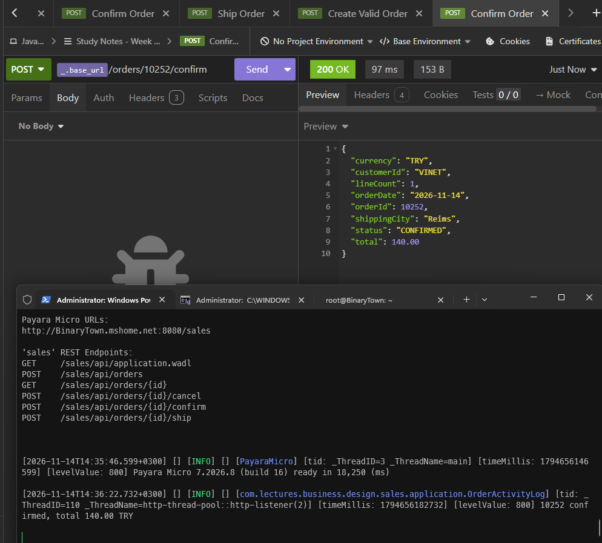

```curl
curl -i -X POST localhost:8080/sales/api/orders/10252/ship
```

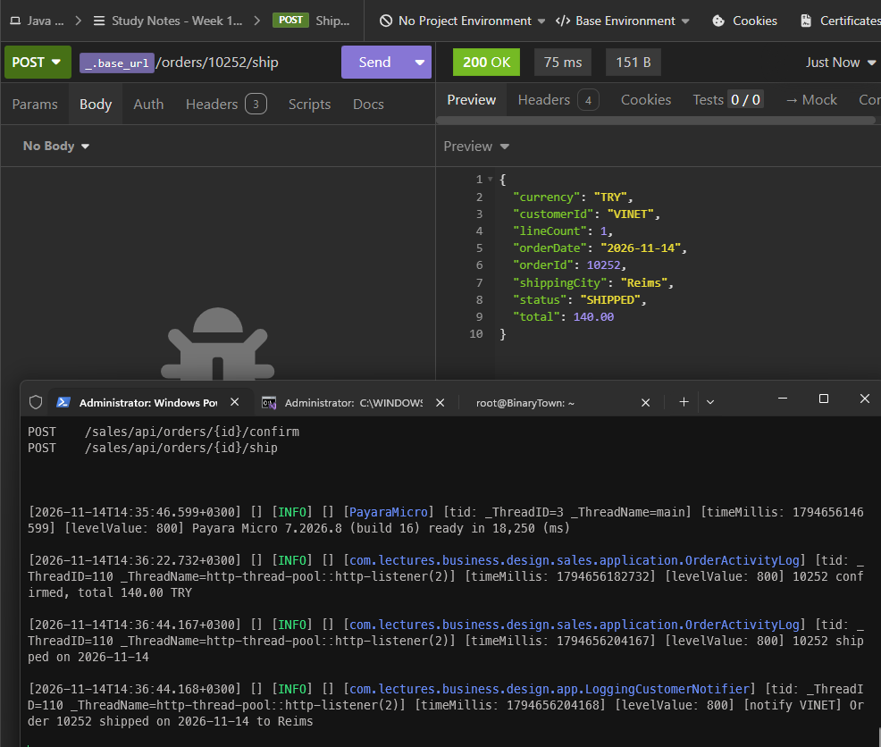

Bu isteklerin her biri ilginç bir şey yapıyor. **placeOrder** kullanım senaryosu tek bir JTA transaction'ı içinde önce müşteriyi JPA ile *(`entityManager.find`)* okuyor, ardından sekanstan bir numara alıp siparişi JDBC ile yazıyor. İki farklı teknoloji aynı bağlantı havuzunu ve aynı transaction'ı paylaşıyor. Daha önce Payara'nın bir transaction içinde aynı havuzdan istenen bağlantıları paylaştırdığından bahsetmiştik. Burada bunun pratik bir faydasını da görüyoruz. Repository'leri teker teker JPA'ya taşıyabiliyoruz ve geçiş sırasında kullanım senaryolarında hiçbir şey değişmiyor.

```curl
curl -i -X POST localhost:8080/sales/api/orders -H "Content-Type: application/json" \
     -d '{"customerId":"ALFKI","lines":[{"productId":11,"unitPrice":14.00,"quantity":1}]}'
```

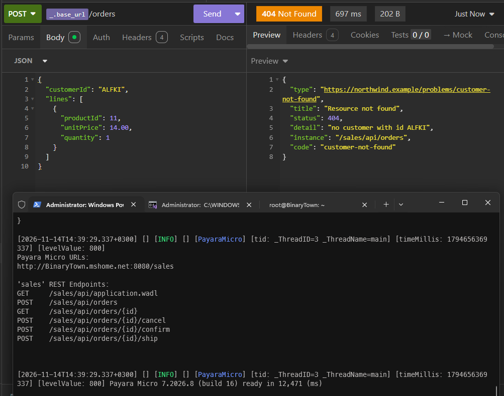

Olmayan bir müşteri için yine `customer-not-found` koduyla bir 404 problemi dönüyor. **CustomerRepository** sözleşmesindeki **getById** metodu değişmediği için **CustomerNotFoundException** fırlatılmaya devam ediyor.

## Siparişler: Bir Aggregate ve Koleksiyonu

**Order** aggregate'i iki tabloya yayılıyor. Sipariş başlığı `orders` tablosunda, sipariş kalemleri ise `order_lines` tablosunda duruyor. **JdbcOrderRepository** sınıfında bunu kendimiz yönetmiştik. Kaydederken başlığı güncelliyor, kalemlerin hepsini silip yeniden yazılıyordu. Okuma işlemlerinde de N+1 probleminden kaçınmak için iki ayrı sorgu çalıştırıp sonuçları bellekte birleştiriyorduk. Şimdi bu fonksiyonelliklerin JPA karşılıklarını yazacağız.

### Sipariş Kalemleri: `@ElementCollection`

**OrderLine** domain'de bir record, yani kimliği olmayan bir value object olarak kullanılıyor. **JPA** tarafında kimliği olmayan nesnelerden oluşan bir koleksiyon `@ElementCollection` ile eşleştirilir. Koleksiyonun elemanları `@Embeddable` niteliği kazandırılmış bir sınıf olur ve kendi tablosunda *(collection table)* sahibi olan entity'nin kimliğiyle birlikte saklanır. Müşteri adresinde yaptığımız gibi önce kalem kolonlarını tarif eden OrderLineColumns sınıfını `persistence` paketine aşağıdaki gibi ekleyelim.

```java
package com.lectures.business.design.sales.persistence;

import com.lectures.business.design.sales.domain.OrderLine;
import com.lectures.business.design.shared.kernel.Money;
import jakarta.persistence.Column;
import jakarta.persistence.Embeddable;
import java.math.BigDecimal;
import java.util.Currency;

@Embeddable
public class OrderLineColumns {

    @Column(name = "line_no", nullable = false)
    private int lineNo;

    @Column(name = "product_id", nullable = false)
    private int productId;

    @Column(name = "unit_price", nullable = false, precision = 10, scale = 2)
    private BigDecimal unitPrice;

    @Column(name = "currency", nullable = false, length = 3)
    private String currency;

    @Column(name = "quantity", nullable = false)
    private int quantity;

    @Column(name = "discount", nullable = false, precision = 3, scale = 2)
    private BigDecimal discount;

    protected OrderLineColumns() {
    }

    static OrderLineColumns from(int lineNo, OrderLine line) {
        OrderLineColumns columns = new OrderLineColumns();
        columns.lineNo = lineNo;
        columns.productId = line.productId();
        columns.unitPrice = line.unitPrice().amount();
        columns.currency = line.unitPrice().currency().getCurrencyCode();
        columns.quantity = line.quantity();
        columns.discount = line.discount();
        return columns;
    }

    OrderLine toOrderLine() {
        return new OrderLine(productId, new Money(unitPrice, Currency.getInstance(currency)), quantity, discount);
    }
}
```

**Money** değer nesnesi iki kolonla *(`unit_price` ve `currency`)* ifade ediliyor. Domain'de olmayan **lineNo** alanı ise kalemlerin sırasını korumak için kullanılmakta. Kalemlerin sıralaması bu alan üzerinden takip ediliyor.

> JPA'nın sıralı listeler için `@OrderColumn` diye bir anotasyonu da var. Bu anotasyon sıra numarasını kendisi yönetir ama numaralandırmaya 0'dan başlar. Mevcut tablomuzdaki kayıtlar 1'den başladığı için sıra numarasını kendimiz veriyor ve okurken `@OrderBy("lineNo")` ile sıralıyoruz.

### Sipariş Entity'si

Şimdi siparişin başlığını ve kalemlerini bir arada eşleştiren entity sınıfını yazalım. İşte **OrderEntity** içeriği.

```java
package com.lectures.business.design.sales.persistence;

import com.lectures.business.design.sales.domain.CustomerId;
import com.lectures.business.design.sales.domain.Order;
import com.lectures.business.design.sales.domain.OrderId;
import com.lectures.business.design.sales.domain.OrderLine;
import com.lectures.business.design.sales.domain.OrderStatus;
import jakarta.persistence.AttributeOverride;
import jakarta.persistence.CollectionTable;
import jakarta.persistence.Column;
import jakarta.persistence.ElementCollection;
import jakarta.persistence.Embedded;
import jakarta.persistence.Entity;
import jakarta.persistence.EnumType;
import jakarta.persistence.Enumerated;
import jakarta.persistence.Id;
import jakarta.persistence.JoinColumn;
import jakarta.persistence.OrderBy;
import jakarta.persistence.Table;
import java.time.LocalDate;
import java.util.ArrayList;
import java.util.List;

@Entity
@Table(name = "orders")
public class OrderEntity {

    @Id
    @Column(name = "order_id")
    private Integer orderId;

    @Column(name = "customer_id", nullable = false, length = 5)
    private String customerId;

    @Column(name = "order_date", nullable = false)
    private LocalDate orderDate;

    @Enumerated(EnumType.STRING)
    @Column(name = "status", nullable = false, length = 16)
    private OrderStatus status;

    @Embedded
    @AttributeOverride(name = "street", column = @Column(name = "ship_street"))
    @AttributeOverride(name = "city", column = @Column(name = "ship_city"))
    @AttributeOverride(name = "postalCode", column = @Column(name = "ship_postal_code"))
    @AttributeOverride(name = "country", column = @Column(name = "ship_country"))
    private AddressColumns shippingAddress;

    @Column(name = "shipped_date")
    private LocalDate shippedDate;

    @ElementCollection
    @CollectionTable(name = "order_lines", joinColumns = @JoinColumn(name = "order_id"))
    @OrderBy("lineNo")
    private List<OrderLineColumns> lines = new ArrayList<>();

    protected OrderEntity() {
    }

    static OrderEntity from(Order order) {
        OrderEntity entity = new OrderEntity();
        entity.orderId = order.orderId().value();
        entity.customerId = order.customerId().value();
        entity.orderDate = order.orderDate();
        entity.status = order.status();
        entity.shippingAddress = order.shippingAddress().map(AddressColumns::from).orElse(null);
        entity.shippedDate = order.shippedDate().orElse(null);
        int lineNo = 1;
        for (OrderLine line : order.lines()) {
            entity.lines.add(OrderLineColumns.from(lineNo++, line));
        }
        return entity;
    }

    Order toDomain() {
        return Order.reconstitute(
                OrderId.of(orderId),
                CustomerId.of(customerId),
                orderDate,
                status,
                shippingAddress == null ? null : shippingAddress.toAddress(),
                shippedDate,
                lines.stream().map(OrderLineColumns::toOrderLine).toList());
    }
}
```

Bu sınıfta bizim için yeni olan birkaç kavram var.

- **`@AttributeOverride` :** Müşteri tablosu için yazdığımız **AddressColumns** sınıfını burada tekrar kullanıyoruz. Ancak siparişlerde adres kolonlarının adları farklı *(`ship_street`, `ship_city` vb.)*. `@AttributeOverride`, gömülen sınıfın kolon adlarını bu entity için yeniden tanımlıyor. Teslimat adresi olmayan bir siparişte dört kolon da **NULL** olacaktır. JPA da okurken dört kolonun hepsi boşsa gömülü nesneyi **null** olarak döndürür.
- **`@Enumerated(EnumType.STRING)`:** **OrderStatus** değerleri tabloya `DRAFT`, `SHIPPED` gibi metinler olarak yazılıyor. Varsayılan değer `ORDINAL` olsaydı enum'ın sıra numarası *(0, 1, 2...)* yazılırdı ve enum'a araya yeni bir değer eklemek mevcut verinin anlamını çaktırmadan bozardı. **OrderStatus** domain'e ait bir tip. Persistence paketi domain'i görebildiği için *(ADR-0003)* entity'de doğrudan kullanabiliyoruz.
- **`@ElementCollection` ve `@CollectionTable`:** Kalemlerin `order_lines` tablosunda durduğunu ve bu tabloya `order_id` kolonuyla bağlandığını söylüyor. Koleksiyon varsayılan olarak **lazy** modda yüklenir. Yani sipariş okunduğunda kalemler hemen çekilmez, onun yerine listeye ilk erişildiğinde ayrı bir sorgu ile alınır.
- **toDomain:** Sadece persistence paketinin çağırabildiği `Order.reconstitute()` metodunu kullanıyor. Entity'den domain nesnesine geçiş tek bir yerde yapılıyor.

### JpaOrderRepository

Sırada repository sınıfı var. **JpaOrderRepository**'yi `persistence` paketine aşağıdaki haliyle ekleyelim.

```java
package com.lectures.business.design.sales.persistence;

import com.lectures.business.design.sales.domain.Order;
import com.lectures.business.design.sales.domain.OrderId;
import com.lectures.business.design.shared.kernel.Specification;
import jakarta.enterprise.context.Dependent;
import jakarta.inject.Inject;
import jakarta.persistence.EntityManager;
import java.util.List;
import java.util.Objects;
import java.util.Optional;

@Dependent
public final class JpaOrderRepository implements OrderRepository {

    private static final String ALL_ORDERS_WITH_LINES = """
            SELECT DISTINCT o
              FROM OrderEntity o
              LEFT JOIN FETCH o.lines
             ORDER BY o.orderId
            """;

    private final EntityManager entityManager;

    @Inject
    public JpaOrderRepository(EntityManager entityManager) {
        this.entityManager = Objects.requireNonNull(entityManager, "entityManager must not be null");
    }

    @Override
    public void save(Order order) {
        Objects.requireNonNull(order, "order must not be null");
        entityManager.merge(OrderEntity.from(order));
    }

    @Override
    public Optional<Order> findById(OrderId orderId) {
        Objects.requireNonNull(orderId, "orderId must not be null");
        return Optional.ofNullable(entityManager.find(OrderEntity.class, orderId.value()))
                .map(OrderEntity::toDomain);
    }

    @Override
    public List<Order> findAll() {
        return entityManager.createQuery(ALL_ORDERS_WITH_LINES, OrderEntity.class)
                .setHint("eclipselink.read-only", true)
                .getResultStream()
                .map(OrderEntity::toDomain)
                .toList();
    }

    @Override
    public List<Order> findAll(Specification<Order> specification) {
        Objects.requireNonNull(specification, "specification must not be null");
        return findAll().stream()
                .filter(specification::isSatisfiedBy)
                .toList();
    }

    @Override
    public long count() {
        return entityManager.createQuery("SELECT COUNT(o) FROM OrderEntity o", Long.class).getSingleResult();
    }
}
```

**JdbcOrderRepository** sınıfında epeyce çok satır vardı. Burada SQL yerine bir **JPQL** *(Jakarta Persistence Query Language)* sorgusu var. JPQL tablolar ve kolonlar yerine entity'ler ve alanlarıyla çalışır. `OrderEntity o` bir tabloyu değil bir entity nesnesini, `o.lines` ise bir kolonu değil bir koleksiyonu ifade eder. Bu sınıfın neredeyse her satırı kayda değer bilgiler içeriyor. Bunları dikkatlice inceleyelim.

> Öncesinde SQL Loglarını Görmek
>
> Şimdiki denemeler sırasında, EclipseLink'in SQL loglaması açmamız işimizi kolaylaştıracaktır. Oluşturulan SQL ifadelerini görmek için **JpaUnit** sınıfının **on** metodundaki özelliklere geçici olarak aşağıdaki iki satırı ekleyip ilgili testleri çalıştırmamız yeterli.
>
> ```java
> "eclipselink.logging.level.sql", "FINE",
> "eclipselink.logging.parameters", "true"
> ```
>
> Payara üzerinde ise aynı özellikleri `persistence.xml` dosyasının **properties** kısmına ekleyebiliriz. Loglar `server.log` dosyasına yazılır. JPA ile çalışırken üretilen SQL'i düzenli olarak görmek, N+1 gibi sorunları erken fark etmenin en kolay yoludur.

### merge Kalemleri Nasıl Güncelliyor?

Daha önceden kalemleri güncellemenin oldukça basit bir yolunu seçmiştik. Bir siparişin kalemlerini tamamen silip yeniden yazıyorduk. `ADR-0008` kararlarında bunun alternatifinin değişiklik takibi *(dirty checking)* olduğunu ve bu işin JPA'ya bırakılacağını da yazmıştık. Şimdi JPA'nın ne yaptığını görelim. Sözleşme testlerindeki **saveIsUpsertOfTheWholeAggregate** testi, taslak bir siparişe yeni bir kalem ekleyip eski kalemi çıkarıyor ve siparişi kaydediyor. Önce testi çalıştıralım.

```powershell
# week15-jpa-persistence klasöründe çalıştırmalıyız
$sql = "-DargLine=-Declipselink.logging.level.sql=FINE -Declipselink.logging.parameters=true"
mvn -q -pl sales -am test $sql "-Dtest=JpaOrderRepositoryTest#saveIsUpsertOfTheWholeAggregate" "-Dsurefire.failIfNoSpecifiedTests=false" | Select-String "EL Fine"
```

EclipseLink'in SQL loglarını açtığımızda bu kayıt için şu cümlelerin çalıştığını görüyoruz.

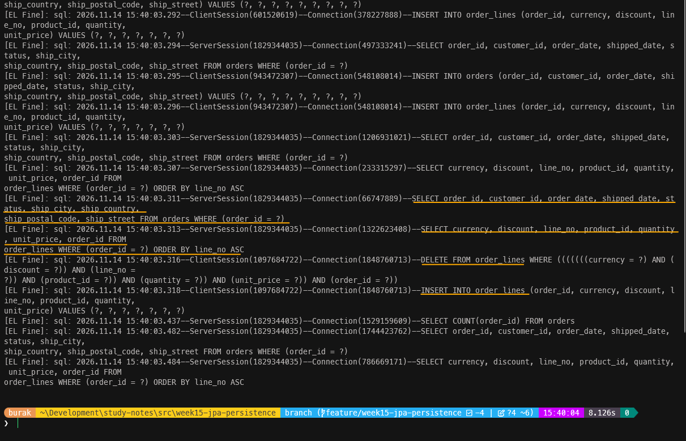

Sırasıyla orders tablosundan `order_id` ye göre bir select, ardından `order_lines` tablosunda aynı `order_id` ye sahip satırları için bir select, sonra çıkarılan kalem için bir delete ve eklenen kalem için bir insert çalışır. Yani;

- **merge** önce siparişi ve kalemlerini veritabanından okuyor. Elimizdeki **OrderEntity** hiçbir persistence context'e bağlı değil *(detached)* ve JPA neyin değiştiğini bilmek için mevcut hali görmek zorunda.
- Ardından iki koleksiyonu karşılaştırıyor. Çıkarılan kalem için bir **DELETE**, eklenen kalem için bir **INSERT** ifadesi yürütülüyor. Değişmeyen kalemlere dokunulmuyor. Sipariş başlığında bir değişiklik olmadığı için başlık için bir **UPDATE** de söz konusu değil.
- **DELETE** cümlesinin **WHERE** kısmına dikkat edelim. Kalemin bütün kolonları orada. Gömülü nesnelerin kimliği yoktur. JPA bir kalemi ancak tüm değerleriyle tanıyabilir. Değer nesnesinin tanımı tam olarak bu *(Kimliği yoktur, değerleriyle tanınır).*

Daha önceden kullandığımız *"hepsini sil, hepsini yaz"* yaklaşımı her kayıtta kalem sayısının iki katı kadar SQL çalıştırılmasına neden oluyordu. JPA ise sadece değişen kalemler için SQL üretiyor ama bunun için önce bir okuma yapıyor. Hangisinin daha verimli olduğu, aggregate'lerin ne kadar büyük olduğuna ve ne sıklıkla değiştiğine bağlı olduğu için tartışmaya açık bir konu.

### N+1 Problemi Geri mi Dönüyor?

**findAll** metodunu ilk yazdığımızda sorgu sadece `SELECT o FROM OrderEntity o ORDER BY o.orderId` şeklindeydi. Testler geçse de SQL loglarına bakmak önemli. Fazladan bir sorgu daha çalışıyor. Kalemler lazy load olduğu için JPA her siparişin kalemlerine **toDomain** içinde erişildiği anda ayrı bir sorgu çalıştırıyor. Bin sipariş varsa bu bin bir sorgu anlamına geliyor. Testler bunu yakalamaz, çünkü sonuç doğrudur. Sadece yavaştır. **JPA** ile çalışırken SQL loglarını açık tutmanın önemi burada ortaya çıkıyor. Çözüm, JPQL'in **JOIN FETCH** ifadesinde. Bu ifade, ilişkili koleksiyonun aynı sorguda bir **JOIN** ile getirilmesini söyler. Bu nedenle `ALL_ORDERS_WITH_LINES` aşağıdaki gibi yazılmalıdır.

```sql
SELECT DISTINCT o
  FROM OrderEntity o
  LEFT JOIN FETCH o.lines
 ORDER BY o.orderId
```

- **LEFT:** Kalemi olmayan siparişler de sonuçta yer alsın.
- **DISTINCT:** Bir JOIN sonucunda iki kalemli bir sipariş iki satır olarak döner. JPQL'deki **DISTINCT**, aynı entity'nin sonuç listesinde iki kez yer almasını engeller.

### Sekans ve Native Sorgular

**SequenceOrderIdGenerator** da artık **DataSource** yerine **EntityManager** kullanıyor. JPQL'in veritabanı sekansları için bir karşılığı olmadığından burada **native sorgu** *(doğrudan SQL)* kullanıyoruz. Söz konusu sınıfı aşağıdaki gibi güncelleyelim.

```java
package com.lectures.business.design.sales.persistence;

import com.lectures.business.design.sales.domain.OrderId;
import com.lectures.business.design.sales.domain.OrderIdGenerator;
import jakarta.enterprise.context.Dependent;
import jakarta.inject.Inject;
import jakarta.persistence.EntityManager;
import java.util.Objects;

@Dependent
public final class SequenceOrderIdGenerator implements OrderIdGenerator {

    private final EntityManager entityManager;

    @Inject
    public SequenceOrderIdGenerator(EntityManager entityManager) {
        this.entityManager = Objects.requireNonNull(entityManager, "entityManager must not be null");
    }

    @Override
    public OrderId next() {
        Number next = (Number) entityManager.createNativeQuery("SELECT nextval('orders_seq')").getSingleResult();
        return OrderId.of(next.intValue());
    }
}
```

Native sorgunun sonucunun tipi veritabanına ve sürücüye göre değişebilir *(PostgreSQL'de `Long`, bazı veritabanlarında `BigInteger` veya `BigDecimal`)*. Bu yüzden sonucu ortak üst tip olan **Number** olarak alıp `intValue()` ile dönüştürüyoruz.

> JPA'nın kendi kimlik üretme mekanizması da var *(`@GeneratedValue` ve `@SequenceGenerator`)*. Ancak bu mekanizma kimliği entity kaydedilirken üretmekte. Bizim domain modelimizde ise sipariş numarası, sipariş **OrderFactory** tarafından oluşturulduğu anda belli olmalı. Kimlik üretme işini domain'deki **OrderIdGenerator** portunda bırakıyoruz.

### Persistence Unit ve Silinenler

Yeni entity'leri `persistence.xml` dosyasındaki listeye ekleyelim.

```xml
<class>com.lectures.business.design.sales.persistence.CustomerEntity</class>
<class>com.lectures.business.design.sales.persistence.AddressColumns</class>
<class>com.lectures.business.design.sales.persistence.OrderEntity</class>
<class>com.lectures.business.design.sales.persistence.OrderLineColumns</class>
```

**JdbcOrderRepository** ve **RepositoryException** sınıflarına artık ihtiyacımız kalmadı. Test tarafında da **JDBC** için yazdığımız **LocalTransactions** sınıfının yerini **JpaUnit** alacak. Bu üç sınıfı silelim ve **JdbcOrderRepositoryTest** sınıfının adını **JpaOrderRepositoryTest** olarak değiştirelim.

```powershell
cd src\week15-jpa-persistence\sales\src
git rm main/java/com/lectures/business/design/sales/persistence/JdbcOrderRepository.java `
       main/java/com/lectures/business/design/sales/persistence/RepositoryException.java `
       test/java/com/lectures/business/design/sales/persistence/LocalTransactions.java
git mv test/java/com/lectures/business/design/sales/persistence/JdbcOrderRepositoryTest.java `
       test/java/com/lectures/business/design/sales/persistence/JpaOrderRepositoryTest.java
```

**RepositoryException** sınıfını, **SQLException** tipinin repository sözleşmelerine sızmasını önlemek için yazmıştık. JPA'nın exception'ları ise zaten **PersistenceException** sınıfından türeyen ve checked olmayan exception türleri. Dolayısıyla **ProblemMapperTest** sınıfındaki **unexpectedFailuresAreOpaque** testinde **RepositoryException** yerine şu ifadeyi kullanabiliriz.

```java
new PersistenceException("could not save order 10248", new SQLException())
```

**ProblemMapper** bu tür hataları zaten HTTP 500 olarak eşliyor ve hiçbir ayrıntıyı sızdırmıyor.

### Write-Behind ile Sözleşme Testleri

**JpaOrderRepositoryTest** sınıfının tam hali aşağıdaki gibi.

```java
package com.lectures.business.design.sales.persistence;

import com.lectures.business.design.sales.domain.OrderBuilder;
import com.lectures.business.design.sales.domain.OrderId;
import com.lectures.business.design.sales.domain.OrderIdGenerator;
import jakarta.persistence.PersistenceException;
import java.sql.Connection;
import java.sql.SQLException;
import java.sql.Statement;
import javax.sql.DataSource;
import org.junit.jupiter.api.DisplayName;
import org.junit.jupiter.api.Test;
import static org.assertj.core.api.Assertions.assertThat;
import static org.assertj.core.api.Assertions.assertThatThrownBy;

class JpaOrderRepositoryTest extends OrderRepositoryContract {

    private DataSource dataSource;
    private JpaUnit unit;

    @Override
    protected OrderRepository createRepository() {
        dataSource = TestDatabases.withDemoCustomers(TestDatabases.h2());
        unit = JpaUnit.on(dataSource);
        return unit.transactional(OrderRepository.class, new JpaOrderRepository(unit.entityManager()));
    }

    @Test
    @DisplayName("the foreign key refuses an order for a customer that does not exist, at commit")
    void unknownCustomerIsRejectedByTheDatabase() {
        assertThatThrownBy(() -> repository.save(OrderBuilder.anOrder()
                .withId(10300).forCustomer("ALFKI").withLine(11, "14.00", 1).build()))
                .isInstanceOf(PersistenceException.class)
                .hasRootCauseInstanceOf(SQLException.class);
        assertThat(repository.findById(OrderId.of(10300))).isEmpty();
    }

    @Test
    @DisplayName("a commit that fails leaves no half-written aggregate behind")
    void failedCommitWritesNothing() throws SQLException {
        try (Connection connection = dataSource.getConnection(); Statement statement = connection.createStatement()) {
            statement.execute("ALTER TABLE order_lines ADD CONSTRAINT ck_sabotage CHECK (quantity <> 7)");
        }

        assertThatThrownBy(() -> repository.save(OrderBuilder.anOrder()
                .withId(10301).forCustomer("VINET").withLine(11, "14.00", 7).build()))
                .isInstanceOf(PersistenceException.class);
        assertThat(repository.findById(OrderId.of(10301))).isEmpty();
        assertThat(repository.count()).isEqualTo(4);
    }

    @Test
    @DisplayName("findAll reads each order once, with all of its lines")
    void findAllJoinsTheLines() {
        repository.save(OrderBuilder.anOrder()
                .withId(10302).forCustomer("VINET").withLine(11, "14.00", 2).withLine(42, "9.80", 3).build());

        assertThat(repository.findAll())
                .filteredOn(order -> order.orderId().value() == 10302)
                .singleElement()
                .satisfies(order -> assertThat(order.productIds()).containsExactly(11, 42));
    }

    @Test
    @DisplayName("ids come from the database sequence and survive a restart")
    void sequenceHandsOutIds() {
        OrderIdGenerator first = unit.transactional(OrderIdGenerator.class,
                new SequenceOrderIdGenerator(unit.entityManager()));
        OrderIdGenerator afterRestart = unit.transactional(OrderIdGenerator.class,
                new SequenceOrderIdGenerator(JpaUnit.on(dataSource).entityManager()));
        assertThat(first.next().value()).isEqualTo(10248);
        assertThat(afterRestart.next().value()).isEqualTo(10249);
    }
}
```

JDBC testleriyle karşılaştırdığımızda nelerin değiştiğini görelim;

- **Hata ne zaman geliyor?** **unknownCustomerIsRejectedByTheDatabase** testi artık **RepositoryException** değil **PersistenceException** bekliyor. Daha da önemlisi, hata **merge** çağrısından değil test proxy'sinin yaptığı commit'ten geliyor. Bu bölümde bahsettiğimiz `write-behind` davranışı burada somutlaşıyor. Sunucuda da aynı şey olur. Olmayan bir müşteriye ait sipariş, `@Transactional` interceptor'ı commit ederken reddedilir ve kullanım senaryosunun dışına bir **TransactionalException** olarak fırlatılır. **OrderService** müşterinin varlığını zaten **getById** ile kontrol ettiği için bu durum normal akışta yaşanmaz.
- **Atomiklik:** **saveIsAtomicInsideATransaction** ve **saveIsNotAtomicOnItsOwn** testlerinin yerini tek bir test aldı. JPA'da yazma işlemleri zaten transaction'ın sonunda topluca yapıldığı için yarım kalmış bir aggregate ancak commit yarıda kalırsa oluşabilir ve rollback bunu engeller. Transaction olmadan **merge** çağırmak ise hiçbir şey yazmaz.
- **Sekans testi:** **SequenceOrderIdGenerator** da bir transaction içinde çalışıyor. *"Yeniden başlatma"* durumunu ikinci bir **JpaUnit**, yani yeni bir **EntityManager** ile taklit ediyoruz.

İşimiz bitmedi. **PostgresOrderRepositoryTest** sınıfındaki **createRepository** metodunun son satırını da aşağıdaki gibi değiştirelim.

```java
JpaUnit unit = JpaUnit.on(dataSource);
return unit.transactional(OrderRepository.class, new JpaOrderRepository(unit.entityManager()));
```

Böylece aynı sözleşme **InMemory**, **H2** ve **Testcontainers** ile **PostgreSQL** üzerinde **JPA** implementasyonu için de çalışacak.

### Payara İle Tekrar Deneyelim

Artık uygulamanın tüm persistence katmanı JPA üzerinde çalışıyor. **SalesStartup** içindeki Flyway hariç uygulamada **DataSource** kullanan bir sınıf kalmadı. Derleyip Payara'yı başlatalım ve iki sipariş oluşturalım.

```text
curl -i -X POST localhost:8080/sales/api/orders -H "Content-Type: application/json" \
     -d '{"customerId":"VINET","lines":[{"productId":11,"unitPrice":14.00,"quantity":10},{"productId":42,"unitPrice":9.80,"quantity":5,"discount":0.10}]}'
```

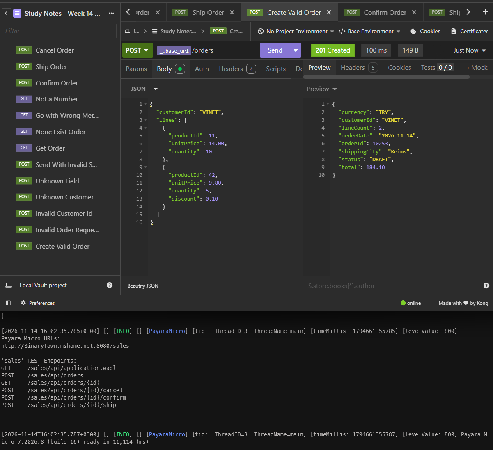

İlk siparişi onaylayıp kargolayalım, ikinciyi ise taslak halindeyken kargolamaya çalışıp ardından iptal edelim *(Bu çalışma sırasında 10253 ve 10254 sipariş numaraları oluştu)*.

```text
curl -i -X POST localhost:8080/sales/api/orders/10253/confirm
curl -i -X POST localhost:8080/sales/api/orders/10253/ship
```

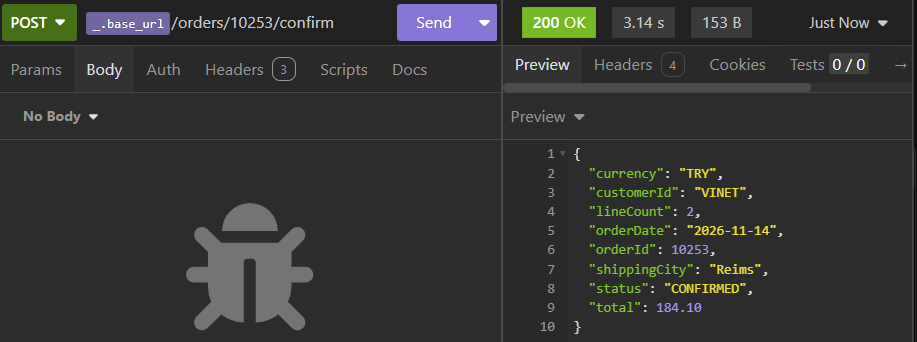

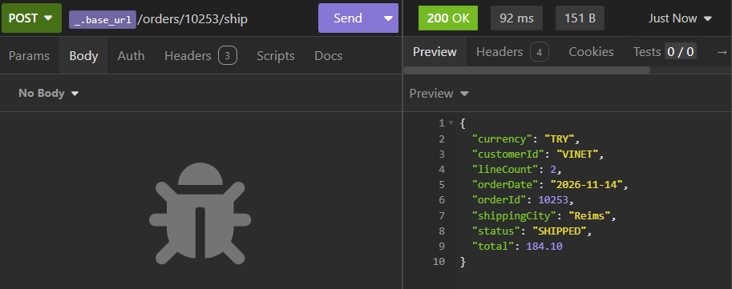

```text
curl -i -X POST localhost:8080/sales/api/orders/10254/ship
curl -i -X POST localhost:8080/sales/api/orders/10254/cancel
```

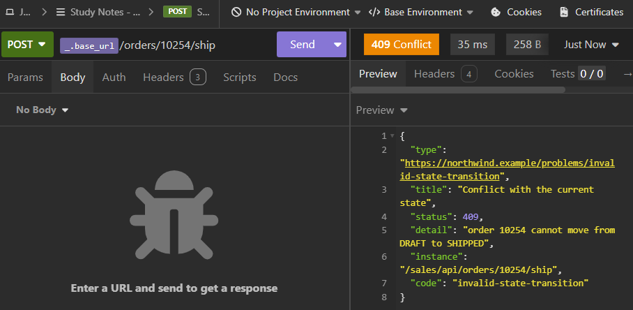

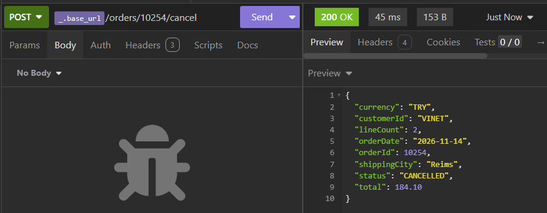

İlk iki istek başarılı oldu ve gözlemciler commit sonrasında bildiri gönderdi. Üçüncü istek `invalid-state-transition` koduyla 409 dönerken, dördüncüsü siparişi iptal etti. Veritabanına baktığımızda iki kalemin de `line_no` değerleriyle doğru yazıldığını görmemiz gerekiyor.

```powershell
docker exec -it java-study-notes-postgres psql -U johndoe -d postgres -c "SELECT order_id, line_no, product_id, quantity, discount FROM order_lines ORDER BY 1, 2"
```

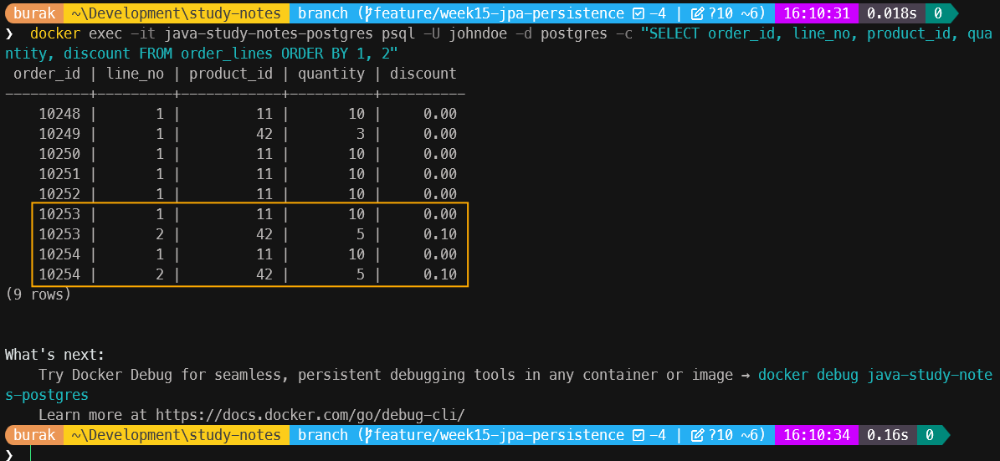

Şu noktaya dikkat edelim. **HTTP** katmanında, kullanım senaryolarında veya domain'de hiçbir şey değişmedi. Daha önceden hazırladığımı **JerseyTest** beklentileri ve **Insomnia** koleksiyonu aynen geçerli.

// DEVAM EDECEK

<!-- nav:bottom:start -->
---

| ← Önceki Bölüm | İçindekiler | Sonraki Bölüm → |
| :--- | :---: | ---: |
| [Bölüm 14: Uygulama Sunucusuna Geçiş: CDI, JTA ve JAX-RS ile Payara Micro](java-chapter-14.md#top) | [Ders Notları](README.md#top) | |
<!-- nav:bottom:end -->
